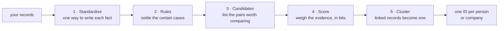

# Entity resolution for Japanese customer records

Finds which customer records belong to the same person or company, and gives each of them one ID. It reads names in katakana, addresses in any format, the last four phone digits and customer IDs. It needs no labels to run.



1. **Standardize.** The same fact is written many ways: full-width digits, kana variants, addresses with or without the prefecture or the building. Each is rewritten in one form.
2. **Rules.** Pairs that agree on strong evidence, such as the same customer ID and the same name, are matched at once. Rules are cheap and easy to audit.
3. **Candidates.** Comparing every pair is impossible on a large file: a million records make 500 billion pairs. Shared keys, such as the same address and phone, or a name one letter apart in the same postal area, list about 5 pairs per record instead.
4. **Score.** Each field adds evidence for or against, in bits. Each bit doubles the odds that the two records are one entity. A pair is accepted at 6 bits or more.
5. **Cluster.** Records linked by accepted pairs become one entity. If A matches B and B matches C, all three are one.

One pair, scored field by field: [chapter 5](docs/guide/05-uncertain-evidence-fellegi-sunter.md#solution-evidence-in-bits).

## How well it works

These numbers come from synthetic records built from real Japanese names, companies and addresses, where the truth is known:

- **It finds 9 duplicates in 10:** 89.9% of the true pairs on test (95% interval 88.7–91.1%). Test is a split never used for any choice.
- **It merged no two different customers:** 0 false merges on test, so the rate is at most 0.14%.
- **A million records take about 45 seconds** and 3.8 GB of memory. Every step's work grows about linearly with the file.

Real data is likely noisier, and only a run on it can tell ([limits](#limits)).

## Use it

```bash
./setup_venv.sh
# map your columns to the logical fields: config/settings.toml [columns]
.venv/bin/python scripts/resolve.py --input customers.parquet --check            # will it run? in seconds
.venv/bin/python scripts/resolve.py --input customers.parquet --output runs/customers
```

The run folder holds `gold.parquet` (each record and its entity's ID), `review.parquet` (pairs for a person to decide or audit) and `qa.md` (checks that need no labels). New records join the run later with `--increment`, and people's decisions with `--decisions`. Every step is in [usage](docs/usage.md).

## Read next

| To | Read |
|---|---|
| run it on your records | [usage](docs/usage.md) |
| see every step on a small file, with charts | [the demo](notebooks/pdf/demo.pdf) |
| see how it is built | [architecture](docs/architecture.md) |
| understand each method, and why it was chosen | [the guide](docs/guide/01-entity-resolution-and-our-task.md), six chapters |
| look up a term | [the glossary](docs/guide/01-entity-resolution-and-our-task.md#words-used-in-this-guide) |
| check the numbers | [results](docs/results.md) · [performance](docs/performance.md) · [choose report](reports/choose.md) · [benchmark](reports/benchmark.md) |
| know where the data comes from | [data](docs/data.md) |
| learn from what went wrong | [lessons](docs/lessons.md) |

## Limits

- **Measured on synthetic data only.** Test comes from the same generator as the data the choices were made on. Other seeds, twice the typos, emptier fields, or a prior off by a factor of two keep recall between 88.3% and 91.5%, with no false merge ([benchmark](reports/benchmark.md)). Real data has not been measured.
- **Close names at one address rely on the name's first letter.** Two names that are close but start with different letters, at the same address, are compared only if another key lists them. Up to 0.6% of matches rest on such keys, by the model's own bound; on labelled data, none was lost.
- **Machine-read kana.** Given-name readings come from SudachiPy, and some differ from the intended reading.
