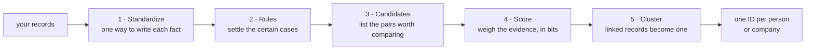

# Entity resolution for Japanese customer records

Finds which customer records belong to the same person or company, and gives each of them one ID. It reads names in katakana, addresses in any format, the last four phone digits, customer IDs and birth dates. It needs no labels to run.



1. **Standardize.** The same fact is written many ways: full-width digits, kana variants, addresses with or without the prefecture or the building. Each is rewritten in one form.
2. **Rules.** Pairs that agree on strong evidence, such as the same customer ID and the same name, are matched at once. Rules are cheap and easy to audit.
3. **Candidates.** Comparing every pair is impossible on a large file: a million records make 500 billion pairs. Shared keys, such as the same address and phone, or a name one letter apart in the same postal area, list about 5 pairs per record instead.
4. **Score.** Each field adds evidence for or against, in bits. Each bit doubles the odds that the two records are one entity. A pair is accepted at 6 bits or more, if a name was compared; without one, a person decides.
5. **Cluster.** Records linked by accepted pairs become one entity. If A matches B and B matches C, all three are one.

One pair, scored field by field: [chapter 5](docs/guide/05-uncertain-evidence-fellegi-sunter.md#solution-evidence-in-bits).

## How well it works

These numbers come from synthetic records built from real Japanese names, companies and addresses, where the truth is known:

- **It finds almost half the duplicates:** 48.2% of the true pairs on test (95% interval 46.2–50.2%); the rules alone find 9.6%. Test is a split never used for any choice.
- **The data is hard on purpose.** About 1% of true pairs are direct matches (the same customer ID and name, or the same name, address code and phone), and 11.3% share nothing usable, so no method finds them all ([data](docs/data.md#how-hard-it-is)).
- **It merged no two unrelated customers:** 0 false merges on test, so the rate is at most 0.26%. Two people of one household (a spouse, a parent or a sibling at one address) can score as high as a duplicate; their pairs are counted apart, 45 on test. On val, people see 27 of the 32 such pairs it accepted labelled "maybe one household" ([usage](docs/usage.md#maybe-one-household)).
- **It merges less falsely than the file's person/company flag alone:** on generated files with one name column for both, and company names held out of its name model's training, it calls a kind where it is sure, never a person against a company flag, and takes the flag's elsewhere, flagging where they disagree. It made 33–111 false merges against 38–121 by the flag alone, and called 63–314 companies persons against 102–644; it called more persons companies, 554–2,690 against 306–2,533 ([chapter 7](docs/guide/07-person-or-company.md)).
- **A million records take 29.7 seconds,** with peak memory 7.1 GB under an 8 GB limit (1,039,995 generated records), and about 3 seconds before that for the reader to read the file as it comes. Every step's work grows about linearly with the file.

Real data may differ, and only a run on it can tell ([limits](#limits)).

## Use it

```bash
./setup_venv.sh
# map the file's columns once: config/settings.toml [columns]
.venv/bin/nayose resolve records customers.parquet --workspace workspaces/customers # Parquet: one ID per person or company
.venv/bin/nayose add records new.parquet --workspace workspaces/customers           # a batch joins the run
.venv/bin/nayose apply decisions --file reviewed.parquet --workspace workspaces/customers   # people's decisions on the pairs
```

On Windows, in PowerShell: `powershell -ExecutionPolicy Bypass -File setup_venv.ps1`, then `.venv\Scripts\nayose` in place of
`.venv/bin/nayose`.

The workspace holds your file (`inputs/`, copied in), `gold.parquet` (each record and its entity's ID, and each one's kind: 1 person, 2 company, 0 not sure), `review.parquet` (pairs for a person to decide or audit), `qa.md` (checks that need no labels) and `report.txt` (the run on one page with no record's value in it, to send when asking for help). Reviewers decide the pairs in a BigQuery table or a Sheet, and the decided rows come back with `apply decisions`. `nayose match records` says what a batch would do without writing it; `build index` and `match record` look one record up. `nayose` (名寄せ, gathering one customer's records) reads as a sentence, verb then noun: every step is in [usage](docs/usage.md), every command in [commands](docs/commands.md).

## Read next

| To | Read |
|---|---|
| run it on your records | [usage](docs/usage.md), and [before a run on your file](docs/usage.md#before-a-run-on-your-file) |
| look up a command | [commands](docs/commands.md) |
| change the code: the rules, and what checks each | [contributing](CONTRIBUTING.md) |
| see every step on a small file, with charts | [the demo](notebooks/pdf/demo.pdf) |
| see what each optimization saves | [the optimizations notebook](notebooks/speedups.ipynb) |
| see how it is built | [architecture](docs/architecture.md) |
| understand each method, and why it was chosen | [the guide](docs/guide/01-entity-resolution-and-our-task.md), seven chapters |
| look up a term | [the glossary](docs/guide/01-entity-resolution-and-our-task.md#words-used-in-this-guide) |
| check the numbers | [results](docs/results.md) · [performance](docs/performance.md) · [choose report](reports/choose.md) · [kind report](reports/choose_kind.md) · [benchmark](reports/benchmark.md) |
| know where the data comes from | [data](docs/data.md) |
| learn from what went wrong | [lessons](docs/lessons.md) |

## Limits

- **Measured on synthetic data only.** Test comes from the same generator as the data the choices were made on. Other seeds, emptier fields, or a prior off by a factor of two keep recall between 44.4% and 50.5%; twice the typos lowers it to 43.1%. None of these made a false merge ([benchmark](reports/benchmark.md)). Real data has not been measured.
- **False pairs appear on files fitted on themselves.** On the generated files of the cost benchmark, the run joined 2 false pairs at 13,019 records, through 1 false link, 2 at 52,115, through 2, and 6 at 77,926, through 5. Each is a model link between 6.8 and 12.0 bits (the threshold is 6), between two people who share an address or a phone, most of them a family name too. The model expects at least as many: the sum of 1 − match probability over its links, which every run reports without labels, is 1.61 at 13,019 records, 4.82 at 52,115 and 8.07 at 77,926; at a million, where personas repeat as clones, 54.54 of 44,065 links.
- **A company that looks like its representative.** A company record under its representative's name, at the representative's address and phone and flagged person, looks like the person's own record in every column. Nothing tells them apart, so it can merge into the person ([chapter 7](docs/guide/07-person-or-company.md#what-it-cant-do)).
- **Close names rely on other keys.** A Jaro–Winkler level guarantees no shared key, so two close but unequal names (or company names) are compared only if another key lists them. By the model's own bound, up to 13.2% of matches at a million records rest on such patterns; on labelled train, every pair that could reach the threshold shares a key.
- **Machine-read kana.** Given-name readings come from SudachiPy, and some differ from the intended reading.
