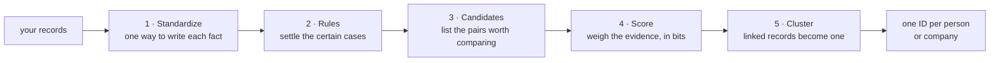

# Entity resolution for Japanese customer records

Finds which customer records belong to the same person or company, and gives each of them one ID. It reads names in katakana, addresses in any format, the last four phone digits, customer IDs and birth dates. It needs no labels to run.



1. **Standardize.** The same fact is written many ways: full-width digits, kana variants, addresses with or without the prefecture or the building. Each is rewritten in one form.
2. **Rules.** Pairs that agree on strong evidence, such as the same customer ID and the same name, are matched at once. Rules are cheap and easy to audit.
3. **Candidates.** Comparing every pair is impossible on a large file: a million records make 500 billion pairs. Shared keys, such as the same address and phone, or a name one letter apart in the same postal area, list about 5 pairs per record instead.
4. **Score.** Each field adds evidence for or against, in bits. Each bit doubles the odds that the two records are one entity. A pair is accepted at 8 bits or more, if a name was compared; without one, a person decides.
5. **Cluster.** Records linked by accepted pairs become one entity. If A matches B and B matches C, all three are one.

One pair, scored field by field: [chapter 5](docs/guide/05-uncertain-evidence-fellegi-sunter.md#solution-evidence-in-bits).

## How well it works

These numbers come from synthetic records built from real Japanese names, companies and addresses, where the truth is known:

- **It finds almost half the duplicates:** 45.9% of the true pairs on test (95% interval 43.9–47.9%); the rules alone find 9.7%. Test is a split never used for any choice.
- **The data is hard on purpose.** About 1% of true pairs are direct matches (the same customer ID and name, or the same name, address code and phone), and 11.5% share nothing usable, so no method finds them all ([data](docs/data.md#how-hard-it-is)).
- **It merged no two different customers:** 0 false merges on test, so the rate is at most 0.28%.
- **It tells persons from companies without trusting the file's flag:** on generated files with one name column for both, and company names held out of its name model's training, it called no person a company, against 304 to 2,362 by the flag alone; recall is 41.4–46.8%, against 39.0–45.5% by the flag, with fewer false merges. With a poor flag it calls few persons surely persons: the rest stay 0, not sure ([chapter 7](docs/guide/07-person-or-company.md)).
- **A million records take 47.7 seconds,** with peak memory 6.23 GB under an 8 GB limit. Every step's work grows about linearly with the file.

Real data may differ, and only a run on it can tell ([limits](#limits)).

## Use it

```bash
./setup_venv.sh
# map your columns to the logical fields: config/settings.toml [columns]
.venv/bin/nayose check records customers.parquet                            # will it run? in seconds
.venv/bin/nayose resolve records customers.parquet --workspace workspaces/customers
.venv/bin/nayose open ui --workspace workspaces/customers                               # or the six steps in a browser, on this machine only
```

The workspace holds `gold.parquet` (each record and its entity's ID, and each one's kind: 1 person, 2 company, 0 not sure), `review.parquet` (pairs for a person to decide or audit), `kind_review.parquet` (records for a person to decide person or company), `qa.md` (checks that need no labels) and `report.txt` (the run on one page with no record's value in it, to send when asking for help). New records join the run later (`nayose add records`). People decide the pairs (`nayose list pairs`, `decide pair`, `apply decisions`) and answer person or company (`list kinds`, `answer kind`, `apply answers`); `nayose serve inbox` takes batches, decisions and answers from an inbox, one file at a time. `nayose` (名寄せ, gathering one customer's records) reads as a sentence, verb then noun: every step is in [usage](docs/usage.md), every command in [commands](docs/commands.md).

## Read next

| To | Read |
|---|---|
| run it on your records | [usage](docs/usage.md) |
| look up a command | [commands](docs/commands.md) |
| change the code: the rules, and what checks each | [contributing](CONTRIBUTING.md) |
| see every step on a small file, with charts | [the demo](notebooks/pdf/demo.pdf) |
| see how it is built | [architecture](docs/architecture.md) |
| understand each method, and why it was chosen | [the guide](docs/guide/01-entity-resolution-and-our-task.md), seven chapters |
| look up a term | [the glossary](docs/guide/01-entity-resolution-and-our-task.md#words-used-in-this-guide) |
| check the numbers | [results](docs/results.md) · [performance](docs/performance.md) · [choose report](reports/choose.md) · [kind report](reports/choose_kind.md) · [benchmark](reports/benchmark.md) |
| know where the data comes from | [data](docs/data.md) |
| learn from what went wrong | [lessons](docs/lessons.md) |

## Limits

- **Measured on synthetic data only.** Test comes from the same generator as the data the choices were made on. Other seeds, emptier fields, or a prior off by a factor of two keep recall between 41.7% and 49.3%; twice the typos lowers it to 33.4%. None of these made a false merge ([benchmark](reports/benchmark.md)). Real data has not been measured.
- **False pairs appear on files fitted on themselves.** On the generated files of the cost benchmark, the run joined 2 false pairs at 12,532 records, through 1 false link, and 4 at 74,959, through 3. Each is a model link between 8.2 and 10.1 bits (the threshold is 8), between near-namesakes with a kana typo who share an address or a phone. The model expects them: the sum of 1 − match probability over its links, which every run reports without labels, is 0.84 at 12,532 records, 4.38 at 74,959, and 30.11 of 38,786 links at a million.
- **A company that looks like its representative.** A company record under its representative's name, at the representative's address and phone and flagged person, looks like the person's own record in every column. Nothing tells them apart, so it can merge into the person ([chapter 7](docs/guide/07-person-or-company.md#what-it-cant-do)).
- **Close names rely on other keys.** A Jaro–Winkler level guarantees no shared key, so two close but unequal names (or company names) are compared only if another key lists them. By the model's own bound, up to 11.9% of matches at a million records rest on such patterns; on labelled train, every pair that could reach the threshold shares a key.
- **Machine-read kana.** Given-name readings come from SudachiPy, and some differ from the intended reading.
