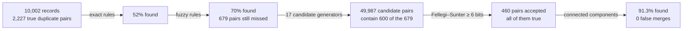

# Entity resolution for Japanese customer records

Finds which customer records (CONT_IDs) belong to the same person or company. It runs on synthetic records built from **real Japanese names, companies and addresses**, so every answer can be checked against the truth before the method touches real data.

**On test** (10,066 records never used for any choice), it finds **89.9%** of the true duplicate pairs (95% interval 88.7–91.1%) with **0 false merges**; the false-merge rate is at most 0.14%. A demo of every step, run with its outputs and charts, is [`notebooks/pdf/demo.pdf`](notebooks/pdf/demo.pdf).

## How it works, on one pair

Two records of the same person, taken from the val split:

| | name | address | phone (last 4) | CIF ID |
|---|---|---|---|---|
| record A | サワベキチヘイ | 北九州市八幡東区景勝町１０－１３ | 3734 | 1037183236105 |
| record B | サベキチヘイ | 福岡県北九州市八幡東区景勝町10-13　メゾン青葉706 | 0945 | 6765670361201 |

The name lost one kana (ワ), the phone changed, and the CIF ID (the ID our CIF system assigns) is new. Only the address agrees, written two ways. Here is what happens to the pair:

1. **Standardize.** Kana variants are folded, and every address format is parsed to one key: both addresses become 北九州市八幡東区景勝町10-13, whatever the prefecture, the full-width digits or the building name.
2. **Rules (exact, then fuzzy).** None fires. Every rule that takes the address also needs the phone, the exact name or the CIF ID, and this person changed all three. The rules are cheap and never wrong on our data (0 false merges on every split), but they find only 70% of the duplicates.
3. **Candidates.** Five generators put the pair on a short list. One is the one-deletion key: サベキチヘイ is サワベキチヘイ with one kana deleted, so the two share a key in their postal area. Others are the address with the name's first kana (サ), the given name with the postal code, and the name's sorted neighbourhood on the reversed name. That list has 49,987 candidate pairs for 10,002 records, instead of all 50 million possible pairs.
4. **Score.** A Fellegi–Sunter model weighs each field as evidence, in bits. Each bit doubles the odds that the two records are the same entity. How often strangers agree on a field (u) is measured on the file being scored, here val.

   | evidence | bits |
   |---|---|
   | starting point: two random records are the same entity (about 1 in 32,000) | −14.98 |
   | names very close (Jaro–Winkler ≥ 0.95 after kana folding) | +11.84 |
   | same address | +13.52 |
   | different phone | −2.51 |
   | different CIF ID | −0.90 |
   | **total** | **+6.98 bits, a 99.2% match probability** |

5. **Decide and cluster.** A pair needs at least **6 bits** to be accepted, and this one passes. Connected components then merge it with any other records already linked to either side.

**A rejected non-match**, from the same val split:

| | name | address | phone | CIF ID |
|---|---|---|---|---|
| record C | セルシスカブシキガイシャ (a company) | 東京都多摩市連光寺5-18-5 | 8813 | 2754477213332 |
| record D | ヤマモトカヨ (a person) | 東京都多摩市連光寺5-18-5 | 6813 | 4590715084681 |

Same address (+13.52), phone one digit off (+4.47), different CIF ID (−0.90). A company and a person have no name the model can compare, so the name adds 0 bits. Total **+2.12 bits, rejected.**

Both pairs share an address. The true pair adds a near-identical name, which outweighs its new phone and CIF ID; this pair has nearly the same phone but no name to compare. Both breakdowns are computed by [`er.match.waterfall`](er/match.py); they are in [`reports/choose.md`](reports/choose.md), and section 8 of the demo draws two more.

## The whole funnel, on val



## Why it's built this way

- **Two stages.** Rules are cheap, auditable and, on this data, never wrong, so they go first. What they leave is messy: a typo in the name and in the phone at once, a move, a new CIF ID. Messy pairs need evidence weighed, not all-or-nothing conditions.
- **Bits.** Evidence from independent fields adds up, so every accepted pair can be explained line by line, as above. Correlated fields (address code, address text, postal code) share one comparison, so the same fact is never counted twice.
- **Linear work, so it scales.** Every step's work grows about linearly with the file. A key's pairs split into true pairs, which grow like N, and chance pairs, which grow like N² when the key's values come from a fixed pool: the last four phone digits, an address that households share. So no key is one such field alone; each adds another (phone and address, address and the name's first letter), and its pairs per record stay within a budget at the target size, checked before every run. TF-IDF, which compares every record with every other, was replaced too ([chapter 3](docs/guide/03-far-too-many-pairs.md#scaling-to-a-million-records)). A sorted window reaches fewer pairs as the file grows, so the keys alone must reach every pair the model could accept, at the target size as well ([why](docs/guide/03-far-too-many-pairs.md#keeping-every-potential-match)).
- **A rule picks the threshold, not a person.** The threshold is the lowest weight at which cross-validated train accepts no false pair, plus one safety step. Every other choice is made by a paired test on train and must not lose anything on val. Test is scored once, at the end. The headline number above was never used to choose anything ([chapter 6](docs/guide/06-measuring-and-choosing.md)).
- **Synthetic data from real names.** Real name, company and address distributions with an exact answer key, so each method's errors can be counted, not guessed ([chapter 1](docs/guide/01-entity-resolution-and-our-task.md#where-does-the-truth-come-from)).
- **Configured for any file, and measured.** Column names live only in `config/settings.toml` `[columns]`; the matching (`config/pipeline.toml`) is written in logical fields, some mandatory and some optional, so a file with other column names or missing fields needs only that mapping. Every search reports its cost (Big-O with the numbers filled in) before it runs, and every metric carries its 95% interval. The cost of every step, end to end, is in [performance.md](docs/performance.md#end-to-end-the-cost-of-every-step).

## Words used here

| Term | Meaning | Explained in |
|---|---|---|
| true pair | two records of the same person or company | [1](docs/guide/01-entity-resolution-and-our-task.md) |
| candidates (blocking) | the short list of pairs worth comparing, built from shared keys, so no one compares all 50 million | [3](docs/guide/03-far-too-many-pairs.md) |
| m | how often two records of the **same** entity land in a level (e.g. "same address") | [5](docs/guide/05-uncertain-evidence-fellegi-sunter.md) |
| u | how often two **different** entities land there by chance | [5](docs/guide/05-uncertain-evidence-fellegi-sunter.md) |
| bits, match weight | log2(m / u) per field, plus the starting point; +1 bit doubles the odds | [5](docs/guide/05-uncertain-evidence-fellegi-sunter.md) |
| recall | the share of true pairs found | [6](docs/guide/06-measuring-and-choosing.md) |
| false merge (FP) | two different entities put together; "rate ≤ 0.14%" is the 95% upper bound when none was seen | [6](docs/guide/06-measuring-and-choosing.md) |
| cross-validation | fitting on two thirds of train and scoring the other third, three times, so a choice is never judged on the data it was fitted on | [6](docs/guide/06-measuring-and-choosing.md) |

## Quickstart

```bash
./setup_venv.sh                           # .venv (Python ≥ 3.12), pinned dependencies, `er` installed editable
.venv/bin/python -m pytest tests/         # engine checks, ~2 s
```

| To | Run | Time |
|---|---|---|
| see every step on a small file | `notebooks/demo.ipynb` with the `.venv` kernel, or `scripts/export_pdfs.py` for its PDF (once first: `.venv/bin/python -m playwright install chromium`) | ~1 min |
| generate the synthetic train / val / test files | `scripts/generate.py` | ~5 s |
| choose the configuration on them | `scripts/choose.py` (`--optuna` adds the searches) → `config/final.toml`, `reports/choose.md`, `data/medallion/gold/<dataset>/` | ~5 min |
| resolve any file, without labels | `scripts/resolve.py --input <file> --output <folder>`; `--increment` adds new records, `--overwrite` replaces a run, `--compute memory_limit=8GB` limits memory | 41 s per million records |
| measure quality and cost | `scripts/benchmark.py --entities 10000 20000 40000 60000 800000 --memory-limit 8GB` → `reports/benchmark.md` | ~5 min |

Every script is run as `.venv/bin/python scripts/<name>.py`.

```
config/settings.toml   paths, [columns] (logical field → the file's columns), [locale], [compute]: the only place that names columns
config/pipeline.toml   the matching, in logical fields: [fields], rules, generators, model, threshold rule, budgets
config/final.toml      what scripts/choose.py chose, in the same format; scripts/resolve.py runs it
config/generator.toml  the synthetic population · config/experiments.py: the variants choose.py decides on
er/                    the engine (names no column); er/run.py is the run on any file, on DuckDB tables
scripts/  reports/     generate · choose · resolve · benchmark · export_pdfs; the reports of the synthetic runs
notebooks/demo.ipynb   every step on ~3,700 records, with charts; saved without outputs, notebooks/pdf/demo.pdf with
tests/  data/          engine checks; bronze reference data (in git); silver records, labels and gold run folders, all Parquet, rebuilt by the scripts
```

## Read the guide

Six chapters explain how everything works. Each starts from a real example, names the challenge, and explains the solution and why we chose it.

| Chapter | What it answers |
|---|---|
| [1. Entity matching, entity resolution, and our task](docs/guide/01-entity-resolution-and-our-task.md) | What are the two problems, how have others solved them, and what exactly is our task? |
| [2. The same fact, written differently](docs/guide/02-the-same-fact-written-differently.md) | How do we compare names and addresses that are spelled differently, in Japanese? |
| [3. Far too many pairs](docs/guide/03-far-too-many-pairs.md) | How do we avoid comparing 50 million pairs? |
| [4. Certain cases first: rules](docs/guide/04-certain-cases-first-rules.md) | Which pairs can simple rules settle safely, and where do rules stop? |
| [5. Uncertain evidence: Fellegi–Sunter](docs/guide/05-uncertain-evidence-fellegi-sunter.md) | How do we weigh partial evidence, learn without labels, and form groups? |
| [6. Measuring honestly, choosing without overfitting](docs/guide/06-measuring-and-choosing.md) | How good is it, how sure are we, and how do we avoid fooling ourselves? |

**Reference:** [architecture](docs/architecture.md) (the run step by step, as a draw.io diagram; data flow; the `er` package) · [data](docs/data.md) (sources, generator, columns) · [results](docs/results.md) (every table) · [performance](docs/performance.md) · [lessons](docs/lessons.md) (what went wrong, and the guards)

## Known limits

- **One generator.** Test is an independent sample from the same generator, so the results hold for its kind of duplicates, typos and gaps. Other seeds, twice the typos, emptier fields and a prior off by a factor of two keep recall between 88.5% and 91.5% with 0 false merges ([chapter 6](docs/guide/06-measuring-and-choosing.md#challenge-does-it-hold-beyond-our-one-dataset)), but noisier real data may still do worse. Only real data can tell.
- **Bigger files, slightly lower recall.** A million records take 41 seconds and 4.5 GB, under an 8 GB limit past which DuckDB would spill to disk. Fitted on each file without labels, recall stays between 88.9% and 89.6% from 12,000 to 75,000 records, and a few false merges appear (a rate of at most 0.16%) ([benchmark](reports/benchmark.md), measured before the latest standardization fixes). Blocking loses none of it: on train, every true pair that could reach the threshold shares a key, at train's size and at a million records. u is measured on each scored file, which keeps agreements on growing fields (address, CIF ID) at their true weight on big files. On files smaller than train it costs a little: test would score 91.1% with train's u, against 89.9% ([chapter 3](docs/guide/03-far-too-many-pairs.md#quality-as-the-file-grows)).
- **Close names at a shared address rely on the name's first letter.** Without labels, the run can only check that every pattern able to reach the threshold implies a shared key. Names that are close by Jaro–Winkler imply no key, so up to 0.6% of matches (the model's own bound) rest on keys that are near-certain but not guaranteed to hold: the name's first letter with the address, or another key. On labelled data none is lost.
- **Machine-read kana.** Given-name readings come from SudachiPy, and some differ from the intended reading.
- **Next steps:** certify on real data; try a supervised classifier on the same comparison vectors under the same decision rule; and add a clerical-review band for pairs just below 6 bits (`scripts/resolve.py` already writes them to `review.parquet`).
