# Entity matching & resolution for Japanese customer records

This project finds the CONT_IDs that belong to the same real person or company. It works on synthetic records built from **real Japanese names, companies and addresses**, whose true answers are known, so every method can be measured exactly before it touches real data.

Ground rules:
- **Config-driven:** each notebook has one Configuration cell, the only place that names columns. The engine is the shared `er` package, which names none.
- **Every search reports its time complexity** (Big-O with the numbers filled in) before and after it runs.
- **Every metric carries its uncertainty**, and every choice is made on data the choice is not judged on (§7).

## 1. Architecture

**How data moves between the notebooks and layers.** Each stage reads only what the previous stage wrote. Truth is read only to evaluate.

```mermaid
flowchart LR
  subgraph sources["public sources: downloaded once, standardized, then deleted"]
    direction TB
    nem["NVIDIA Nemotron-Personas-Japan"]
    wd["Wikidata companies"]
    geo["geolonia/japanese-addresses"]
    yub["yubinbango-data"]
  end
  bronze[("medallion/bronze/reference<br/>individual · companies · addresses (.json)")]
  gen["dataset_generation.ipynb"]
  silver[("medallion/silver/〈dataset〉.csv<br/>19 columns")]
  labels[("labels/〈dataset〉.csv<br/>truth")]
  det["deterministic_matching.ipynb"]
  detart[("artifacts/{matched,resolved,unresolved}/〈dataset〉/deterministic_*")]
  prob["probabilistic_matching.ipynb"]
  probart[("artifacts/{matched,resolved,unresolved}/〈dataset〉/probabilistic_*")]
  gold[("medallion/gold/〈dataset〉.csv<br/>CONT_ID → entity")]
  board[("artifacts/experiments/leaderboard.csv")]

  sources -->|"parse names · read kana (SudachiPy) · join postal codes"| bronze
  bronze -->|"samples personas, companies, towns"| gen
  gen -->|"writes records"| silver
  gen -->|"writes truth"| labels
  silver -->|"reads"| det
  det -->|"writes pairs, clusters, leftovers"| detart
  detart -->|"leftovers + pairs"| prob
  silver -->|"reads"| prob
  prob -->|"writes"| probart
  prob -->|"writes resolved entities"| gold
  labels -.->|"evaluation only"| det
  labels -.->|"evaluation only"| prob
  det -->|"one row per experiment"| board
  prob -->|"one row per experiment"| board
```



`〈dataset〉` ∈ `full`, `train`, `val`, `test`, `stress`, `large` (§3).

**Where Splink and Optuna sit inside the two matching stages.** Splink does the joins, the scoring and the clustering. Everything around it (candidates, thresholds, decisions, evaluation) is the `er` package. Optuna proposes configurations and is scored only on data it doesn't fit on.

```mermaid
flowchart LR
  subgraph detstage["deterministic_matching.ipynb"]
    direction LR
    drec["records"] -->|"derive + normalize (er.standardize)"| dprep["prepared records"]
    dprep -->|"one SQL join per rule on its exact keys"| djoin["Splink deterministic_link<br/>DuckDB hash join"]
    djoin -->|"fuzzy conditions on joined pairs only (cl_* functions)"| dacc["accepted pairs<br/>first rule wins"]
    dacc -->|"keep pairs touching an unresolved record"| dcc["Splink connected components"]
    dopt["Optuna on train<br/>dashboard :8080"] -->|"swaps one Comparator per fuzzy column"| djoin
    dcc -->|"FP, recall"| dopt
  end
  subgraph probstage["probabilistic_matching.ipynb"]
    direction LR
    pleft["deterministic leftovers"] -->|"unresolved vs all records"| pcand["candidates (er.candidates)<br/>exact keys · sorted neighbourhood · TF-IDF"]
    pfit["train, k−1 folds"] -->|"λ prior · u sampling · m by EM or labels"| pmodel[("Splink FS model")]
    pcand -->|"register_blocked_pairs_for_predict"| pscore["Splink predict<br/>match_weight per pair"]
    pmodel -->|"weights"| pscore
    pscore -->|"weight ≥ threshold (rule on out-of-fold scores)"| pacc["accepted pairs"]
    pacc -->|"+ deterministic pairs"| pcc["Splink connected components"]
    popt["Optuna, cross-validated objective<br/>dashboard :8081"] -->|"generators, m, tf, levels, threshold, resolver"| pcand
    pcc -->|"out-of-fold FP, recall"| popt
  end
  dcc -->|"leftovers"| pleft
```



Both Optuna studies are stored in SQLite (`artifacts/optuna/*.db`), and optuna-dashboard reads them live.

## 2. Setup

```bash
./setup_venv.sh        # creates .venv (Python ≥ 3.12) with pinned dependencies and `er` installed editable
```

- **Kernel:** in VS Code, **Select Kernel → Python Environments → .venv**.
- **Order:** run the notebooks from `notebooks/`, in order: generation → deterministic → probabilistic. All paths are relative to that folder.
- **Reading CSVs:** use `dtype=str`, because codes such as `0600042` keep their leading zeros.

## 3. Data layout

```
data/
  medallion/
    bronze/reference/   individual.json · companies.json · addresses.json · SOURCES.md   (tracked in git)
    silver/             <dataset>.csv   generated customer records: the pipeline input
    gold/               <dataset>.csv   resolved entities (CONT_ID → cluster), from the last stage
  labels/               <dataset>.csv   truth (CONT_ID → ENTITY_ID, KIND), read only to evaluate
  artifacts/
    matched/<dataset>/<stage>_pairs.csv          entity matching: accepted pairs
    resolved/<dataset>/<stage>_resolved.csv      entity resolution: clusters
    unresolved/<dataset>/<stage>_unresolved.csv  records still unresolved: the hand-off
    experiments/leaderboard.csv                  one row per (experiment, dataset)
    models/ · optuna/                            Splink models (JSON) · Optuna studies (SQLite)
```

**Datasets** use the same file name in every layer. Splits are partitions of one dataset, so they are files, not folders:

| Dataset | Size | Role |
|---|---|---|
| `full` | 8,000 entities, 10,000 records | seed 0, the whole generated set |
| `train` / `val` / `test` | 60 / 20 / 20% of `full`'s entities | fitting and selection / A/B confirmation / final report, once per configuration |
| `stress` | 8,000 entities | seed 1; about 2× the typos (incl. addresses), less nesting, more households. Evaluation only |
| `large` | 50,000 entities, 62,510 records | seed 2; certifies FP rates. Evaluation only |

Only `bronze/reference` is in git; everything else rebuilds from the notebooks (`.gitignore`).

## 4. Reference data (bronze)

Built once from public sources. The downloads were deleted afterwards; `SOURCES.md` records the exact steps, filters, counts and licences.

| File | Records | Source (licence) | Content |
|---|---|---|---|
| `individual.json` | 60,000 personas, 8,405 distinct surnames | NVIDIA Nemotron-Personas-Japan (CC BY 4.0) | names parsed from the persona text; kana readings by SudachiPy; sex, age, prefecture |
| `companies.json` | 31,596 companies | Wikidata, direct company types (CC0) | name + kana (official P1814 where present, else SudachiPy); legal forms stripped |
| `addresses.json` | 46,364 towns, all 47 prefectures | geolonia/japanese-addresses (CC BY 4.0) + yubinbango-data | prefecture, city and town with kana, JIS municipality code, chome, postal code |

Two traps came up while building this:
- **Wikidata's class tree:** 13,766 of the 16k "Japanese companies" with kana in the transitive `company` tree are dissolved municipalities. Only direct company types give real companies.
- **yubinbango prefecture codes:** they are written without the leading zero (`1`, not `01`), which silently dropped 9 prefectures until the codes were zero-padded.

## 5. Synthetic data: `dataset_generation.ipynb`

All parameters live in `SPEC`. `DATASETS` holds the `full`, `stress` and `large` variants of it, and `generate(spec)` builds each one.

- **Entities:** 20% companies. Each entity has `1 + Poisson(0.25)` records.
  - **Persons** are sampled personas, with realistic surname frequencies (サトウ, スズキ, タカハシ …). Their addresses lie in the persona's prefecture.
  - **Companies** are sampled real names with a legal form (カブシキガイシャ before or after the name).
  - **Addresses** are real towns with random 番/号, and a real postal code and JIS code.
- **Multi-valued entities:** each entity owns `1 + Poisson(λ)` phones, addresses and names (λ = 0.3 for persons, 1.0 for companies). Each record shows one of them: married names, branch offices.
- **Columns:**
  - IDs and codes: CONT_ID, PHONE_NUM_4, CIF_ID (a duplicate keeps the entity's CIF half the time)
  - person names in kana: FULL_NAME_KANA, O_PERSON_NAME_KANA, LAST_NAME_KANA, GIVEN_NAME_KANA
  - company name in kana: NYS_CNV_P_NAME_KANA
  - postal: POST_CD, POST_CD_KANA
  - address: SOURCE_ADDR_CD, ORIGINAL_ADDRESS (as typed, in 3 formats), ADDRESS_FIVE(_KANA) (`chome-ban-go`, or `ban-go`), ADDR_CD(_KANA) (11-digit 住所コード), STD_ADDRESS, ADDRESS_ONE (prefecture), ADDRESS_TWO (city)
- **Entry errors:**
  - 10% of name parts get one kana typo (ガ/カ, ッ/ツ, ー/ウ … or a dropped character)
  - 5% of phones get one wrong digit
  - 5% of ORIGINAL_ADDRESS values get one wrong digit or a dropped character
- **Missingness:**
  - **Rates:** the non-null rate falls from 0.9999 to 0.6544 along the column order, counted where the column applies.
  - **Correlation:** shared within the name, postal and address groups by `nesting` ρ.
- **Households:** unrelated entities sometimes share an address, which gives look-alikes that must not be merged.
- **Asserts** run on every dataset: exact rates, digit formats, kind consistency, no CIF shared across entities, address code ↔ address 1:1.

## 6. Pipeline concepts and the `er` package

| Step | Question | Module | Output |
|---|---|---|---|
| Standardize | derived fallback columns, normalized copies | `er.standardize` | prepared records |
| Candidates (blocking) | which pairs are worth comparing? | `er.candidates` | candidate pairs |
| **Entity matching** | are these two records the same entity? | `er.match` | accepted / scored pairs |
| **Entity resolution** | which records form one entity? | `er.resolve`, `er.pipeline.cascade` | clusters |
| Evaluation | how good, how sure, at what cost? | `er.evaluate` | metrics with intervals, Big-O, seconds |

`er.config` (typed config), `er.strings` (character-level functions), `er.io` (datasets, stage files, leaderboard, test counter), `er.tune` (Optuna helpers).

**Matching vs resolution:**
- **Matching** decides pair by pair:
  - rule stages accept a pair automatically when every condition of one rule holds
  - the probabilistic stage accepts a pair when its Fellegi–Sunter match weight reaches the threshold
- **Resolution** turns accepted pairs into entities:
  - `connected_components`: transitive; A–B and B–C make one entity
  - `constrained`: refuses a merge whose clusters hold different values in a cannot-link column
- **Metrics:** `pairs_*` measure the accepted pairs; the others measure the clusters (pairwise, B-cubed, over-merged, split).

**Cascade:** a stage adds pairs only where at least one record is still unresolved, so leftovers can join existing clusters. Metrics are cumulative.

**Blocking:**
- **Deterministic stage:** each rule is a DuckDB hash join on its exact keys. Fuzzy conditions run only on the joined pairs, so a rule costs `O(N + P)`, with P = Σ C(k, 2) over its key blocks. The preflight counts P per rule before any join and stops the run if a rule is over budget.
- **Probabilistic stage:** `er.candidates` generates pairs for the deterministic leftovers against all records, and Splink scores exactly that list.

  | Generator | Cost |
  |---|---|
  | exact keys | hash join, `O(N + P)` |
  | sorted neighbourhood | `O(N log N + N·w)` |
  | TF-IDF | brute-force cosine, `O(U·N·q)` |

  On `large`, the phone key alone gives 42% of the candidates (only 10,000 possible values, so it grows with N²). TF-IDF takes 12 of the ~14 s of candidate time.

**Character vs byte:** DuckDB's `jaro_winkler_similarity`, `jaccard` and `damerau_levenshtein` compare UTF-8 bytes, and katakana is 3 bytes per character. That scores サトウヒロシ / サトウタカシ at 0.897 instead of 0.844. `er.strings.connect()` registers character-level rapidfuzz versions (`cl_*`); every rule and every Fellegi–Sunter level uses them, and a self-check guards them.

## 7. Overfitting and uncertainty controls

| Risk | Control in the code |
|---|---|
| Fitting and selecting on the same data | Fellegi–Sunter is fitted on train. The threshold and Optuna's objective use **entity-level 3-fold cross-validation inside train**: each fold is scored by a model fitted on the other folds. |
| Selecting on one small set | Every table shows `recall_lo`/`recall_hi` (95% Wilson interval) and `fp_rate_hi` (95% Clopper–Pearson upper bound). A/B rows are **paired** against `SPEC`: true pairs gained and lost on the same records, an exact sign test, FP added and removed. Pareto choice by `pick_within_noise`: the cheapest configuration within one interval half-width of the best. |
| Threshold chosen by eye | `ThresholdRule`: on out-of-fold train scores, the lowest weight with 0 false accepted pairs and a stage FP upper bound ≤ 5%, then one grid step stricter as a safety margin. Val only confirms. |
| Variants adopted by preference | `DECISIONS` adopt a change only by rule, each applied on top of the current choice. "Better" needs a significant paired gain on cross-validated train with no FP added. "Cheaper" needs no paired loss. Both need no loss on `stress` and `large`. |
| Leakage into design | Design analyses (which keys reach which pairs) run on **train only**. |
| Overfitting the generator | Every final configuration is also reported on `stress` (another seed, harsher noise) and `large`. |
| Small sets can't certify FP rates | `large` gives thousands of predicted pairs. Zero FP among n pairs only bounds the rate at ≈ 3/n. |
| Test peeking | The leaderboard counts distinct configurations scored on test per family; the output cells warn above 1. Currently 1 each. |

## 8. Stage 1: deterministic matching

**Rules:**
- **exact:**
  - CIF_ID + FULL_NAME_KANA
  - CIF_ID + NYS_CNV_P_NAME_KANA
  - CIF_ID + PHONE_NUM_4
  - FULL_NAME_KANA + SOURCE_ADDR_CD + PHONE_NUM_4
  - NYS_CNV_P_NAME_KANA + SOURCE_ADDR_CD + PHONE_NUM_4
- **fuzzy:** one `Comparator` per column over derived fallback columns:
  - `PERSON_NAME`: kana fold → JW ≥ 0.92
  - company name: legal form stripped, then the same
  - `ADDRESS`: normalized so all typed formats give one key, then exact
  - phone: hamming ≤ 1
  - plus the surname-change rule: given name + address code + phone

The train-only design analysis justifies "never one key alone". Single keys collide across entities: phone 1,805 different-entity pairs, postal code 3,675, given name 4,586. Every rule's key combination has 0.

| Data | exact → + fuzzy recall | 95% interval | FP | FP rate ≤ |
|---|---|---|---|---|
| val | 51.1% → 67.0% | 62.6–71.2% | 0 | 0.97% |
| **test** | 57.0% → **73.4%** | 69.0–77.4% | 0 | 0.97% |
| stress | 46.0% → 69.1% | 67.2–70.9% | 0 | 0.18% |
| **large** | 51.8% → 68.1% | 67.4–68.9% | **0 of 9,618 pairs** | **0.031%** |

Paired A/B on val against `SPEC`, all with 0 FP:

| Variant | True pairs gained / lost | p |
|---|---|---|
| fold → Levenshtein ≤ 1 | 0 / 0 | 1 |
| fold → exact | 0 / 5 | 0.06 |
| raw Jaro-Winkler (no kana folding) | 0 / 8 | 0.008 |
| constrained resolver (cannot-link on given name) | 0 / 40 | < 0.001 |

The constrained resolver loses because given-name typos look like conflicts.

## 9. Stage 2: probabilistic matching

**Method:** the **Fellegi–Sunter model (Splink 5)** is the only probabilistic method so far; every A/B row is a variant of it.
- λ comes from near-certain rules, u from 1e7 random pairs, m from EM (or labels).
- There are five comparisons: name, company, address, phone, cif. Correlated columns share one comparison (address code / normalized address / postal form one), because FS assumes independence.
- Levels use the `cl_*` functions.

**Candidates** (val: 151 true pairs the deterministic stage missed):

| Generators (cumulative) | Candidates | Missed pairs reached |
|---|---|---|
| phone | 242 | 41.7% |
| + address, address code, CIF | 592 | 82.1% |
| + folded person name, folded company name | 621 | 94.0% |
| + sorted neighbourhood | 5,713 | 94.7% |
| + TF-IDF | 5,801 | **95.4%** |

**Training:** EM and labels learn the same weights within noise.
- Agreeing on CIF, phone, same address or postal code is worth about 10–14 bits; an exact name about 13.
- The new address typos give "address close" a sensible +9.9 bits; it learned −34.7 when addresses were never mistyped.
- Splink reports the company "JW low" level as never observed, so its m stays at Splink's default.

**Threshold** (`ThresholdRule` on out-of-fold train scores): the lowest weight with 0 FP is 4 (0 of 183 accepted pairs); one step of margin gives **6**. Val confirms 0 FP.

**Decisions** (paired, cross-validated train + robustness):

| Change | Rule | Cross-validated train | stress | large | Adopted |
|---|---|---|---|---|---|
| term-frequency adjustment off | better | +82 / −0 true pairs (p < 10⁻²⁰), no FP added | +23 / −0 | +150 / −0 | **yes** |
| exact keys only (drop sorted neighbourhood, TF-IDF) | cheaper | −1 true pair | −2 | −1 | no |

On val alone, both variants tied with `SPEC`. The cross-validated and robustness checks are what separated them.

**Results with the final `SPEC`** (all generators, term frequency off, m by EM, threshold 6, connected components):

| Data | After deterministic → after probabilistic | 95% interval | FP | FP rate ≤ |
|---|---|---|---|---|
| val | 67.0% → 86.5% | 83.0–89.3% | 0 | 0.75% |
| **test** | 73.4% → **90.7%** | 87.6–93.2% | **0** | 0.78% |
| stress | 69.1% → 88.7% | 87.4–89.9% | 2 | 0.30% |
| **large** | 68.1% → 88.4% | 87.9–88.9% | **13 of 12,494 pairs** | **0.17%** |

**What the large dataset revealed:** at 50k entities, the probabilistic stage makes false positives that small sets never show, because false-pair opportunities grow with N². The top ones share a cause: **one side has no name**, or one side is a **company and the other a person**. Neither name comparison can fire, so the same address (+11.8 bits) plus the same last-4 phone digits (+12.3 bits) is enough. The deterministic stage stays at 0 FP on `large`.

**Optuna** (cross-validated objective, 30 trials, ≈ 10 min): three Pareto points.
- **Suggested (`pick_within_noise`):** trial 25, with **0 FP and 90.7% recall out-of-fold**, confirmed on val at **0 FP, 91.7% recall (88.8–93.9%)**. It uses a lower threshold (2.5), term-frequency adjustment on, and fewer generators (the folded-name keys, person sorted neighbourhood and TF-IDF off).
- **Train and val now agree.** With the old train-scored objective, a 0-FP point turned into 1 FP on val.
- **Not adopted yet:** it must pass the same decision rule (paired on cross-validated train, no loss on `stress` / `large`), and the low threshold needs checking against the large-scale false positives below.

## 10. Performance

Measured on `large`: candidates ~14 s (TF-IDF 12.4 s), scoring 437k pairs 1.5 s. One model fit is 8.2 s, of which u-sampling is 8.0 s.

**Free savings in the code** (identical results, self-checked):
- **u reuse.** u depends only on the comparisons and the fitting records (`FSModel.u_signature`), not on the m method or term-frequency adjustment. Reusing it gives an identical model (weights equal to 1e-14) and cuts that training from 7.4 s to 0.1 s.
- **Run cache.** Identical runs (same config, dataset and threshold) are computed once. The decision cell went 96 → 57 s, robustness 20 → 0 s, outputs 24 → 3 s.

**Tried and rejected, because they change results:**
- **u from 1e6 pairs** instead of 1e7: 6× faster, but loses true pairs on stress (−19 / +7, p = 0.03) and on large (−104 / +59, p = 0.0005).
- **Exact sparse top-k for TF-IDF:** only 10.5 → 9.0 s, and 2,911 pairs differ through tie handling.

**Still slow:** the Optuna study (≈ 9 min for 30 trials). Each trial changes level thresholds, so u must be re-sampled per fold. Options:
- fewer trials
- not searching the level thresholds
- computing u from a fixed per-fold sample of pairs (needs a paired check)

## 11. Comparing solutions

Every experiment appends a leaderboard row: experiment, dataset, config hash, candidate metrics, matching and resolution metrics with intervals, paired-test results, Big-O and seconds.

How to choose:
1. **Candidates:** the cheapest generator union that reaches the target completeness on the previous stage's misses.
2. **Scorer, threshold and variants:** by the rules in §7, on cross-validated train with robustness checks.
3. **Resolver:** by resolution FP and over-merged clusters.
4. **Test:** once.

## Next steps

- **Stop the false positives at scale:**
  - add a "kind" comparison (person vs company, from which name columns are filled) or block on kind
  - make a missing name on one side count against a pair that agrees only on address + phone
- **Certify at production size:** set `budget.target_rows` to the real row count and generate a `large` at that size.
- **Speed up Optuna** (§10).
- **Supervised classifier** on the Fellegi–Sunter comparison vectors (`gamma_*`, already in the scored pairs), compared on the leaderboard.
- Then: a clerical-review band, golden-record survivorship, approximate nearest-neighbour TF-IDF at scale.

## Known limits

- **Real names, synthetic behaviour:** names, companies and towns are real, but who has duplicates, typos and missing values is still the generator's model.
- **Machine-read kana:** given-name readings come from SudachiPy, and some differ from the intended reading.
- **FP bounds hold only at the tested size:** at production scale, validate again (§9).
