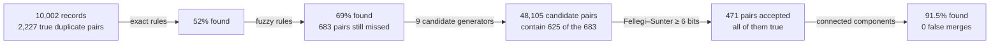

# Entity resolution for Japanese customer records

Finds which customer records (CONT_IDs) belong to the same person or company. It runs on synthetic records built from **real Japanese names, companies and addresses**, so every answer can be checked against the truth before the method touches real data.

**On test** (10,066 records never used for any choice), it finds **90.3%** of the true duplicate pairs (95% interval 89.1–91.5%) with **0 false merges**; the false-merge rate is at most 0.14%. Every notebook, run with all its outputs, is in [`notebooks/pdf/`](notebooks/pdf/).

## How it works, on one pair

Two records of the same man, taken from the val split:

| | name | address | phone (last 4) | CIF ID |
|---|---|---|---|---|
| record A | マツモトヒサオ | 福島県福島市吉倉4-11 | 0599 | 5227073594045 |
| record B | マツモトヒサウ | 福島県福島市吉倉4-11 | 0499 | 5912064752971 |

The name has one wrong kana (オ → ウ), the phone one wrong digit, and the CIF ID (the ID our CIF system assigns) is new. Here is what happens to the pair:

1. **Standardize.** Kana variants are folded and every address format is parsed to one key, so 福島市吉倉4-11 compares equal whether it was typed with 丁目/番/号, full-width digits or a building name.
2. **Rules (exact, then fuzzy).** None fires. Every rule needs the name, the phone or the CIF ID to match exactly, and here all three differ slightly. The rules are cheap and never wrong on our data (0 false merges on every split), but they find only 69% of the duplicates.
3. **Candidates.** Three generators put the pair on a short list: the shared address, the shared address code, and the name's sorted neighbourhood (sorted by name, the two records sit within a few places of each other). That list has 48,105 candidate pairs for 10,002 records, instead of all 50 million possible pairs.
4. **Score.** A Fellegi–Sunter model weighs each field as evidence, in bits. Each bit doubles the odds that the two records are the same entity.

   | evidence | bits |
   |---|---|
   | starting point: two random records are the same entity (about 1 in 32,000) | −15.0 |
   | names close (Jaro–Winkler ≥ 0.75 after kana folding) | +4.0 |
   | same address | +14.0 |
   | phone one digit off | +4.5 |
   | different CIF ID | −0.9 |
   | **total** | **+6.6 bits, a 99% match probability** |

5. **Decide and cluster.** A pair needs at least **6 bits** to be accepted, and this one passes. Connected components then merge it with any other records already linked to either side.

**The closest non-match**, from the same val split:

| | name | address | phone | CIF ID |
|---|---|---|---|---|
| record C | セルシスカブシキガイシャ (a company) | 東京都多摩市連光寺5-18-5 | 8813 | 2754477213332 |
| record D | ヤマモトカヨ (a person) | 東京都多摩市連光寺5-18-5 | 6813 | 4590715084681 |

Same address (+14.0), phone one digit off (+4.5), different CIF ID (−0.9). The same evidence as the true match, except for the name: a company and a person have no name the model can compare, so the name adds 0 bits. Total **+2.6 bits, rejected.**

The four bits between a match and a non-match come from the name. The notebook computes both breakdowns ([`er.match.waterfall`](er/match.py); the "Why a pair matches" cell in the probabilistic PDF).

## The whole funnel, on val



## Why it's built this way

- **Two stages.** Rules are cheap, auditable and, on this data, never wrong, so they go first. What they leave is messy: a typo in the name and in the phone at once, a move, a new CIF ID. Messy pairs need evidence weighed, not all-or-nothing conditions.
- **Bits.** Evidence from independent fields adds up, so every accepted pair can be explained line by line, as above. Correlated fields (address code, address text, postal code) share one comparison, so the same fact is never counted twice.
- **Linear work, so it scales.** Up to a million records, every step's work grows about linearly with the file. Two steps grew with its square: keys on the last four phone digits, which take only 10,000 values, and TF-IDF, which compares every record with every other. Both were replaced without losing a true pair the model accepts ([chapter 3](docs/guide/03-far-too-many-pairs.md#scaling-to-a-million-records)).
- **A rule picks the threshold, not a person.** The threshold is the lowest weight at which cross-validated train accepts no false pair, plus one safety step. Every other choice is made by a paired test on train and must not lose anything on val. Test is scored once, at the end. The headline number above was never used to choose anything ([chapter 6](docs/guide/06-measuring-and-choosing.md)).
- **Synthetic data from real names.** Real name, company and address distributions with an exact answer key, so each method's errors can be counted, not guessed ([chapter 1](docs/guide/01-entity-resolution-and-our-task.md#where-does-the-truth-come-from)).
- **Configured and measured.** Column names live only in `config/settings.toml` and each notebook's Configuration cell. Every search reports its cost (Big-O with the numbers filled in) before it runs, and every metric carries its 95% interval.

## Words used here

| Term | Meaning | Explained in |
|---|---|---|
| true pair | two records of the same person or company | [1](docs/guide/01-entity-resolution-and-our-task.md) |
| candidates (blocking) | the short list of pairs worth comparing, built from shared keys, so no one compares all 50 million | [3](docs/guide/03-far-too-many-pairs.md) |
| m | how often two records of the **same** entity land in a level (e.g. "same address") | [5](docs/guide/05-uncertain-evidence-fellegi-sunter.md) |
| u | how often two **different** entities land there by chance | [5](docs/guide/05-uncertain-evidence-fellegi-sunter.md) |
| bits, match weight | log2(m / u) per field, plus the starting point; +1 bit doubles the odds | [5](docs/guide/05-uncertain-evidence-fellegi-sunter.md) |
| recall | the share of true pairs found | [6](docs/guide/06-measuring-and-choosing.md) |
| false merge (FP) | two different entities put together; "rate ≤ 0.14%" is the 95% upper bound when none was seen | [6](docs/guide/06-measuring-and-choosing.md) |
| cross-validation | fitting on two thirds of train and scoring the other third, three times, so a choice is never judged on the data it was fitted on | [6](docs/guide/06-measuring-and-choosing.md) |

## Quickstart

```bash
./setup_venv.sh                           # .venv (Python ≥ 3.12), pinned dependencies, `er` installed editable
.venv/bin/python -m pytest tests/         # engine checks, ~2 s
```

Then run the notebooks in order, with the `.venv` kernel: `dataset_generation` → `deterministic_matching` → `probabilistic_matching`. Or run `.venv/bin/python scripts/export_pdfs.py` to run all three and save them, with outputs, to `notebooks/pdf/` (~13 min; once first: `.venv/bin/python -m playwright install chromium`). After them, `.venv/bin/python scripts/robustness.py --smoke` re-runs the final configurations on other populations and on a million records, and writes `data/artifacts/robustness/report.md` (~15 min, 6 GB of memory).

```
config/settings.toml   paths, datasets, schema, standardization: the only shared place that names columns
er/                    the engine: candidates, matching, resolution, evaluation (names no column)
notebooks/             the three stages, saved without outputs; notebooks/pdf/ holds the last full run
tests/  scripts/       engine checks · PDF export · robustness report
data/                  bronze reference data (in git); everything else is rebuilt by the notebooks
```

## Read the guide

Six chapters explain how everything works. Each starts from a real example, names the challenge, and explains the solution and why we chose it.

| Chapter | What it answers |
|---|---|
| [1. Entity matching, entity resolution, and our task](docs/guide/01-entity-resolution-and-our-task.md) | What are the two problems, how have others solved them, and what exactly is our task? |
| [2. The same fact, written differently](docs/guide/02-the-same-fact-written-differently.md) | How do we compare names and addresses that are spelled differently, in Japanese? |
| [3. Far too many pairs](docs/guide/03-far-too-many-pairs.md) | How do we avoid comparing 50 million pairs? |
| [4. Certain cases first: rules](docs/guide/04-certain-cases-first-rules.md) | Which pairs can simple rules settle safely, and where do rules stop? |
| [5. Uncertain evidence: Fellegi–Sunter](docs/guide/05-uncertain-evidence-fellegi-sunter.md) | How do we weigh partial evidence, learn without labels, and form groups? |
| [6. Measuring honestly, choosing without overfitting](docs/guide/06-measuring-and-choosing.md) | How good is it, how sure are we, and how do we avoid fooling ourselves? |

**Reference:** [architecture](docs/architecture.md) (data flow, the `er` package) · [data](docs/data.md) (sources, generator, columns) · [results](docs/results.md) (every table) · [performance](docs/performance.md) · [lessons](docs/lessons.md) (what went wrong, and the guards)

## Known limits

- **One generator.** Test is an independent sample from the same generator, so the results hold for its kind of duplicates, typos and gaps. Other seeds, twice the typos, emptier fields and a prior off by a factor of two keep recall between 88.8% and 91.4% with 0 false merges ([chapter 6](docs/guide/06-measuring-and-choosing.md#challenge-does-it-hold-beyond-our-one-dataset)), but noisier real data may still do worse. Only real data can tell.
- **Bigger files, slightly lower recall.** A million records take under two and a half minutes and 6 GB. At a fixed threshold, though, recall falls from 89.8% at 12,000 records to 87.5% at 75,000, and a few false merges appear (a rate of at most 0.07%). Half of the drop comes from keeping train's u values; re-sampling u on the scored file recovers it ([chapter 3](docs/guide/03-far-too-many-pairs.md#quality-as-the-file-grows)).
- **Machine-read kana.** Given-name readings come from SudachiPy, and some differ from the intended reading.
- **Next steps:** take u from the scored file, through the decision rule; certify on real data at production size; try a supervised classifier on the same comparison vectors under the same decision rule; and add a clerical-review band for pairs just below 6 bits.
