# Entity matching & resolution for Japanese customer records

This project finds the CONT_IDs that belong to the same real person or company. It works on synthetic records built from **real Japanese names, companies and addresses**, whose true answers are known, so every method can be measured exactly before it touches real data.

Ground rules:
- **Config-driven:** column names live only in `config/settings.toml` (paths, datasets, schema, standardization, shared by every notebook) and in each notebook's Configuration cell (that stage's rules, model and search). The engine is the shared `er` package, which names none.
- **Every search reports its time complexity** (Big-O with the numbers filled in) before and after it runs.
- **Every metric carries its uncertainty**, and every choice is made on data the choice is not judged on (§7).

## 1. Architecture

**How data moves between the notebooks and layers.** Each stage reads only what the previous stage wrote. Truth is read only to evaluate.

```mermaid
flowchart LR
  subgraph sources["public sources: downloaded once, standardized, then deleted"]
    direction TB
    nem["NVIDIA Nemotron-Personas-Japan"]
    wd["Wikidata companies"]
    geo["geolonia/japanese-addresses"]
    yub["yubinbango-data"]
  end
  bronze[("medallion/bronze/reference<br/>individual · companies · addresses (.json)")]
  settings[/"config/settings.toml<br/>paths · datasets · schema · standardization"/]
  gen["dataset_generation.ipynb"]
  silver[("medallion/silver/〈dataset〉.csv<br/>19 columns")]
  labels[("labels/〈dataset〉.csv<br/>truth")]
  det["deterministic_matching.ipynb"]
  detart[("artifacts/{matched,resolved,unresolved}/〈dataset〉/deterministic_*")]
  prob["probabilistic_matching.ipynb"]
  probart[("artifacts/{matched,resolved,unresolved}/〈dataset〉/probabilistic_*")]
  gold[("medallion/gold/〈dataset〉.csv<br/>CONT_ID → entity")]
  board[("artifacts/experiments/leaderboard.csv")]

  sources -->|"parse names · read kana (SudachiPy) · join postal codes"| bronze
  bronze -->|"samples personas, companies, towns"| gen
  gen -->|"writes records"| silver
  gen -->|"writes truth"| labels
  silver -->|"reads"| det
  det -->|"writes pairs, clusters, leftovers"| detart
  detart -->|"leftovers + pairs"| prob
  silver -->|"reads"| prob
  prob -->|"writes"| probart
  prob -->|"writes resolved entities"| gold
  labels -.->|"evaluation only"| det
  labels -.->|"evaluation only"| prob
  det -->|"one row per experiment"| board
  prob -->|"one row per experiment"| board
  settings -.->|"er.settings.load_settings()"| gen & det & prob
```



`〈dataset〉` ∈ `train`, `val`, `test`: one generated population, split by entity (§3).

**Where Splink and Optuna sit inside the two matching stages.** Splink does the joins, the scoring and the clustering. Everything around it (candidates, thresholds, decisions, evaluation) is the `er` package. Optuna proposes configurations and is scored only on data it doesn't fit on.

```mermaid
flowchart LR
  subgraph detstage["deterministic_matching.ipynb"]
    direction LR
    drec["records"] -->|"derive + normalize (er.standardize)"| dprep["prepared records"]
    dprep -->|"one SQL join per rule on its exact keys"| djoin["Splink deterministic_link<br/>DuckDB hash join"]
    djoin -->|"fuzzy conditions on joined pairs only (cl_* functions)"| dacc["accepted pairs<br/>first rule wins"]
    dacc -->|"keep pairs touching an unresolved record"| dcc["Splink connected components"]
    dopt["Optuna on train<br/>dashboard :8080"] -->|"swaps one Comparator per fuzzy column"| djoin
    dcc -->|"FP, recall"| dopt
  end
  subgraph probstage["probabilistic_matching.ipynb"]
    direction LR
    pleft["deterministic leftovers"] -->|"unresolved vs all records"| pcand["candidates (er.candidates)<br/>exact keys · sorted neighbourhood · TF-IDF"]
    pfit["train, k−1 folds"] -->|"λ prior · u sampling · m by EM or labels"| pmodel[("Splink FS model")]
    pcand -->|"register_blocked_pairs_for_predict"| pscore["Splink predict<br/>match_weight per pair"]
    pmodel -->|"weights"| pscore
    pscore -->|"weight ≥ threshold (rule on out-of-fold scores)"| pacc["accepted pairs"]
    pacc -->|"+ deterministic pairs"| pcc["Splink connected components"]
    popt["Optuna, cross-validated objective<br/>dashboard :8081"] -->|"generators, m, tf, levels, resolver"| pcand
    pcc -->|"out-of-fold FP, recall"| popt
  end
  dcc -->|"leftovers"| pleft
```



Both Optuna studies are stored in SQLite (`artifacts/optuna/*.db`), and optuna-dashboard reads them live.

## 2. Setup

```bash
./setup_venv.sh                    # creates .venv (Python ≥ 3.12) with pinned dependencies and `er` installed editable
.venv/bin/python -m pytest tests/  # engine checks (character-level strings, address keys, u reuse, scoring), ~2 s
```

- **Kernel:** in VS Code, **Select Kernel → Python Environments → .venv**.
- **Order:** generation → deterministic → probabilistic. Paths in `config/settings.toml` are relative to the project root (the folder with `pyproject.toml`), so the notebooks run from any working folder.
- **Reading CSVs:** use `dtype=str`, because codes such as `0600042` keep their leading zeros.

## 3. Layout

```
config/settings.toml    shared settings, loaded and validated by er.settings.load_settings()
er/                     the engine (no column names)
notebooks/              dataset_generation · deterministic_matching · probabilistic_matching
tests/                  pytest checks of the engine, on a small hand-made frame
data/
  medallion/
    bronze/reference/   individual.json · companies.json · addresses.json · SOURCES.md   (tracked in git)
    silver/             <dataset>.csv   generated customer records: the pipeline input
    gold/               <dataset>.csv   resolved entities (CONT_ID → cluster), from the last stage
  labels/               <dataset>.csv   truth (CONT_ID → ENTITY_ID, KIND), read only to evaluate
  artifacts/
    matched/<dataset>/<stage>_pairs.csv          entity matching: accepted pairs
    resolved/<dataset>/<stage>_resolved.csv      entity resolution: clusters
    unresolved/<dataset>/<stage>_unresolved.csv  records still unresolved: the hand-off
    experiments/leaderboard.csv                  one row per (experiment, dataset)
    experiments/archive/                         leaderboards of development runs
    models/ · optuna/                            Splink models (JSON) · Optuna studies (SQLite)
```

**Datasets:** one generated population of 40,000 entities (50,215 records), split by entity so a duplicate group never spans two splits. Each split uses the same file name in every layer:

| Dataset | Entities | Records | Role |
|---|---|---|---|
| `train` | 60% | 30,147 | fitting, design analyses, cross-validated threshold and decisions, Optuna objective |
| `val` | 20% | 10,002 | A/B confirmation and selection checks |
| `test` | 20% | 10,066 | final report, once per configuration |

Only `bronze/reference` is in git; everything else rebuilds from the notebooks (`.gitignore`).

## 4. Reference data (bronze)

Built once from public sources. The downloads were deleted afterwards; `SOURCES.md` records the exact steps, filters, counts and licences.

| File | Records | Source (licence) | Content |
|---|---|---|---|
| `individual.json` | 60,000 personas, 8,405 distinct surnames | NVIDIA Nemotron-Personas-Japan (CC BY 4.0) | names parsed from the persona text; kana readings by SudachiPy; sex, age, prefecture |
| `companies.json` | 31,596 companies | Wikidata, direct company types (CC0) | name + kana (official P1814 where present, else SudachiPy); legal forms stripped |
| `addresses.json` | 46,364 towns, all 47 prefectures | geolonia/japanese-addresses (CC BY 4.0) + yubinbango-data | prefecture, city and town with kana, JIS municipality code, chome, postal code |

Two traps came up while building this:
- **Wikidata's class tree:** 13,766 of the 16k "Japanese companies" with kana in the transitive `company` tree are dissolved municipalities. Only direct company types give real companies.
- **yubinbango prefecture codes:** they are written without the leading zero (`1`, not `01`), which silently dropped 9 prefectures until the codes were zero-padded.

## 5. Synthetic data: `dataset_generation.ipynb`

All parameters live in `SPEC` (the population) and `SPLIT` (shares and seed). `generate(SPEC)` builds the population, `check` asserts its invariants, and the split writes `silver/<split>.csv` and `labels/<split>.csv`.

- **Entities:** 40,000, 20% companies. Each entity has `1 + Poisson(0.25)` records.
  - **Persons** are sampled personas, each at most once, with realistic surname frequencies (サトウ, スズキ, タカハシ …). Their addresses lie in the persona's prefecture. Sampling with replacement made about 8,500 pairs of clones (same name, same prefecture) that no matcher can tell apart; same-name pairs now come only from the persona file itself.
  - **Companies** are sampled real names with a legal form (カブシキガイシャ before or after the name).
  - **Addresses** are real towns with random 番/号, and a real postal code and JIS code.
- **Multi-valued entities:** each entity owns `1 + Poisson(λ)` phones, addresses and names (λ = 0.3 for persons, 1.0 for companies). Each record shows one of them: married names, branch offices.
- **Columns:**
  - IDs and codes: CONT_ID, PHONE_NUM_4, CIF_ID (a duplicate keeps the entity's CIF half the time)
  - person names in kana: FULL_NAME_KANA, O_PERSON_NAME_KANA, LAST_NAME_KANA, GIVEN_NAME_KANA
  - company name in kana: NYS_CNV_P_NAME_KANA
  - postal: POST_CD, POST_CD_KANA
  - address: SOURCE_ADDR_CD, ORIGINAL_ADDRESS (as typed, in 3 formats), ADDRESS_FIVE(_KANA) (`chome-ban-go`, or `ban-go`), ADDR_CD(_KANA) (11-digit 住所コード), STD_ADDRESS, ADDRESS_ONE (prefecture), ADDRESS_TWO (city)
- **Entry errors:**
  - 10% of name parts get one kana typo (ガ/カ, ッ/ツ, ー/ウ … or a dropped character)
  - 5% of phones get one wrong digit
  - 5% of ORIGINAL_ADDRESS values get one wrong digit or a dropped character
- **Missingness:**
  - **Rates:** the non-null rate falls from 0.9999 to 0.6544 along the column order, counted where the column applies.
  - **Correlation:** shared within the name, postal and address groups by `nesting` ρ.
- **Households:** unrelated entities sometimes share an address, which gives look-alikes that must not be merged.
- **Asserts** run on the whole population before it is split: exact rates, digit formats, kind consistency, no CIF shared across entities, address code ↔ address 1:1.

## 6. Pipeline concepts and the `er` package

| Step | Question | Module | Output |
|---|---|---|---|
| Standardize | derived fallback columns, normalized copies | `er.standardize` | prepared records |
| Candidates (blocking) | which pairs are worth comparing? | `er.candidates` | candidate pairs |
| **Entity matching** | are these two records the same entity? | `er.match` | accepted / scored pairs |
| **Entity resolution** | which records form one entity? | `er.resolve`, `er.pipeline.cascade` | clusters |
| Evaluation | how good, how sure, at what cost? | `er.evaluate` | metrics with intervals, Big-O, seconds |

`er.config` (typed config), `er.strings` (character-level functions), `er.io` (datasets, stage files, leaderboard, test counter), `er.tune` (Optuna helpers).

**Matching vs resolution:**
- **Matching** decides pair by pair:
  - rule stages accept a pair automatically when every condition of one rule holds
  - the probabilistic stage accepts a pair when its Fellegi–Sunter match weight reaches the threshold
- **Resolution** turns accepted pairs into entities:
  - `connected_components`: transitive; A–B and B–C make one entity
  - `constrained`: refuses a merge whose clusters hold different values in a cannot-link column
- **Metrics:** `pairs_*` measure the accepted pairs; the others measure the clusters (pairwise, B-cubed, over-merged, split).

**Cascade:** a stage adds pairs only where at least one record is still unresolved, so leftovers can join existing clusters. Metrics are cumulative.

**Blocking:**
- **Deterministic stage:** each rule is a DuckDB hash join on its exact keys. Fuzzy conditions run only on the joined pairs, so a rule costs `O(N + P)`, with P = Σ C(k, 2) over its key blocks. The preflight counts P per rule before any join and stops the run if a rule is over budget.
- **Probabilistic stage:** `er.candidates` generates pairs for the deterministic leftovers against all records, and Splink scores exactly that list.

  | Generator | Cost |
  |---|---|
  | exact keys | hash join, `O(N + P)` |
  | sorted neighbourhood | `O(N log N + N·w)` |
  | TF-IDF | brute-force cosine, `O(U·N·q)` |

  On val, the sorted neighbourhoods give 76% of the 33,945 candidates but reach no missed pair the exact keys miss. The phone key (only 10,000 possible values, so it grows with N²) gives 14%. TF-IDF takes 0.45 of the 0.64 s of candidate time.

**Character vs byte:** DuckDB's `jaro_winkler_similarity`, `jaccard` and `damerau_levenshtein` compare UTF-8 bytes, and katakana is 3 bytes per character. That scores サトウヒロシ / サトウタカシ at 0.897 instead of 0.844. `er.strings.connect()` registers character-level rapidfuzz versions (`cl_*`); every rule and every Fellegi–Sunter level uses them. `connect()` checks them on every start, and so does `tests/`.

## 7. Overfitting and uncertainty controls

| Risk | Control in the code |
|---|---|
| Fitting and selecting on the same data | Fellegi–Sunter is fitted on train. The threshold and Optuna's objective use **entity-level 3-fold cross-validation inside train**: each fold is scored by a model fitted on the other folds. |
| Selecting on one small set | Every table shows `recall_lo`/`recall_hi` (95% Wilson interval) and `fp_rate_hi` (95% Clopper–Pearson upper bound). A/B rows are **paired** against `SPEC`: true pairs gained and lost on the same records, an exact sign test, FP added and removed. Pareto choice by `pick_within_noise`: the cheapest configuration within one interval half-width of the best, among points that meet the FP target on val (none if no point does). |
| Threshold chosen by eye | `ThresholdRule`: on out-of-fold train scores, the lowest weight with 0 false accepted pairs and a stage FP upper bound ≤ 5%, then one grid step stricter as a safety margin. One policy for every configuration: `SPEC`, each decision variant and each Optuna trial get their threshold this way (Optuna does not search it). The evaluation cell checks that it transfers: val's false-pair rate within the CV bound. |
| Variants adopted by preference | `DECISIONS` adopt a change only by `er.evaluate.adopt`, each applied on top of the current choice. "Better" needs a significant paired gain (p < 0.05) on the selection set with no FP added; "cheaper" needs no paired loss there. Both need no paired loss on val. The selection set is cross-validated train for the probabilistic stage and train for the rules, which fit nothing. Optuna's suggestion faces the same rule before it can become a `CHANGES` entry. |
| Leakage into design | Design analyses (which keys reach which pairs) run on **train only**. |
| Small sets can't certify FP rates | Zero FP among n predicted pairs only bounds the rate at ≈ 3/n, so the population is 40,000 entities: test alone gives ~1,700 deterministic pairs, enough to bound the rate at 0.18%. |
| Test peeking | The leaderboard counts distinct configurations scored on test per family; the output cells warn above 1. Currently 1 each. |

## 8. Stage 1: deterministic matching

**Rules:**
- **exact:**
  - CIF_ID + FULL_NAME_KANA
  - CIF_ID + NYS_CNV_P_NAME_KANA
  - CIF_ID + PHONE_NUM_4
  - FULL_NAME_KANA + SOURCE_ADDR_CD + PHONE_NUM_4
  - NYS_CNV_P_NAME_KANA + SOURCE_ADDR_CD + PHONE_NUM_4
- **fuzzy:** one `Comparator` per column over derived fallback columns, plus the surname-change rule (given name + address code + phone):

  | Column | As written (`SPEC`) | Adopted (`FINAL`) |
  |---|---|---|
  | `PERSON_NAME` | kana fold → JW ≥ 0.92 | kana fold → Levenshtein ≤ 2 |
  | company name | legal form stripped, kana fold → JW ≥ 0.92 | character-set Jaccard ≥ 0.77 |
  | `ADDRESS` | normalized (all typed formats give one key) → exact | normalized → JW ≥ 0.91 |
  | phone | Hamming ≤ 1 | Damerau–Levenshtein ≤ 1 |

The train-only design analysis justifies "never one key alone". Single keys collide across entities: phone 45,506 different-entity pairs, postal code 41,868, given name 117,118, even the full name 230. Every exact rule's key combination has 0. The fuzzy rules' join keys have at most 4, and their fuzzy conditions reject those.

**Decisions** (`adopt`, each on top of the choice so far; rules fit nothing, so train is the selection set):

| Change | Rule | Train: true pairs gained / lost | Val: gained / lost | Adopted |
|---|---|---|---|---|
| names: fold → Levenshtein ≤ 1 | better | 14 / 3 (p = 0.013) | 6 / 0 | yes |
| names: fold → exact | cheaper | 0 / 173 | 0 / 66 | no |
| Optuna's comparators (below) | better | 26 / 1 (p < 0.001) | 6 / 0 | yes |

None adds a false pair. **Optuna** (60 trials on train, ≈ 50 s) starts from `FINAL`: its suggestion passed the same rule and became a `CHANGES` entry. Re-run from the new `FINAL`, the search's suggestion joins exactly the same pairs as `FINAL` (it differs only in using address Levenshtein ≤ 1 instead of JW ≥ 0.91), so the loop has converged.

**Results with `FINAL`:**

| Data | Recall | 95% interval | FP | FP rate ≤ |
|---|---|---|---|---|
| train | 69.2% | 68.1–70.3% | 0 | 0.06% |
| val | 69.3% (exact rules alone: 52.2%) | 67.4–71.2% | 0 | 0.19% |
| **test** | **71.1%** | 69.2–72.9% | **0** | 0.18% |

Paired A/B on val against `SPEC` (informational; decisions use the rule above), all with 0 FP:

| Variant | True pairs gained / lost | p |
|---|---|---|
| fold → Levenshtein ≤ 1 | 6 / 0 | 0.031 |
| fold → exact | 0 / 60 | < 0.001 |
| raw Jaro-Winkler (no kana folding) | 1 / 53 | < 0.001 |
| constrained resolver (cannot-link on given name) | 0 / 210 | < 0.001 |
| Optuna's comparators | 12 / 0 | < 0.001 |

The constrained resolver loses because given-name typos look like conflicts.

## 9. Stage 2: probabilistic matching

**Method:** the **Fellegi–Sunter model (Splink 5)** is the only probabilistic method so far; every A/B row is a variant of it.
- λ comes from near-certain rules, u from 1e7 random pairs, m from EM (or labels).
- There are five comparisons: name, company, address, phone, cif. Correlated columns share one comparison (address code / normalized address / postal form one), because FS assumes independence.
- Levels use the `cl_*` functions.
- **A level without an estimate never uses Splink's defaults.** No sampled pair reached it → u at its 95% upper bound, so its weight is a lower bound on the evidence. Never seen in training → m = u, 0 bits. The training cell lists such levels (none in `SPEC`).

**Scores don't depend on the size of the scored set** (`er.match.score_fs`):
- **Term frequencies** come from the fitting records, stored in the model. A value never seen in training gets no adjustment, the conservative side.
- **λ** is a per-pair rate: true pairs grow with N, pairs with N². It is rescaled from the fitting set's size to the scored set's. So CV folds, val and test (about 10k records each) are scored on the same scale, and the threshold keeps its meaning at production size. There, the same evidence earns log2(N/10k) fewer bits.
- Before this, Splink computed term frequencies on whatever it scored and cached them on the shared connection. Every dataset after the first was scored with the first one's frequencies (tests/ reproduces it). That is why train and CV recall had sat about 10 points below val and test.

**Candidates** (val: 683 true pairs the deterministic stage missed):

| Generators (cumulative) | Candidates | Missed pairs reached |
|---|---|---|
| phone | 4,985 | 47.6% |
| + address, address code, CIF | 6,566 | 84.3% |
| + folded person name, folded company name | 6,724 | 93.1% |
| + sorted neighbourhood | 31,942 | 93.6% |
| + TF-IDF | 33,871 | **93.9%** |

`FINAL` keeps six of them (phone, address, address code, CIF, company sorted neighbourhood, person TF-IDF): 14,180 candidates on val.

**Training:** EM and labels learn the same weights within noise.
- Agreeing on CIF, phone, same address or postal code is worth about 11–16 bits; an exact name about 15.5.
- "address close" (Levenshtein ≤ 2 on the normalized address) is worth +8.9 bits, "phone one digit off" +4.5.

**Threshold** (`ThresholdRule` on out-of-fold train scores): for `SPEC`, the lowest weight with 0 false pairs is 6 (0 of 1,397 accepted), and one step of margin gives 8. Every decision variant gets its own threshold the same way; `FINAL`'s is **6**.

**Decisions** (`adopt`: paired on cross-validated train, plus no paired loss on val):

| Change | Rule | Cross-validated train | Val | Adopted |
|---|---|---|---|---|
| term-frequency adjustment off | better | +15 / −0 true pairs (p = 0.0001), no FP added | +2 / −0 | **yes** |
| exact keys only (drop sorted neighbourhood, TF-IDF) | cheaper | −4 true pairs | ±0 | no |
| Optuna's suggestion (below) | better | +198 / −0 (p < 10⁻⁵⁰), no FP added | +62 / −1 | **yes** |
| u from 1e6 pairs instead of 1e7 | cheaper | +10 / −24 (p = 0.024) | +0 / −3 | no |

**Results with `FINAL`** (six generators, term frequency off, m by EM, Optuna's JW thresholds, threshold 6, connected components):

| Data | After deterministic → after probabilistic | 95% interval | FP | FP rate ≤ |
|---|---|---|---|---|
| train | 69.2% → 89.3% | 88.5–90.0% | 0 | 0.05% |
| val | 69.3% → 91.5% | 90.2–92.6% | 0 | 0.15% |
| **test** | 71.1% → **90.2%** | 88.9–91.3% | **0** | 0.14% |

**The threshold transfers:** at weight 6, cross-validated train accepts 0 false of 1,430 pairs (rate ≤ 0.21%) and val 0 of 471. The evaluation cell prints this check on every run.

**What the false positives were:** an earlier run had 3 false pairs on val and 2 on test, each from one over-merged cluster. Each time, two entities with the same full name lived at the same address and differed only in CIF and phone. They were clones: the generator drew personas with replacement, about 8,500 same-persona pairs. It now draws each persona at most once (§5), and those false positives are gone.

**Optuna** (cross-validated objective, 30 trials, seeded): each trial switches generators off and picks the m method, term frequency, level thresholds and resolver. Its threshold comes from `THRESHOLD_RULE`, as `FINAL`'s does.
- **Round 1** searched the threshold directly. Its 0-FP suggestion (trial 12) passed `adopt` against `FINAL` (cross-validated train +280 / −0, val +92 / −0) and became the `optuna_suggestion` decision. It drops four generators (folded-name keys, person sorted neighbourhood, company TF-IDF) and changes the JW thresholds (names 0.95 / 0.75, companies 0.97 / 0.80).
- **That exposed a policy conflict.** Optuna's own low threshold (3.5) beat any configuration whose threshold the rule had set with its safety margin, so the adopt-and-rerun loop could not converge. Trials now take the rule's threshold instead of searching it.
- **Round 2,** from the new `FINAL`: the suggestion (trial 19: 0 FP out-of-fold, 90.8% recall; 0 FP on val, 91.5%) does not pass `adopt` (+11 / −7, p = 0.48). The search has converged.
- A trial's "term frequency on" now restores `SPEC`'s keys. Before, it was a no-op once `FINAL` had dropped them.
- Studies are bounded by `n_trials` only. A wall-clock timeout made the front depend on machine speed, and on this laptop, sleep cut studies to 3–37 trials.

## 10. Performance

Measured in the final clean pass, on an awake machine:

| Step | Time | Note |
|---|---|---|
| one fit on train, nothing cached | 8.1 s | u-sampling of 1e7 pairs is nearly all of it |
| one fit, only name + company u re-sampled | 5.0 s | an Optuna trial: it changes those comparisons' thresholds |
| one fit, all u cached | 0.4 s | m method / term-frequency variants, decisions, re-scoring |
| candidates on val | 0.56 s | person TF-IDF 0.33 s of it |
| Optuna, 30 trials | 518 s | ≈ 17 s per trial (was ≈ 27 s) |
| whole probabilistic notebook | ≈ 10.7 min | was ≈ 15 min; the deterministic one takes ≈ 1.3 min |

**Free savings in the code** (identical results, covered by tests/):
- **u cached per comparison** (`FSModel.u_keys`). A comparison's u depends only on itself and the fitting records, and Splink's random sample doesn't depend on which comparisons it scores. So any model that shares a comparison reuses its u.
- **Threshold rule without clustering** (`accept_curve`). The rule reads only accepted and false accepted pairs per weight, so trials and decision variants resolve clusters at the chosen weight only.
- **Run cache.** Identical runs (same config, dataset and threshold) are computed once.

**Tried and rejected by the rule, because it changes results:** u from 1e6 pairs instead of 1e7 (the `u_from_1e6_pairs` decision) would make u-sampling about 6× cheaper. It loses true pairs, though: cross-validated train +10 / −24 (p = 0.024), val −3.

**What still costs time:** every Optuna trial changes the name comparison's JW thresholds, so its u must be re-sampled per fold.

## 11. Comparing solutions

Every experiment appends a leaderboard row: experiment, dataset, config hash, candidate metrics, matching and resolution metrics with intervals, paired-test results, Big-O and seconds.

How to choose:
1. **Candidates:** the cheapest generator union that reaches the target completeness on the previous stage's misses.
2. **Scorer, threshold and variants:** by the rules in §7 (`ThresholdRule`, `adopt`), on cross-validated train, confirmed on val.
3. **Resolver:** by resolution FP and over-merged clusters.
4. **Test:** once.

## Next steps

- **Certify at production size:** set `budget.target_rows` to the real row count and raise `SPEC.entities` towards it; scores already rescale λ to the scored size (§9).
- **Supervised classifier** on the Fellegi–Sunter comparison vectors (`gamma_*`, already in the scored pairs), compared on the leaderboard by the same `adopt` rule.
- Then: a clerical-review band, golden-record survivorship, approximate nearest-neighbour TF-IDF at scale.

## Known limits

- **One generator, one noise model:** test is an independent sample of entities from the same generator, so the results hold for its duplicate, typo and missingness model. A shift to noisier data is untested by design (one population, by choice); only real data can settle it.
- **Real names, synthetic behaviour:** names, companies and towns are real, but who has duplicates, typos and missing values is still the generator's model.
- **Machine-read kana:** given-name readings come from SudachiPy, and some differ from the intended reading.
- **Test was seen during development:** an earlier version of the pipeline (with the stale term-frequency cache and the persona clones) was scored on test. The fixes since came from bugs found on train and val. The leaderboard holds one clean pass of the final code: 1 configuration per family scored on test. Development runs are archived in `data/artifacts/experiments/archive/`.
