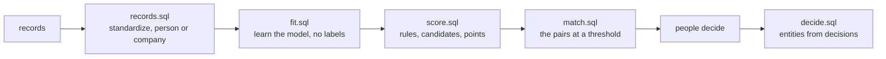

# nayose: entity resolution for Japanese customer records

nayose finds the customer records that belong to the same person or company. It reads names in katakana, addresses
in any format, the last four phone digits, customer IDs and birth dates, and it needs no labels. It never merges by
itself. It scores the pairs worth comparing, people decide the pairs above a threshold they set, and their decisions
make the entities.

The method is BigQuery SQL, one file per stage ([nayose/sql/](nayose/sql/)). BigQuery runs it as written. DuckDB runs
it on a laptop or in CI after sqlglot translates it. A run is a set of tables: a BigQuery dataset, or a DuckDB file.



## Setup

```bash
python3 -m venv .venv
.venv/bin/python -m pip install --upgrade pip
.venv/bin/python -m pip install -r requirements.txt
# Windows, in PowerShell: powershell -ExecutionPolicy Bypass -File setup_venv.ps1
```

This needs Python 3.12 or later. On Windows, write `.venv\Scripts\python` in place of `.venv/bin/python`.

## Data to try it on

```bash
.venv/bin/python scripts/generate.py   # data/medallion/bronze/{train,val,test}.parquet, their entities in data/labels/
```

The generator writes synthetic records from real names, companies and addresses, and records which entity each one
belongs to. [nayose/mapping.sql](nayose/mapping.sql) reads its columns. For a file with other columns, write a mapping
of your own, name it in `NAYOSE_MAPPING`, and list the columns it reads in `nayose/config.toml` `[input]`.

## The jobs

```bash
.venv/bin/python -m nayose build data/medallion/bronze/train.parquet --out workspaces/demo  # a run's first batch
.venv/bin/python -m nayose update data/medallion/bronze/val.parquet --out workspaces/demo    # a batch added to the run
.venv/bin/python -m nayose match --out workspaces/demo --threshold 6     # the pairs at 6 points or more: matched/points-6.parquet
.venv/bin/python -m nayose decide decided.parquet --out workspaces/demo  # the match table, its decisions filled in, applied
.venv/bin/python -m nayose lookup --out workspaces/demo --record 1234    # a stored record, looked up as if it were new
.venv/bin/python -m nayose lookup --out workspaces/demo FULL_NAME_KANA=ヤマダタロウ PHONE_NUM_4=1234
```

A run is a folder. It holds `run.duckdb` (the run's tables), `report.txt` (the run on one page, with no record's
value in it) and `matched/`. The match table has an empty `decision` column. Reviewers fill it in with `match` or
`no_match`, in a BigQuery table or a Sheet, and `decide` reads it back. The `gold` table gives each record its entity.

Each job prints one JSON object. Exit code 2 means a mistake that people fix, and the JSON's `fix` says how. Exit
code 75 means another job is writing the run, so try again later. On BigQuery, build, update, decide and match are
procedures of the run's dataset, and Jenkins calls them ([operations](docs/operations.md)).

## Tests

```bash
.venv/bin/python -m pytest -n auto
```

## The repository

| Path | Holds |
|---|---|
| `nayose/sql/` | the method: functions, records, fit, score, decide, match, lookup, report |
| `nayose/config.toml` | the values the SQL reads, a section a stage, and the generators and rules a run uses |
| `nayose/mapping.sql` | the input's columns as fields (each deployment has its own) |
| `nayose/__main__.py`, `__init__.py`, `reporting.py` | the jobs and the run's folder; each stage run with its values; report.txt |
| `nayose/engines.py` | DuckDB and BigQuery: the translation, the function twins |
| `nayose/procedures.py` | the deploy's statements: the functions, and one procedure a job |
| `nayose/em.py`, `entities.py`, `strings.js` | EM and connected components (Python UDFs); the comparisons in JavaScript |
| `config/` | `kind_names.npz` (the person-or-company name model), `generator.toml` (the synthetic data) |
| `deploy/` | the deploy to BigQuery, the Jenkinsfile, the Terraform |
| `scripts/`, `design/` | design time: generate, benchmark, estimate_cost, generator_quality, train_name_model; the generator and the metrics |
| `data/reference/` | public names, companies and addresses the generator reads |
| `reports/` | what the benchmark measured on synthetic data |
| `tests/` | the tests |

## Read next

| To | Read |
|---|---|
| see how it is built: every stage, table and engine | [architecture](docs/architecture.md) |
| understand each method, and why it is the one chosen | [the guide](docs/guide/01-entity-resolution-and-our-task.md) |
| deploy and run it on BigQuery | [operations](docs/operations.md) |
| run it by hand in the BigQuery console, no Python | [console](docs/console.md) |
| know what each stage costs | [performance](docs/performance.md) |
| check the numbers (synthetic data only) | [benchmark](reports/benchmark.md) |
| know where the data comes from | [data](docs/data.md) |
| change the code | [contributing](CONTRIBUTING.md) |
| see what comes next | [roadmap](docs/roadmap.md) |
