[← README](../README.md) · [Usage](usage.md) · [Guide](guide/01-entity-resolution-and-our-task.md)

# Architecture

Four views, from the outside in:

1. [Context](#1--context-two-loops): who uses the system, and what crosses its edges.
2. [Building blocks](#2--building-blocks): the parts of the repository, and which calls which.
3. [The run](#3--the-run): one file, step by step, with each step's code and cost.
4. [Data](#4--data): where every table lives, and for how long.

This page says how the system is built. Why each method was chosen is in the [guide](guide/01-entity-resolution-and-our-task.md); the measurements are in [results](results.md) and [performance](performance.md).

## 1 · Context: two loops



The system turns a file of customer records into one ID per person or company. It works in two loops:

- **Design time** happens once, and again whenever the matching changes. `scripts/generate.py` builds synthetic records from real names, companies and addresses, with the truth for each. `scripts/choose.py` tries each proposed change on them, keeps the ones the decision rule accepts, and writes the result to `config/final.toml`. This is the only loop that reads labels.
- **Run time** happens for every file, without labels. `scripts/resolve.py` runs `config/final.toml` on the file and writes a run folder. New records join that run later, with `--increment`, and people's decisions on the pairs just below the threshold go back with `--decisions`. `scripts/schedule.py` does both from an inbox, one file at a time.

`config/final.toml` is the only hand-off between the loops. It is plain TOML, so it can be read, diffed and edited by hand.

| Who | Does | Uses |
|---|---|---|
| data owner | maps the file's columns once, then runs the resolution | [usage](usage.md), `config/settings.toml` |
| reviewer | decides the pairs just below the threshold, audits those just above, checks the largest clusters | `review.parquet`, `qa.md`; gives back decisions |
| downstream system | takes one ID per person or company | `gold.parquet` |
| developer | proposes changes to the matching, and lets the decision rule judge them | `config/pipeline.toml`, `config/experiments.py`, `reports/choose.md` |

## 2 · Building blocks



| Part | Holds |
|---|---|
| `scripts/` | the entry points: generate, choose, resolve, schedule (serves an inbox through resolve), benchmark, export_pdfs |
| `er/` | the engine: every computation, tested. It names no column, except the synthetic generator (`er/generate.py`) |
| `config/` | every setting: `settings.toml` (paths, `[columns]`, `[locale]`, `[compute]`), `pipeline.toml` (the matching, in logical fields), `final.toml` (what was chosen), and for design time `generator.toml` and `experiments.py` |
| `data/` | records, labels, run folders and artifacts, all Parquet. Only `data/reference/` is in git; the scripts rebuild the rest |
| `reports/` | what `choose.py` and `benchmark.py` measured on synthetic data, kept in git; never real records |
| `notebooks/demo.ipynb` | every step of a run on 3,700 records, charted; no logic of its own |
| `tests/` | engine checks and whole runs, about 10 s |

**One engine.** `resolve.py`, `benchmark.py` and the demo all run `er.run.Run`. `choose.py` makes its decisions on pandas frames through `er.select`, which calls the same rule, key and model functions, and a test requires both paths to give the same gold. `choose.py` then writes each split's run folder through `er.run`.

**Where Splink sits.** Splink does the rules' joins, the model's training and scoring, and the clustering, on the run's DuckDB connection. Everything around it is the `er` package: candidate generation as SQL, budgets, u from the scored file, the threshold rule, decisions, evaluation.

**Configured for any file.** The engine reads logical fields only. `config/settings.toml` `[columns]` maps each field to the file's columns, and `[fields]` in the pipeline says which are mandatory and which optional. A missing optional field turns off only what reads it ([usage](usage.md#2--map-your-columns)).

### Moving to another SQL engine

The SQL is written to move: joins, group-bys, window functions and `CREATE TABLE … AS`. These pieces would need a counterpart elsewhere:

| Piece | Where | DuckDB form |
|---|---|---|
| character-level similarity (`cl_jaro_winkler`, `cl_levenshtein`, …) | `er.strings` | Python UDFs over Arrow (rapidfuzz); DuckDB's own compare bytes, and katakana is 3 bytes a character |
| one-character deletions of a value | `er.candidates` | `list_transform` + `unnest` |
| a pair's generators as bits | `er.candidates` | `bit_or`, `any_value` |
| the first rule that pairs two records | `er.match`, `er.run` | `DISTINCT ON`, `arg_min` |
| sampling whole postal areas for the fit | `er.run` | `ORDER BY hash(…)` |
| reading and writing files | `er.source`, `er.run` | `read_parquet(…, union_by_name = true)`, `COPY … (FORMAT parquet)`, `UNION ALL BY NAME` |
| standardization (NFKC, kana folding, the address chain) | `er.standardize` | pandas, per chunk: DuckDB has no NFKC |

Splink writes the training, scoring and clustering SQL for each engine it supports.

## 3 · The run


`er.run.Run` runs a chosen pipeline on one file, without labels. `full()` calls the steps below in order; `increment()` adds a batch of new records to a written run; the demo calls them one at a time. Each step logs its Big-O, with the numbers filled in, its time and its peak memory to `steps.json`.

| Mode | Cost |
|---|---|
| full run | `O(N·L + ΣP + C·K·L² + (N+E)·d)`, plus a fixed-size fit and u sample. Linear in N while every key keeps its pairs per record flat, which the budget checks |
| increment | `O(Δ·(L + Σb) + C_Δ·K·L²)`, plus narrow `O(N)` scans: the stored key columns, the exact u counts, gold rewritten. A comparison's u is sampled again, `O(S)`, only once its drift exceeds its sampling error. The joins start from the batch, so the expensive work follows Δ, not N |
| decisions | `O(D + touched clusters)`, plus `O(N)` to rewrite gold. Nothing is scored |

*N records · Δ records in a batch · L characters in a value · P pairs a key makes, b records in one key block · C candidate pairs · K comparisons · E accepted pairs · d the largest cluster's diameter. All symbols, and the measured times: [performance](performance.md#end-to-end-the-cost-of-every-step).*

### 1 · Load and standardize · `O(N·L)`

Opens the input through `er.source`, the one door every file goes through: it finds the Parquet files (a path, a glob or a folder), checks that each is Parquet, reads several together by column name, and uses a column whose name differs from the mapping only in case, width or separators. Then it checks the columns against `[fields]`: a missing mandatory field stops the run, with suggestions from the file's values; a missing optional one turns off what reads it. Records it can't resolve are set aside, with the reason: no ID, or one ID holding different records. Finally, in chunks of 200,000 records, it builds each logical field from its columns, and the normalized copies that keys and comparisons use: kana folded, legal forms removed, one key per address.

- **Why:** every later step compares values, so the same fact must be written the same way first. Chunks keep memory flat at any size. A mistake in the input either gets fixed and reported, or stops the run with what to fix: never a traceback.
- **Code:** `Run.load` → `source.open_source` (reads only each file's schema), `source.suggest` (a fixed-size sample), `settings.fit_to_file` → `config.check_fields`, `restrict`; `Run._set_aside`; `standardize.prepare`
- **Increment:** the batch only, `O(Δ·L)`. It first finishes any interrupted write. A record already stored is set aside, so a batch given twice adds nothing.

### 2 · Budget · `O(N)` per key

Counts the pairs each rule and each candidate generator would make, Σ C(b, 2) over its blocks, and its largest block, with one group-by each. If any would exceed 5 pairs per record, or a block of 5,000, the run stops (`OverBudget`).

- **Why:** a key that is too coarse, such as four phone digits alone, makes pairs that grow like N². Counting costs `O(N)`; the join it prevents would cost far more, in time and memory.
- **Code:** `Run.budget` → `candidates.estimate`
- **Increment:** inside step 5, and only for the blocks the batch's keys reach. The batch may make 2 × 5 pairs per record, the average a full run within budget gives a record (a pair has two records).

### 3 · Fit the model, without labels · `O(n + S·K + P_em·K)`, whatever N

Takes a fixed sample of 30,000 records, made of whole postal areas, and learns the Fellegi–Sunter model: λ, how likely two random records are to match, from near-certain rules; u, how often strangers agree at each level, counted exactly for the leading exact levels and from 10 million random pairs for the rest; m, how often true matches agree, by EM on pairs that share a phone or an address.

- **Why:** a real file has no labels, so the model learns from the data. A fixed sample keeps the cost flat at any size; whole postal areas keep a household's records together.
- **Code:** `Run.fit` → `match.train_fs` (Splink), `match.sample_u`, `exact_u`. A near-certain or learning rule that finds no pair in the sample (its field nearly empty) is skipped and named in the summary; with none left of either, the run stops with what to fix.
- **Increment:** no fit. It reads `state/model.json`, so every increment scores with the full run's model.

### 4 · Rules: the certain cases · `O(N + ΣP_r·L²) + O((N+E)·d)`

Each rule is one join on its exact keys; its fuzzy conditions (names within two edits, addresses by Jaro–Winkler, a phone one digit off, …) are checked on the joined pairs only. A pair belongs to the first rule that finds it. Stage by stage, exact then fuzzy, a pair is kept only if it touches a record still unresolved, and the kept pairs are clustered.

- **Why:** certain cases are cheap and auditable, and settle most duplicates without a false merge. The model then works only on what is left.
- **Code:** `Run.rules` → `match.rule_edges_table` (one Splink join per rule), `config.Stage.sql`, `strings.connect` (the character-level `cl_*` functions)
- **Increment:** each rule joins the batch against all records. Each stored cluster is merged as a single node (`Run._merge`): `O(Δ·Σb)` plus a scan.

### 5 · Candidates: which pairs to score · `O(N·L + ΣP_g)`

Lists the pairs worth scoring. Each generator is one SQL query:

| Generator | SQL | Cost |
|---|---|---|
| equal keys | a self-join | `O(N + P)` |
| one-character deletions of a name, within its postal area | each value and its deletions, unnested, then a self-join | `O(N·L + P)` |
| sorted neighbourhood | `lead()` over the sorted key, w − 1 times | `O(N log N + N·w)` |

Each generator sets one bit, so OR-ing the bits merges the lists and every pair keeps the names of the generators that found it. Pairs inside one rule cluster are dropped.

- **Why:** comparing every pair is impossible: 5 × 10¹¹ at a million records. The keys keep about 5 pairs per record, and `choose.py` checks that every true pair able to reach the threshold shares one.
- **Code:** `Run.candidates` → `candidates.candidates` (budget, run, merge) → `candidates.pairs_sql`
- **Increment:** the batch is the query, so only pairs touching it are listed: `O(Δ·Σb)` plus a scan.

### 6 · Score: evidence in bits · `O(N + S·K) + O(C·K·L²)`

Measures u again on this file, then scores every candidate: for each field, it finds the level the pair reaches (exact, close, different or missing) and adds that level's bits, log2(m/u), to the starting point.

- **Why:** how often strangers agree depends on the file's size, so u from a file of another size would weigh agreements wrongly. Bits add up, so every score can be explained field by field.
- **Code:** `Run.score` → `match.exact_u` (exact levels, from value counts), `scored_sample` (the rest, from S random pairs), `assemble_u`; `match.score_fs`, `scaled_prior` (λ at this file's size)
- **Increment:** `match.refreshed_u`. The exact levels are counted again on all records. A comparison's sampled u are measured again only once the drift of its exact level, since it was sampled, exceeds the sampling error of its most precise sampled level, 1/(ln 2·√hits) bits: before that, a new sample would only redraw the noise. Then only the pairs touching the batch are scored: `O(N + S·K_stale + C_Δ·K·L²)`.

### 7 · Cluster: from pairs to entities · `O(C + (N+E)·d)`

Accepts a pair at 6 bits or more, if it touches a record the rules left alone or joins two rule clusters, and if people haven't decided it is no match. Then it clusters the accepted pairs with the rules' pairs and the pairs people decided are a match (connected components), and records, for each record, its cluster, the stage that resolved it, and the rule (`fs` for the model, `review` for people). A cluster is named after its smallest record ID.

- **Why:** pairs must become entities: if A matches B and B matches C, all three are one. Recording what resolved each record makes every merge auditable, and naming a cluster by its smallest ID makes an increment name it as a full run would.
- **Code:** `Run.cluster` → `Run._accept` (the threshold; people's decisions, loaded by `Run._load_decisions` from `decisions/`), `Run._cluster` (Splink's connected components), `Run._gold`
- **Increment:** the stored gold is the base, each stored cluster one node, and stored answers stand: `O(C_Δ + touched clusters)`.

### 8 · Write the run folder · `O(N + C)`

Writes each table as Parquet under a temporary name. Once all are complete, it saves the renames still owed in `pending.json`, then does them.

- **Why:** an interruption must never leave half a run. A write cut before `pending.json` leaves the run as it was; one cut after it is finished by the next increment.
- **Code:** `Run.write`, `finish_writes`
- **Increment:** new parts of records, rule pairs and matches; gold and the rules' clusters rewritten: `O(Δ + C_Δ) + O(N)`.

### 9 · Report, for people · `O(review pairs)`

`scripts/resolve.py` writes `qa.md`, the label-free checks, and `review.parquet`, with the evidence for each pair ([usage](usage.md#6--review-and-decide)). Its *decide* rows are every pair of clusters whose best link scored in the threshold rule's safety margin: from the `[threshold]` grid point `margin_steps` below the threshold (4 bits) up to it. Its *audit* rows are about 50 accepted pairs up to 4 bits above it.

- **Why:** the margin holds pairs that were clean on cross-validated train, held back in case of noise: on the synthetic test split, 47 pairs, all true. Accepting them automatically would let false pairs through (1 out of fold at 4 bits), so people decide them. Without labels, the audit rows and the largest clusters are how a person catches over-merging.
- **Code:** `run.qa`, `review_floor`, `review_sheet`, `carry_over`; `pipeline.pattern_coverage` (match patterns no key guarantees)
- **Increment:** the same for the pairs the batch made, plus the previous sheet's rows still open: a run keeps no scores, so a row dropped from the sheet could never come back.

### Decisions · `O(D + touched clusters) + O(N)`

`scripts/resolve.py --decisions` gives people's decisions back to a written run, scoring nothing. Each `match` pair merges its two clusters, each cluster one node. A `no_match` pair splits nothing now, but a full run on the folder never accepts it.

- **Why:** people's work must change the answer at once, and must survive a full re-run. `decisions/` is not a run file, so `--overwrite` keeps it and the full run applies it again.
- **Code:** `Run.decide` (checks the file: the columns, the values, a pair decided both ways, IDs not in the run), `Run._merge`, `Run._stage`

## 4 · Data

### On disk

Every table is Parquet. The layout follows the medallion layers of the pipeline: bronze is the records as they arrive, silver the standardized records a run keeps, gold the resolved run. The reference data feeds only the synthetic generator, so it sits outside them.

```
data/reference/*.json                       public names, companies, addresses (in git; SOURCES.md)   generator input
data/medallion/bronze/<dataset>.parquet     records as they arrive                                    scripts/generate.py
data/labels/<dataset>.parquet               the truth, read only to choose and to evaluate            scripts/generate.py
data/medallion/gold/<dataset>/              a run folder per dataset; silver is its state/records/   scripts/choose.py, via er.run
data/artifacts/                             models, the leaderboard, Optuna studies, benchmark runs   scripts/choose.py, benchmark.py
```

`<dataset>` is `train`, `val` or `test`: one generated population, split by entity ([data](data.md)). `scripts/resolve.py` writes a run folder wherever `--output` says, in the same form.

### The run folder

Kept on disk. Steps are numbered as in [the run](#3--the-run).

| File | Written by step | Read by | Holds |
|---|---|---|---|
| `gold.parquet` | 8, rewritten each run and by decisions | you; the next increment | record → `cluster_id`, `resolved_stage`, `resolved_by` |
| `matches/part-n.parquet` | 8, one part per run | you | accepted pairs: weight, probability, generators |
| `rule_kept/part-n.parquet` | 8, one part per run | you | the rules' pairs |
| `state/records/part-n.parquet` | 8, one part per run | increments | the standardized records: the silver layer |
| `state/rule_clusters.parquet` | 8, rewritten each run | increments | record → rule cluster |
| `state/model.json` | 8, full runs only | increments | the fitted model: λ, and m and u per level |
| `state/scoring.json` | 8, every run | increments | the u the run scored with; per comparison, the exact u it was sampled alongside and its last drift check |
| `steps.json` | 8 | you | each step's Big-O with its numbers, time and peak memory |
| `pending.json` | 8, deleted when done | the next increment | renames owed by an unfinished write |
| `.lock` | every writer | every writer | the run folder's lock: one writer at a time |
| `jobs.jsonl` | `scripts/schedule.py` | people | one line per attempt: the file, its SHA-256, the outcome |
| `qa.md`, `review.parquet` | 9 | people | the label-free report; the pairs to decide and to audit |
| `decisions/part-n.parquet` | decisions, one part per file | full runs | the pairs people decided: both IDs and `match` or `no_match` |
| `set_aside/part-n.parquet` | 8, one part per run | you | records not resolved, and why: no ID; the same ID with different content; already in the run |

### While a run runs

Working tables live in DuckDB, in memory; past `[compute]` `memory_limit` they spill to `temp_directory`. All are dropped when the run ends.

| Table | Made by step | Used by | Holds |
|---|---|---|---|
| `records` | 1 | 2–9 | the standardized records: logical fields and keys |
| `set_aside`, `er_in` | 1 | 8 | records set aside, with the reason; the input with exact copies dropped, when something was off |
| `rule_edges`, `rule_kept`, `rule_clusters` | 4 | 5, 7 | every rule pair; the pairs the cascade kept; record → rule cluster |
| `cands` | 5 | 6, 7, 9 | candidate pairs, and the generators that found each |
| `scores` | 6 | 7, 9 | weight, probability, the level of each field |
| `matches`, `kept`, `clusters`, `gold` | 7 | 8, 9 | accepted pairs; all kept pairs; record → cluster; the answer |
| `er_decisions` | 7, or decisions | 7, 9 | people's decisions, from `decisions/` or the file given |
| `new_records`, `old_records`, `new_ids`, `touched`, `gold_old` | 1, 6, 7, increments only | 4–7 | the batch; a view over the stored records; the batch's IDs; the records its pairs touch; the stored gold |

The Python process holds only one chunk at a time (200,000 records), the fit sample (30,000) and the model.

## Editing the diagrams

The three diagrams are draw.io files: `architecture-context.drawio.svg`, `architecture-blocks.drawio.svg` and `architecture.drawio.svg`. Each is an SVG with the draw.io model inside, so GitHub shows it as an image, and draw.io (the desktop app, app.diagrams.net, or the Draw.io Integration extension for VS Code) opens it and rewrites both on save.
