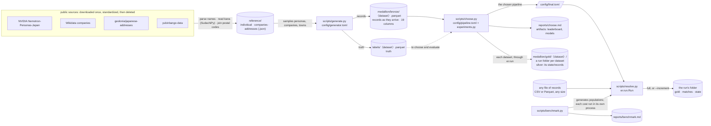

[← README](../README.md) · [Guide](guide/01-entity-resolution-and-our-task.md)

*Reference for the guide. The concepts are explained in [chapters 2–5](guide/02-the-same-fact-written-differently.md).*

# Architecture

## Roles

| Part | Role | Data size |
|---|---|---|
| `er/` | the engine: every computation, tested; names no column, except the synthetic generator (`er/generate.py`) | any |
| `config/` | every setting: `settings.toml` (paths, `[columns]`, `[locale]`, `[compute]`), `pipeline.toml` (the matching, in logical fields), `final.toml` (what was chosen), `generator.toml` and `experiments.py` (development only) | — |
| `scripts/` | the runs: generate, choose, resolve, benchmark, export | any |
| `notebooks/demo.ipynb` | a walkthrough that calls the engine one step at a time and charts each; no logic of its own | about 3,700 records, 25 s |
| `reports/` | what `choose.py` and `benchmark.py` measured on synthetic data, kept in git; never real records | — |
| `docs/` | the guide and these reference pages, citing `reports/` | — |

## How data moves

Each step reads only what the one before wrote. Truth is read only to choose and to evaluate, never by a run.

`〈dataset〉` ∈ `train`, `val`, `test`: one generated population, split by entity ([data.md](data.md)). The medallion
layers follow the pipeline: bronze is the records as they arrive, silver the standardized records a run keeps in its
folder's `state/records/`, gold the resolved run folder. The reference data feeds only the generator, so it sits outside
them. Every script reads
`config/settings.toml` through `er.settings.load_settings()`.

**Configured for any file.** `[columns]` maps each logical field to the file's columns: a list is a set of fallbacks
(the first filled one wins), an inner list is concatenated. `pipeline.toml` `[fields]` says which fields a run needs:
`id` is mandatory, at least one of `person_name` and `company_name` must be present, and an optional field that is
missing disables only the rules, generators and comparison levels that read it, which the run lists. A file with other
column names needs only `[columns]`; another language needs `[locale]`.

## A run, step by step

*The diagram is a draw.io file. Open `docs/architecture.drawio.svg` in draw.io (the desktop app, app.diagrams.net, or
the Draw.io Integration extension for VS Code) to edit it: it is an SVG with the draw.io model inside, so saving
rewrites both, and GitHub shows it as an image. Times are for a million generated records, measured before the latest
standardization fixes.*

`er.run.Run` runs a chosen pipeline on one file, without labels. `full()` calls its steps in order; `increment()` takes
a batch of new records into a written run; the demo calls them one at a time. Each step records its Big-O, with the
numbers filled in, its time and the peak memory, in `steps.json` ([performance.md](performance.md)).

| Mode | Cost | |
|---|---|---|
| full run | `O(N·L + ΣP + C·K·L² + (N+E)·d)`, plus a fixed fit and u sample | linear in N while every key keeps its pairs per record flat; a million records: 41 s, 4.5 GB |
| increment | `O(Δ·(L + Σb) + C_Δ·K·L²)`, plus the fixed u sample and scans of stored columns | its joins start from the batch, so the cost follows Δ, not N |

Functions without a module are in `er/run.py`. A full run refuses a folder that already holds a run, unless
`--overwrite`. `scripts/choose.py` writes the same folder for each labelled dataset, in `data/medallion/gold/<dataset>/`,
so the labelled splits and any other file are stored alike. A cluster is named after its smallest record id, so a
merge done by an increment names the cluster as a full run would.

### 1 · Load and standardize

`O(N·L) · 1M: 5.3 s`

**What happens.** Reads your file through DuckDB in chunks of 200,000 records. Checks its columns against the fields the pipeline needs: a missing mandatory field stops the run, and a missing optional field turns off only the rules, generators and levels that read it. Builds each logical field from the columns that hold it (the first filled one wins), then the normalized copies that keys and comparisons use: kana folding, legal forms removed, one key per address. Blank values and full-width spaces count as missing.

**Why here.** Every later step compares values for equality or similarity, so the same fact must be written the same way before anything is compared. Chunks keep memory flat whatever the file's size.

**Code:**
- `er/run.py` · `Run.load, source_sql`: read CSV or Parquet as text, chunk by chunk
- `er/settings.py` · `fit_to_file`: find which fields the file holds
- `er/config.py` · `check_fields, restrict`: stop on a missing mandatory field; disable what reads an absent one
- `er/standardize.py` · `prepare, normalize`: fallbacks between columns; every normalization

**Reads** your file; config/settings.toml [columns], [locale] · **Leaves** records

**In an increment.** Only the batch, into new_records: O(Δ·L). It first finishes any interrupted write (finish_writes), loads the stored model, and refuses records whose id is already in the run.

### 2 · Budget

`O(N) per key · 0.9 s`

**What happens.** For every rule and every candidate generator, counts the pairs its keys would create, Σ C(k, 2) over its blocks, and its largest block, with one group-by. Stops the run (OverBudget) if any would exceed 5 pairs per record, or a block of 5,000.

**Why here.** A key that is too coarse, such as four phone digits alone, makes pairs that grow with N². Counting costs O(N); the join it prevents would cost O(P), in time and memory.

**Code:**
- `er/run.py` · `Run.budget`: count every rule and generator; stop if one is over
- `er/candidates.py` · `estimate`: Σ C(k, 2) and the largest block, by group-by

**Reads** records; [budget] in config/final.toml · **Leaves** nothing but its counts, in steps.json

**In an increment.** Checked per generator inside step 5.

### 3 · Fit the model, without labels

`O(n + S·K + P_em·K) · 7.5 s, whatever N`

**What happens.** Takes a fixed-size sample, 30,000 records from whole postal areas, and learns the Fellegi–Sunter model: λ, how likely two random records are to match, from near-certain rules; u, how often strangers agree at each level, counted exactly for each comparison's leading exact levels and from 10 million random pairs for the rest; m, how often true matches agree, by EM on pairs that share a phone or an address.

**Why here.** Real data has no labels, so the model learns from the data itself. A fixed sample keeps the cost the same at any size, and whole postal areas keep a household's records together.

**Code:**
- `er/run.py` · `Run.fit`: draw the sample: whole postal areas, by hash
- `er/match.py` · `train_fs`: λ, u and m through Splink (random sampling, EM)
- `er/match.py` · `sample_u, exact_u`: u from a sample, or exactly from value counts

**Reads** records · **Leaves** the model, in memory; state/model.json at step 8

**In an increment.** No fit: it reads state/model.json, so every increment scores with the model of the full run.

### 4 · Rules: the certain cases

`O(N + ΣP_r·L²) + O((N+E)·d) · 3.3 s`

**What happens.** Runs each rule as one join on its exact keys, then checks its fuzzy conditions (character-level: names within two edits, company names by shared characters, addresses by Jaro–Winkler, a phone one digit off) on the joined pairs only. A pair takes the first rule that finds it. Stage by stage, exact then fuzzy, a pair is kept only if it touches a record still unresolved, and the kept pairs are clustered.

**Why here.** Certain cases are cheap and auditable: on test they settle about 70% of the duplicates with no false merge. The probabilistic stage then works only on what is left.

**Code:**
- `er/run.py` · `Run.rules, Run._cluster`: the cascade; clusters after each stage
- `er/match.py` · `rule_edges_table`: one Splink join per rule; the first rule wins
- `er/config.py` · `Stage.sql`: a rule as SQL: exact keys, then fuzzy conditions
- `er/strings.py` · `connect`: registers the character-level cl_* functions in DuckDB

**Reads** records · **Leaves** rule_edges, rule_kept, rule_clusters

**In an increment.** Each rule joins the batch against all records; the stored clusters are merged, each as a single node (Run._merge): O(Δ·Σb) + a scan.

### 5 · Candidates: which pairs to score

`O(N·L + ΣP_g) · 3.2 s`

**What happens.** Lists the pairs worth scoring. Each generator is one SQL query: equal keys (a self-join), one-character deletions of a name within its postal area (unnest, then join), or neighbours in sorted order (a window). Each generator sets one bit, and OR-ing the bits merges the lists, so every pair keeps the names of the generators that found it. Pairs inside one rule cluster are dropped.

**Why here.** Comparing every pair is impossible: 5 × 10¹¹ at a million records. These keys keep about 5 pairs per record, and scripts/choose.py checks that every true pair able to reach the threshold shares one of them.

**Code:**
- `er/run.py` · `Run.candidates`: call the generators on the records table
- `er/candidates.py` · `candidates`: budget each generator, run it, merge by bits
- `er/candidates.py` · `pairs_sql`: one generator as SQL: join, unnest or window

**Reads** records, rule_clusters · **Leaves** cands: each pair and its generators

**In an increment.** The batch is the query, so only pairs touching it are listed: O(Δ·Σb) + a scan.

### 6 · Score: evidence in bits

`O(N + S·K) + O(C·K·L²) · 18.9 s, about 8 s of it the fixed u sample`

**What happens.** Measures u again on this file, then scores every candidate. For each field it finds the level the pair reaches (exact, close, different or missing) and adds that level's bits, log2(m/u), to the starting point.

**Why here.** How often strangers agree depends on the file's size, so u from a file of another size weighs agreements wrongly: too few bits on a bigger file, too many on a smaller one. Bits add up, so every score can be explained field by field.

**Code:**
- `er/run.py` · `Run.score`: score every candidate pair
- `er/match.py` · `with_scored_u`: u on this file, cached by its fingerprint
- `er/match.py` · `score_fs, scaled_prior`: Splink scoring of the listed pairs; λ at this file's size

**Reads** records, cands, the model · **Leaves** scores: weight, probability, the level of each field

**In an increment.** u on all records, then only the pairs touching the batch: O(S·K + C_Δ·K·L²).

### 7 · Cluster: from pairs to entities

`O(C + (N+E)·d) · 0.4 s`

**What happens.** Accepts a pair at 6 bits or more if it touches a record the rules left alone or joins two rule clusters. Clusters the accepted pairs together with the rules' pairs (connected components), then records for each record its cluster, the stage that resolved it, and the rule, or fs for the model.

**Why here.** Pairs must become entities: if A matches B and B matches C, all three are one. Recording what resolved each record makes every merge auditable.

**Code:**
- `er/run.py` · `Run.cluster, _accept`: the threshold, and which pairs may join clusters
- `er/run.py` · `Run._cluster`: connected components through Splink
- `er/run.py` · `Run._gold`: cluster id (the smallest record id), stage, rule

**Reads** scores, cands, rule_kept, rule_clusters · **Leaves** matches, kept, clusters, gold

**In an increment.** The stored gold is the base and each stored cluster one node (_merge); stored answers stand: O(C_Δ + touched clusters).

### 8 · Write the run folder

`O(N + C) · 1.1 s`

**What happens.** Writes the tables as Parquet. Every file goes under a temporary name first; once all are complete, the renames still owed are saved in pending.json, then done.

**Why here.** Parquet is columnar and compact. Staging makes an interruption safe: the next increment finishes a write that was cut short, and one cut before pending.json left the run as it was.

**Code:**
- `er/run.py` · `Run.write`: COPY each table to a temporary Parquet file
- `er/run.py` · `finish_writes`: do the saved renames; also run first by every increment

**Reads** the tables above · **Leaves** the run folder (below)

**In an increment.** New parts of records, rule pairs and matches; gold and the rules' clusters rewritten: O(Δ + C_Δ) + O(N).

### 9 · Report, for people

`O(review pairs) and small group-bys`

**What happens.** scripts/resolve.py writes qa.md: the fill rate of each field, what was turned off, each step's cost, pairs by weight, cluster sizes, the 10 largest clusters, and patterns no key guarantees. And review.parquet: about 50 pairs near the line, with both records' compared fields and each field's level and bits.

**Why here.** Without labels, this is how a person checks a run: the largest clusters show over-merging, and the review sheet shows the borderline calls with the evidence behind each.

**Code:**
- `er/run.py` · `qa, review_sheet`: the label-free checks; the review sample
- `er/pipeline.py` · `pattern_coverage`: patterns able to reach the line with no guaranteed key
- `scripts/resolve.py` · `main`: runs everything, then writes qa.md and review.parquet

**Reads** records, scores, cands, gold · **Leaves** qa.md, review.parquet

**In an increment.** The same, after each increment.

### Where the data lives

Three places: the inputs you provide, working tables that exist only while a run runs, and the run folder that stays on
disk. Steps are numbered as above.

| Data | Where | Written by step | Read by | What it holds |
|---|---|---|---|---|
| **Inputs** | | | | |
| `Your file` | CSV or Parquet, anywhere | you | step 1 | the records to resolve |
| `config/settings.toml` | the repository | you | every step | [columns] maps fields to your columns; [locale]; [compute] sets memory |
| `config/final.toml` | the repository | scripts/choose.py | every step | rules, generators, comparisons and levels, threshold, budgets |
| **Working tables · DuckDB, in memory, spilled to [compute] temp_directory past memory_limit, dropped at the end** | | | | |
| `records` | DuckDB | 1 | 2 to 9 | standardized records: logical fields and keys |
| `rule_edges · rule_kept · rule_clusters` | DuckDB | 4 | 5, 7 | every rule pair; those the cascade kept; record → rule cluster |
| `cands` | DuckDB | 5 | 6, 7, 9 | candidate pairs and the generators that found them |
| `scores` | DuckDB | 6 | 7, 9 | weight, probability, the level of each field |
| `matches · kept · clusters · gold` | DuckDB | 7 | 8, 9 | accepted pairs; all kept pairs; record → cluster; the answer |
| `new_records · old_records · new_ids · touched · gold_old` | DuckDB, increments only | 1, 6, 7 | 4 to 7 | the batch; a view over the stored records; the batch's ids; records its pairs touch; the stored gold |
| **Run folder · Parquet on disk, kept** | | | | |
| `gold.parquet` | run folder | 8, rewritten each time | you; the next increment | record → cluster_id, resolved_stage, resolved_by |
| `matches/part-n.parquet` | run folder | 8, one part per run | you | accepted pairs: weight, probability, generators |
| `rule_kept/part-n.parquet` | run folder | 8, one part per run | you | the rules' pairs |
| `state/records/part-n.parquet` | run folder | 8, one part per run | increments | standardized records to join against: the silver layer |
| `state/rule_clusters.parquet` | run folder | 8, rewritten each time | increments | record → rule cluster |
| `state/model.json` | run folder | 8, full runs only | increments | the fitted model: λ, m, u per level |
| `steps.json` | run folder | 8 | you | each step's Big-O with its numbers, time and peak memory |
| `pending.json` | run folder | 8, deleted when done | the next increment | renames owed by an unfinished write |
| `qa.md · review.parquet` | run folder | 9 | people | the label-free report; the pairs to review |
| **Python process** | | | | |
| `a chunk, the fit sample, the model` | memory | 1, 3 | 1 to 6 | 200,000 records at a time; 30,000 for the fit; small summaries |

**Where Splink sits.** Splink does the rules' joins, the training, the scoring and the clustering, on the run's DuckDB
connection. Everything around it is the `er` package: candidate generation as SQL, budgets, u from the scored file and
from value counts, the threshold rule, decisions, evaluation.

`scripts/choose.py` runs the same engine on pandas frames for the labelled decisions, through `er.select`. The rules
stage hands its results to the Fellegi–Sunter stage in memory, and a test requires both engines to give the same gold:
`RulesChooser` and `FSChooser` hold every design analysis, A/B, decision, cost check and test scoring. Both Optuna
studies are off by default (`enabled=False` in `config/experiments.py`): their adopted suggestions are written as
changes, and later searches found nothing that passed the decision rule. `--optuna` turns them on; they are stored in
SQLite (`artifacts/optuna/*.db`), and optuna-dashboard reads them live.

## The `er` package

| Step | Question | Module | Output |
|---|---|---|---|
| Configure | which columns hold which field, what does the pipeline need? | `er.settings`, `er.config` | typed settings and pipeline |
| Standardize | logical fields from their sources, normalized copies | `er.standardize` | prepared records |
| Candidates (blocking) | which pairs are worth comparing? | `er.candidates` | candidate pairs, with the generators that found them |
| **Entity matching** | are these two records the same entity? | `er.match` | accepted / scored pairs |
| **Entity resolution** | which records form one entity? | `er.resolve`, `er.pipeline.cascade` | clusters |
| Run | all of it on one file, without labels, full or incremental | `er.run` | the run's folder |
| Choose | which configuration, by the decision rule? | `er.select`, `er.pipeline` | `config/final.toml`, `reports/choose.md` |
| Evaluation | how good, how sure, at what cost? | `er.evaluate` | metrics with intervals, Big-O, seconds |

`er.generate` (the synthetic population), `er.strings` (character-level functions and the DuckDB connection),
`er.io` (datasets, final configurations, leaderboard, test counter, report tables), `er.tune` (Optuna helpers).

**Matching vs resolution:**
- **Matching** decides pair by pair:
  - rule stages accept a pair automatically when every condition of one rule holds
  - the probabilistic stage accepts a pair when its Fellegi–Sunter match weight reaches the threshold
- **Resolution** turns accepted pairs into entities:
  - `connected_components`: transitive; A–B and B–C make one entity
  - `constrained`: refuses a merge whose clusters hold different values in a cannot-link column
- **Metrics:** `pairs_*` measure the accepted pairs; the others measure the clusters (pairwise, B-cubed, over-merged, split).

**Cascade:** a rule stage adds pairs only where at least one record is still unresolved, so leftovers can join
existing clusters. The probabilistic stage may also join two clusters the rules formed (`FSSpec.bridge`): it scores
every pair across two clusters, so an entity the rules split in two can still be joined. Metrics are cumulative.

**Blocking:**
- **Rules:** each rule is a join on its exact keys. Fuzzy conditions run only on the joined pairs, so a rule costs
  `O(N + P)`, with P = Σ C(k, 2) over its key blocks. `budget` counts P per rule on the file before any join and stops
  the run if a rule is over `max_pairs_per_record` × N.
- **Probabilistic stage:** `er.candidates` turns each generator into SQL on the records table and merges their pairs,
  each generator one bit. Pairs inside one rule cluster are dropped; Splink scores exactly that list.

  | Generator | SQL | Cost |
  |---|---|---|
  | keys (`KeyBlocker`) | a self-join on equal keys | `O(N + P)` |
  | one-deletion keys (`DeletionKeys`) | each value and its one-character deletions, unnested, then a self-join | `O(N·L + P)` |
  | sorted neighbourhood | `lead()` over the sorted key, w − 1 times | `O(N log N + N·w)` |
  | TF-IDF (defined, not chosen) | pandas, brute-force cosine | `O(U·N·q)` |

  A key whose values come from a fixed pool pairs a share of the records that grows with the file: the last four
  phone digits (10,000 values), an address shared by a household. So in `FINAL` no such field is a key alone; each is
  combined with another (phone and prefecture, address and phone, address and the name's first letter). Most of them
  then grow like N; the slowest-diluted, phone with the name's first letter, makes 2.0 pairs per record at a million
  records, inside the budget of 5 (`er.pipeline.scale_check`). A sorted window reaches fewer pairs as the file grows, so `choose.py` stops if a true
  pair that could reach the threshold shares no key, at train's size or at `target_rows`
  (`er.pipeline.window_only`; [chapter 3](guide/03-far-too-many-pairs.md#keeping-every-potential-match)). On val,
  `FINAL`'s 17 generators list 49,987 candidates; the two person-name sorted passes make 45,020 of them.

**Character vs byte:** DuckDB's `jaro_winkler_similarity`, `jaccard` and `damerau_levenshtein` compare UTF-8 bytes,
and katakana is 3 bytes per character. That scores サトウヒロシ / サトウタカシ at 0.897 instead of 0.844.
`er.strings.connect()` registers character-level rapidfuzz versions (`cl_*`); every rule and every Fellegi–Sunter
level uses them. `connect()` checks them on every start, and so does `tests/`.

## Porting to another SQL engine

The SQL is written to move: joins, group-bys, window functions and `CREATE TABLE … AS`. What would need a
counterpart elsewhere:

| Piece | Where | DuckDB form |
|---|---|---|
| character-level similarity (`cl_jaro_winkler`, `cl_levenshtein`, …) | `er.strings` | Python UDFs over Arrow (rapidfuzz) |
| one-character deletions of a value | `er.candidates` | `list_transform` + `unnest` |
| a pair's generators as bits | `er.candidates` | `bit_or`, `any_value` |
| the first rule that pairs two records | `er.match`, `er.run` | `DISTINCT ON`, `arg_min` |
| sampling whole postal areas for the fit | `er.run` | `ORDER BY hash(…)` |
| reading and writing files | `er.run` | `read_csv`, `read_parquet`, `COPY … (FORMAT parquet)`, `UNION ALL BY NAME` |
| standardization (NFKC, kana folding, the address chain) | `er.standardize` | pandas, per chunk: DuckDB has no NFKC. Both pandas' Arrow strings and DuckDB use RE2, whose `\s` doesn't match the full-width space, so the patterns name it |

Splink generates the training, scoring and clustering SQL for each of the engines it supports.
