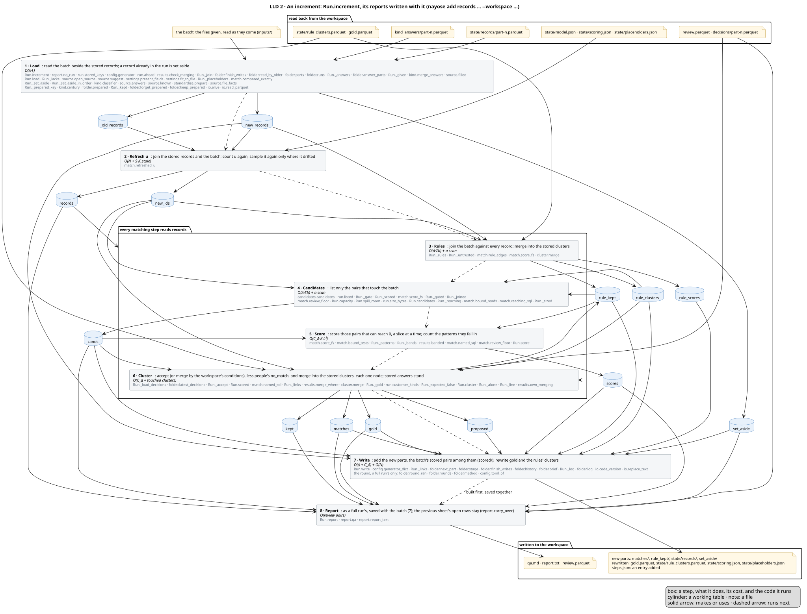
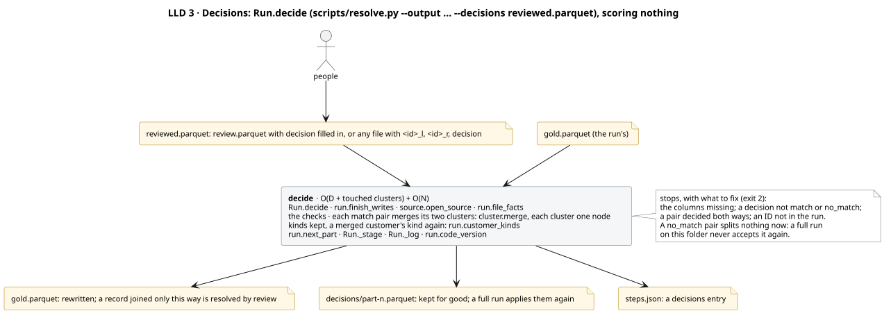
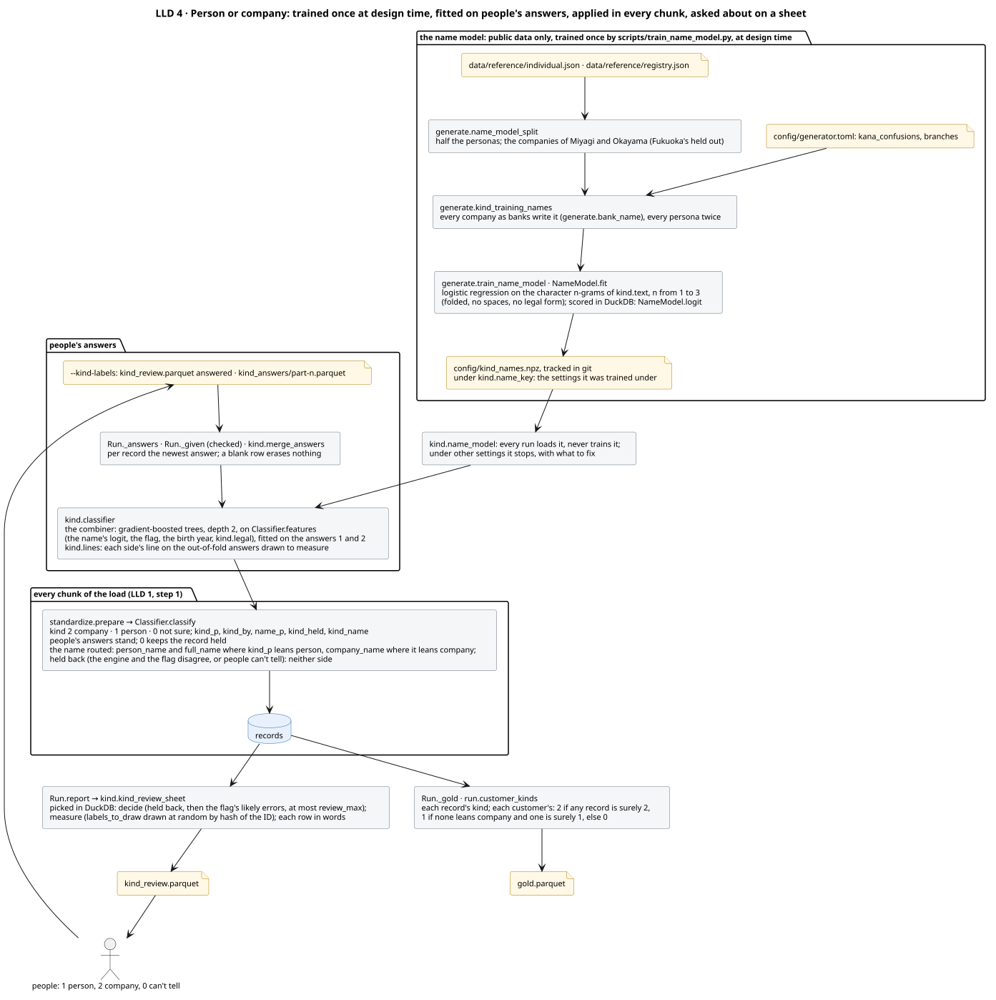

[← README](../README.md) · [Usage](usage.md) · [Guide](guide/01-entity-resolution-and-our-task.md)

# Architecture


Above, the whole system on one page. Below, a high-level design (HLD) in three C4 views, from the outside in, then a low-level design (LLD) of every flow and every file. Each diagram has a legend: in the LLD a box is a step (what it does, its cost, and in grey the code it runs), a cylinder a working table and a note a file; a solid arrow makes or uses, a dashed one runs next, and an arrow into a group stands for one to each step in it.

| | View | Shows |
|---|---|---|
| HLD | [1 · Context](#1--context-two-loops) | who uses the system, and what crosses its edges |
| | [2 · Containers](#2--containers) | the entry points, the engine and every store |
| | [3 · Components](#3--components) | every module of `er/` and every import between them |
| LLD | [4 · The run](#4--the-run) | a full run, step by step: each step's functions, the tables it makes and uses, its cost |
| | [5 · An increment](#5--an-increment) | new records added to a written run |
| | [6 · Decisions](#6--decisions) | people's decisions applied, scoring nothing |
| | [7 · Person or company](#7--person-or-company) | the name model, people's answers, the routing, the sheet |
| | [8 · Data](#8--data) | every file of a run folder with its columns, and every working table |

Every diagram is the contract: `tests/test_design.py` checks it against the code and fails with what to draw or remove ([the diagrams](#the-diagrams-source-and-checks)). Why each method was chosen is in the [guide](guide/01-entity-resolution-and-our-task.md); the measurements are in [results](results.md) and [performance](performance.md).

## 1 · Context: two loops


The system turns a file of customer records into one ID per person or company. It works in two loops:

- **Design time** happens once, and again whenever the matching changes. `scripts/generate.py` builds synthetic records from real names, companies and addresses, with the truth for each. `scripts/choose.py` tries each proposed change on them, keeps the ones the decision rule accepts, and writes the result to `config/final.toml`. `scripts/choose_kind.py` measures every way to tell persons from companies across the unknowns; the combination in `config/pipeline.toml` `[kind]` is set from its report. This is the only loop that reads the truth (`data/labels/`).
- **Run time** happens for every file, without labels. `scripts/resolve.py` runs `config/final.toml` on the file and writes a run folder. New records join that run later, with `--increment`; people's decisions on the pairs just below the threshold go back with `--decisions`, and their person/company answers with `--kind-labels` on a full run. `scripts/schedule.py` does both from an inbox, one file at a time.

`config/final.toml` and `config/kind_names.npz` are the hand-off between the loops. `final.toml` is plain TOML, so it can be read, diffed and edited by hand. `kind_names.npz` is the person-or-company name model, trained by `scripts/train_name_model.py` from `data/reference/` and two settings of `config/generator.toml` (`kana_confusions`, `branches`); a run only loads it, so no change to the synthetic-data generator reaches a run until the model is trained again and committed.

| Who | Does | Uses |
|---|---|---|
| data owner | maps the file's columns once, then runs the resolution | [usage](usage.md), `config/settings.toml` |
| reviewer | decides the pairs just below the threshold, audits those just above, checks the largest clusters; answers person or company for the records held back and those drawn to measure | `review.parquet`, `kind_review.parquet`, `qa.md`; gives back decisions and answers |
| downstream system | takes one ID per person or company | `gold.parquet` |
| developer | proposes changes to the matching, and lets the decision rule judge them | `config/pipeline.toml`, `config/experiments.py`, `reports/choose.md`, `reports/choose_kind.md` |

## 2 · Containers


| Part | Holds |
|---|---|
| `scripts/` | the entry points: generate, choose, choose_kind, resolve, schedule (serves an inbox through resolve), benchmark, export_pdfs |
| `er/` | the engine: every computation, tested. It names no column, except the synthetic generator (`er/generate.py`) |
| `config/` | every setting: `settings.toml` (paths, `[datasets]`, `[columns]`, `[locale]`, `[compute]`, `[kind]`), `pipeline.toml` (the matching, in logical fields), `final.toml` (what was chosen), and for design time `generator.toml` and `experiments.py` |
| `data/` | records, labels, run folders and artifacts, all Parquet. Only `data/reference/` is in git; the scripts rebuild the rest |
| `reports/` | what `choose.py`, `choose_kind.py` and `benchmark.py` measured on synthetic data, kept in git; never real records |
| `notebooks/demo.ipynb` | every step of a run on 3,758 records, charted; no logic of its own |
| `docs/diagrams/` | the diagrams on this page, as PlantUML |
| `tests/` | engine checks, whole runs, and the design's checks |

**One engine.** `resolve.py`, `benchmark.py`, the demo and `choose.py` all run `er.run.Run`. `choose.py` measures each configuration by running it (`er.pipeline.run_rules`, `run_fs`: the run's steps up to its clusters, nothing written) and joining the run's tables to the truth, so it judges exactly what runs, with the same gate on oversized blocks and the same untrusted values. It then writes each split's run folder through `er.run`.

**Where Splink sits.** Splink does the model's training and scoring, and the clustering, on the run's DuckDB connection. Everything around it is the `er` package: the rules' joins and candidate generation as SQL, budgets, u from the scored file, the threshold rule, decisions, evaluation ([what we take from Splink, and why the rest is ours](#what-we-take-from-splink-and-what-we-do-ourselves)).

**Configured for any file.** The engine reads logical fields only. `config/settings.toml` `[columns]` maps each field to the file's columns, and `[fields]` in the pipeline says which are mandatory and which optional. A missing optional field turns off only what reads it ([usage](usage.md#2--map-your-columns)).

### Moving to another SQL engine

The SQL is written to move: joins, group-bys, window functions and `CREATE TABLE … AS`. These pieces would need a counterpart elsewhere:

| Piece | Where | DuckDB form |
|---|---|---|
| character-level similarity (`cl_jaro_winkler`, `cl_levenshtein`, …) | `er.strings` | Python UDFs over Arrow (rapidfuzz); DuckDB's own compare bytes, and katakana is 3 bytes a character |
| one-character deletions of a value | `er.candidates`, `er.match` | `list_transform` + `unnest` |
| a pair's generators as bits | `er.candidates` | `bit_or`, then a `CASE` per bit |
| the first rule that pairs two records | `er.match`, `er.run` | `DISTINCT ON`, `arg_min` |
| sampling whole postal areas for the fit | `er.run` | `ORDER BY hash(…)` |
| reading and writing files | `er.source`, `er.run` | `read_parquet(…, union_by_name = true)`, `COPY … (FORMAT parquet)`, `UNION ALL BY NAME` |
| standardization (NFKC, kana folding, the address chain) | `er.standardize` | pandas, per chunk: DuckDB has no NFKC |

Splink writes the training, scoring and clustering SQL for each engine it supports.

### What we take from Splink, and what we do ourselves

Splink 5 was read against this code, and each overlap measured on the same data, with the same output both ways.

| Job | Ours or Splink's | Why |
|---|---|---|
| training (λ, EM), scoring, connected components | Splink's | its job; pairs are scored through `register_blocked_pairs_for_predict`, Splink 5's path for given pairs, which also prunes the records read |
| the rules' joins | ours, plain SQL | `deterministic_link` gives the same pairs but first joins every column of both records back: 1.35× slower at a million records, 17× at 10,000. Splink has no cascade (a later stage adding a pair only for a record still unresolved) |
| merging the generators' pairs | ours | 1.56× faster at a million records, and every generator that found a pair is kept (`sources`); Splink keeps the first. Sorted windows aren't Splink blocking rules |
| counting a key's pairs before any join | ours | one group-by, 5–6× faster than Splink's exact count |
| threshold curves | ours | the same counts as Splink's truth-space table at every weight, faster, and with folds, bounds and the name check, none of which Splink has |
| cluster metrics, intervals, the paired test | ours | Splink has no cluster-level accuracy |
| λ at the file's size, exact u from value counts | ours | Splink has neither; a 10⁷-pair sample can't see an agreement rarer than one in 10⁹ pairs |
| increments: merging into stored clusters, stable names | ours | Splink 5 has no incremental clustering; `predict_between`, which replaced `find_matches_to_new_records`, scores only |
| string similarity | ours (`cl_*`) | DuckDB's built-ins, which Splink's comparison libraries call, compare bytes: タナカ / タカナ get Jaro–Winkler 0.956 from them, 0.556 by character |

Not used, and why: chunked prediction (refuses given pairs, and only bounds memory); salting (ignored in Splink 5); Parquet materialisation (1.05–1.67× slower here); `cluster_using_single_best_links` (for sources without duplicates); `DateOfBirthComparison` (birth dates that aren't dates, and no extra true pair); m from people's review decisions (rows chosen by their score bias m by up to 3.8 bits; the decisions are applied as merges instead).

## 3 · Components


Every module sits in one layer: the tools, design time, the run (`er/run.py`, the steps of a run; `er/folder.py`, the run folder on disk; `er/report.py`, the reports for people), the steps, and the foundation. Each layer imports only the layers below it; `tests/test_design.py` fails on an import that goes up or across.

## 4 · The run


`er.run.Run` runs a chosen pipeline on one file, without labels. `full()` calls steps 1–8 in order and holds the run folder's lock throughout, so no other job writes in between; given the pipeline file (`scripts/resolve.py` gives it), step 8 builds step 9's reports first and writes them with the run's files. The lock (`flock`) and the renames that finish a write (`os.replace`) hold on a local disk, not on network or object storage. `increment()` adds a batch of new records to a written run ([5](#5--an-increment)); the demo calls the steps one at a time. Each step logs its Big-O, with the numbers filled in, its time and its peak memory to `steps.json`.

| Mode | Cost |
|---|---|
| full run | `O(N·L + ΣP + C·K·L² + E·d)`, plus a fixed-size fit and u sample. Linear in N while every key keeps its pairs per record flat, which the budget checks |
| increment | `O(Δ·(L + Σb) + C_Δ·K·L²)`, plus narrow `O(N)` scans: the stored records read into one table, the exact and one-edit u counts, gold rewritten. A comparison's u is sampled again, `O(S)`, only once its drift exceeds its sampling error. The joins start from the batch, so the expensive work follows Δ, not N |
| decisions | `O(D + touched clusters)`, plus `O(N)` to rewrite gold. Nothing is scored |

*N records · Δ records in a batch · L characters in a value · P pairs a key makes, b records in one key block · C candidate pairs · K comparisons · E accepted pairs · d the largest cluster's diameter. All symbols, and the measured times: [performance](performance.md#end-to-end-the-cost-of-every-step).*

### 1 · Load and standardize · `O(N·L)`

Opens the input through `er.source`, the one door every input file goes through, people's answers and decisions included: it finds the Parquet files (a path, a glob or a folder), checks that each is Parquet, reads several together by column name, and uses a column whose name differs from the mapping only in case, width or separators. Then it checks the columns against `[fields]`: a missing mandatory field stops the run, with suggestions from the file's values; a missing optional one turns off what reads it, and a file that turns off every rule or every candidate generator stops the run. Records it can't resolve are set aside, with the reason: no ID, or one ID holding different records. Finally, in chunks of 200,000 records, it builds each logical field from its columns, each record's kind ([7](#7--person-or-company)), and the normalized copies that keys and comparisons use: kana folded, legal forms removed, one key per address.

- **Why:** every later step compares values, so the same fact must be written the same way first. Chunks keep memory flat at any size. A mistake in the input either gets fixed and reported, or stops the run with what to fix (exit code 2): never a traceback.
- **Code:** `Run.load` → `source.open_source` (reads only each file's schema), `source.suggest` (a fixed-size sample), `settings.fit_to_file` → `config.check_fields`, `restrict`; `Run._set_aside`; people's answers through `Run._answers`, `Run._given` → `source.answers`, and `source.known` (every ID a record of the file, the same check as decisions'); `kind.classifier`; `standardize.prepare`
- **Increment:** the batch only, `O(Δ·L)`. It first finishes any interrupted write. A record already stored is set aside, so a batch given twice adds nothing. The stored records and the batch then form one table, `records`, which every later step reads.

### 2 · Budget · `O(N)` per key

Counts the pairs each rule and each candidate generator would make, Σ C(b, 2) over its blocks, its largest block, and its **oversized** blocks, with one group-by each. A block is oversized when it has more pairs than a check sample (`[budget] sample_pairs`, 2,000): 64 records or more sharing one value. Such a block is never joined blind: a generator checks it on a sample first (step 5), and a rule doesn't trust its value (step 4). The run stops only if the pairs of the normal blocks alone would not fit in memory and the room DuckDB may spill to (about 350 bytes a pair), naming the largest contributors. That room is DuckDB's own cap: 90% of the temp disk's free space, unless `max_temp_directory_size` sets a size.

- **Why:** the work after this step is per pair, and a block's pairs grow with the square of its size. A block's share of true matches falls as it grows, and a placeholder's block (a dummy phone) holds none. Counting costs `O(N)`; the joins it steers cost far more.
- **Code:** `Run.budget` → `candidates.estimate`; `Run.capacity` (memory limit + spill room)
- **Increment:** no budget step. Inside step 5, the oversized blocks the batch's keys reach are checked on a sample, and only they are held to the room; the normal blocks' pairs all touch the batch.

### 3 · Fit the model, without labels · `O(n + S·K + P_em·K) + O(N + S·K)`

Takes a fixed sample of 30,000 records, made of whole postal areas (by the ID's hash when the file has no postal code), and learns the Fellegi–Sunter model: λ, how likely two random records are to match, from near-certain rules; m, how often true matches agree, by EM on pairs that share a phone or an address. EM also needs u, how often strangers agree at each level: on the sample, counted as below where it can be and from 10⁶ random pairs for the rest (`fit_u_max_pairs`). These feed only EM. Then it measures u on the whole file, because how often strangers agree depends on the file's size, so u from the sample would weigh agreements wrongly:

- the leading exact levels are counted from value counts;
- a one-edit level right after them on the same column (the customer ID, phone or birth date one digit off) is counted exactly too: the distinct values are joined on their one-character deletions, which two values one edit apart always share, and the distance is checked on those value pairs only. So cif, phone and birth need no sample;
- the other levels, of name, company and address, come from 10⁷ random pairs, every one of them.

The gate on oversized blocks (step 5) and the scores (step 6) both use these u.

- **Why:** a real file has no labels, so the model learns from the data. A fixed sample keeps the cost flat at any size; whole postal areas keep a household's records together. A sample of 10⁷ pairs can't see an agreement rarer than one in 10⁹ pairs, such as two customer IDs one digit apart in a big file; a count can.
- **Code:** `Run.fit` → `match.train_fs` (Splink), `exact_u` (value counts and one-deletion keys), `counted` (the comparisons that need no sample), `scored_sample` (u by random sampling, cached per comparison and the values it reads, so within one process a model's variants share one sample), `assemble_u`, `u_basis`. A near-certain or learning rule that finds no pair in the sample (its field nearly empty) is skipped and named in the summary; with none left of either, the run stops with what to fix.
- **Increment:** no fit. It reads `state/model.json`, so every increment scores with the full run's model, and settles its u before the rules, as a full run does: `match.refreshed_u`. The exact and one-edit levels are counted again on all records. A comparison's sampled u are measured again only once the drift of its exact level, since it was sampled, exceeds the sampling error of its most precise sampled level, 1/(ln 2·√hits) bits: before that, a new sample would only redraw the noise. `O(N + S·K_stale)`.

### 4 · Rules: the certain cases · `O(N + ΣP_r·L²) + O(E·d + N)`

Each rule is one join on its exact keys; its fuzzy conditions (names within two edits, addresses by Jaro–Winkler, a phone one digit off, …) are checked on the joined pairs only. A pair belongs to the first rule that finds it. Stage by stage, exact then fuzzy, a pair is kept only if it touches a record still unresolved, and the kept pairs are merged into the rule clusters, each cluster one node.

- **Why:** certain cases are cheap and auditable, and settle most duplicates without a false merge. The model then works only on what is left.
- **Code:** `Run.rules` → `Run._rules` → `match.rule_edges` (one plain SQL join per rule, the same for `choose.py`, full runs and increments: Splink's `deterministic_link` would join every column of both records back first), `config.Stage.sql` (a fuzzy condition lets equal values through without the string function), `strings.connect` (the character-level `cl_*` functions), `cluster.merge`. A rule leaves out any value of its keys held by an oversized block (`Run._untrusted`): one customer ID on 3,000 records is not one customer's, so the summary names it, and the model can still match those records.
- **Increment:** each rule joins the batch against all records. Each stored cluster is merged as a single node (`cluster.merge`): `O(Δ·Σb)` plus a scan.

### 5 · Candidates: which pairs to score · `O(N·L + ΣP_g)`

Lists the pairs worth scoring. Each generator is one SQL query:

| Generator | SQL | Cost |
|---|---|---|
| equal keys | a self-join | `O(N + P)` |
| one-character deletions of a value (a company name, a customer ID; a person's name within its postal area, a birth date within its prefecture) | each value and its deletions, unnested once per call into a table that the count, the join and the sample read, then a self-join | `O(N·L + P)` |
| sorted neighbourhood | `lead()` over the sorted key, w − 1 times | `O(N log N + N·w)` |

Only pairs that touch a record the rules left alone are listed (with `[model] bridge`, every pair across two rule clusters too). Each generator sets one bit, so OR-ing the bits merges the lists and every pair keeps the names of the generators that found it.

Oversized blocks are left out of each generator's join, then checked: about 2,000 pairs among 64 of the block's records, chosen by hash, minus those another block already listed, are scored as the candidates will be: with the model and the file's u (step 3). A block with a sampled pair at the review floor (6 bits) or above is joined in full; one without is skipped, and the summary and `qa.md` name it with its sample. No hit in 2,000 pairs bounds a block's yield under 0.15%. If the kept blocks would not fit, the highest-yield ones go first.

- **Why:** comparing every pair is impossible: 5 × 10¹¹ at a million records. `choose.py` holds each key to at most 5 pairs per record at a million records (`[budget] max_pairs_per_record`), and checks that every true pair able to reach the threshold shares one. Checking a big block on a sample costs at most what joining it would, and tells a placeholder from a real shared value without guessing.
- **Code:** `Run.candidates` → `candidates.candidates` (run, gate, merge) → `Records.variants` (the deletion keys), `candidates.oversized`, `pairs_sql`, `sample_sql`, `_gate`; `Run._gate` scores the sample, `Run._gated` keeps what it decided
- **Increment:** the batch is the query, so only pairs touching it are listed, and the deletion keys are kept only for the blocks the batch reaches: `O(Δ·Σb)` plus a scan.

### 6 · Score: evidence in bits · `O(C·K·L²)`

Scores every candidate, with the u step 3 measured on this file: for each field, it finds the level the pair reaches (exact, close, different or missing) and adds that level's bits, log2(m/u), to the starting point.

- **Why:** bits add up, so every score can be explained field by field.
- **Code:** `Run.score` → `match.score_fs`, `scaled_prior` (λ at this file's size)
- **Increment:** only the pairs touching the batch are scored, on the records they touch (`touched`): `O(C_Δ·K·L²)`.

### 7 · Cluster: from pairs to entities · `O(C + E·d + N)`

Accepts a pair at 8 bits or more (`[model] min_match_weight`), if it touches a record the rules left alone (with `[model] bridge`, also if it joins two rule clusters), if a name was compared (`[model] needs`: the person names or the company names, filled on both sides), and if people haven't decided it is no match. Then it clusters the accepted pairs with the rules' pairs and the pairs people decided are a match (connected components: a run refuses a pipeline that asks for another resolver), and records, for each record, its cluster, the stage that resolved it, and the rule (`fs` for the model, `review` for people), with its kind and its customer's ([7](#7--person-or-company)). A cluster is named after its smallest record ID.

- **Why:** pairs must become entities: if A matches B and B matches C, all three are one. Recording what resolved each record makes every merge auditable, and naming a cluster by its smallest ID makes an increment name it as a full run would. A household shares address and phone, and those two alone reach the threshold; so do a person and a company at one address. Without a name compared, people decide.
- **Code:** `Run._load_decisions` (people's decisions, from `decisions/`), `Run.cluster` → `Run._accept` (the threshold, `match.named_sql`), `cluster.merge` (Splink's connected components over the clusters the pairs touch only, each rule cluster one node, as in an increment), `Run._gold` (`run.customer_kinds`), `Run._expected_false`
- **Increment:** the stored gold is the base, each stored cluster one node, and stored answers stand: `O(C_Δ + touched clusters)`.

### 8 · Write the run folder · `O(N + C)`

Writes each table as Parquet under a temporary name, with the reports (9). Once all are complete, it saves the moves still owed in `pending.json`, then does them; `steps.json` too is written whole, then renamed. A full run writes into `.full.tmp/`, and its moves replace the old run's files only then: an overwrite cut short leaves the old run, people's answers included.

- **Why:** an interruption must never leave half a run. A write cut before `pending.json` leaves the run as it was; one cut after it is finished by the next run, increment or set of decisions. A run lands with its reports or not at all: a retry finds nothing new, so it could not make them again. A new part takes the number after the highest (`folder.next_part`), so a part deleted by hand, a sheet of answers undone, frees no number to write over.
- **Code:** `Run.write` → `folder.next_part`, `folder.stage`, `folder.finish_writes`, `Run._log` → `folder.log`
- **Increment:** new parts of records, rule pairs and matches; gold and the rules' clusters rewritten: `O(Δ + C_Δ) + O(N)`.

### 9 · Report, for people · `O(review pairs)` + `O(N)` in SQL

`Run.report` builds, and step 8 writes with the run's files: `qa.md`, the label-free checks; `report.txt`, the run on one page with no record's value in it, which can leave the machine that holds the records; `review.parquet`, with the evidence for each pair; and, on a full run that tells persons from companies, `kind_review.parquet`, the records for people to answer person or company ([usage](usage.md#6--review-and-decide)). The review sheet's *decide* rows are every pair of clusters whose best link scored in the threshold rule's safety margin: from the `[threshold]` grid point `margin_steps` below the threshold (6 bits) up to it, and every pair above it with no name compared. Its *audit* rows are about 50 of the pairs the run accepted (`matches`), up to 4 bits above it.

- **Why:** the margin holds pairs that were clean on cross-validated train, held back in case of noise: on the synthetic val split, 112 pairs from 6 to 8 bits, all true; one grid step lower, at 4 bits, val's first false pair appears. So people decide them. Without labels, the audit rows and the largest clusters are how a person catches over-merging.
- **Code:** `Run.report` → `report.qa` (`report.fill_rates`, `match.review_floor`, `report.review_sheet`, `report.carry_over`, `match.pattern_coverage`), `report.report_text`, `kind.kind_review_sheet` (its rows picked in DuckDB, so only they reach Python), `io.markdown`
- **Increment:** the same for the pairs the batch made, plus the previous sheet's rows still open: a run keeps no scores, so a row dropped from the sheet could never come back. No `kind_review.parquet`: a record an increment holds back is on the next full run's sheet.

## 5 · An increment



`Run.increment` reads back from the run folder `state/model.json`, `state/scoring.json`, `state/records/`, `state/rule_clusters.parquet`, `gold.parquet` and `kind_answers/`, and runs steps 1 and 3–8 on the batch, as each step's *Increment* line above says; `Run.report` then keeps the previous sheet's open rows. It takes no `--kind-labels` and no `--model`: the stored records' kinds and the model come from the full run, and `scripts/resolve.py` refuses both with an increment. It stops, with what to fix, when the folder holds no run, and when the pipeline or the column mapping is not the one the full run used (`state/config.txt`): its batch would be resolved otherwise than the records it joins.

`Run.match` runs the same steps on a batch and writes nothing: for each record, the entity it would join, or a new one, the rule or the model's best weight that links it, or why it is set aside (`Run._join` holds the steps both share).

`Run.rerun` is a full run again on the record files the run read: the full run's, then each increment's, in order, as `steps.json` names them (`folder.inputs`). Each must still hold what was read, by its SHA-256; a file the scheduler moved to `done/` is found through `jobs.jsonl`. An ID's records stand from the first file that holds it exactly once: copies in earlier files held other content, copies in later ones were already in the run (`Run._set_aside_in_order`).

- **Why:** two stored records the increments never paired meet again only in a full run, and a full run on all the batches read together would set aside an ID sent twice with other content, which the increments kept. In order, the rerun keeps the records the increments kept and compares every pair of them again.

## 6 · Decisions



`scripts/resolve.py --decisions` gives people's decisions back to a written run, scoring nothing. Each `match` pair merges its two clusters, each cluster one node; each record keeps its kind, and a merged customer's kind follows its records again. A `no_match` pair splits nothing at once, but a full run on the folder never accepts it.

- **Why:** people's work must change the answer at once, and must survive a full re-run. `decisions/` is not a run file, so `--overwrite` keeps it and the full run applies it again. `qa.md`, `report.txt` and the sheets describe the run before the decisions until the next run or increment writes them again.
- **One at a time:** an answer can also be written into the run folder's sheet, a decision into `review.parquet`, a kind into `kind_review.parquet`, under the lock and staged as every run file is (`folder.type_in`). Nothing is applied until the sheet is given back; an increment keeps the decisions written in.
- **Code:** `Run.decide` → `source.decisions` (the columns, a decided row without both IDs, a sheet with no decision, the values, a pair decided both ways), `source.known` (every ID a record of the run), `cluster.merge`, `run.customer_kinds`, `folder.stage`

## 7 · Person or company



Each chunk, before its normalized copies, gets each record's kind (`er.kind`): `kind` 2 company, 1 person, 0 not sure (the codes a person/company flag uses), `kind_p` the probability of a company, and `name_p`, what the name alone says.

- **The parts:** a legal form written where banks write one (`config.legal_pattern`: each reading, and the bank abbreviation at the front, カ)〇〇, or the end, 〇〇(カ), a company, near certain. A name model, logistic regression on the name's character 1–3-grams with legal forms and spaces removed, trained once on public data (half the personas and two prefectures' registry companies: `generate.name_model_split`, `generate.kind_training_names`, `generate.train_name_model`) by `scripts/train_name_model.py` into `config/kind_names.npz`. A run loads it and stops with what to fix when it was trained under other settings (`kind.name_key`: the legal forms, the kana folding, the n-grams); a test fails when it is not what training builds today. With people's answers, a combiner, gradient-boosted trees of depth 2, on the name's score, the file's flag, the birth year and the legal form.
- **Correct first:** a side is called only above its line, placed on the answers drawn to measure, out of fold: no labelled person above the company line, then two grid steps stricter, three on fewer answers than the measuring draw (`labels_to_draw`, 2,000); above the person line, a wrong share within 1% at 95% confidence (with none wrong, 300 answers above it). The combiner and its lines need 50 answers drawn to measure, both kinds among them; below that, answers stand for their own records and the engine calls a company only where a legal form is written, never surely a person. A record without a name stays 0.
- **Routing, and the gate:** with one name column for every kind (`[columns]` `kind = …`), each record's name goes to `person_name` or `company_name` by where `kind_p` leans. A person–company pair then has no name compared, and the model's name check (`[model] needs`) leaves it to people: no other gate is needed. A record whose lean and the flag disagree goes to neither side (`kind_held`): a company sent to the person side could merge into its representative's own records, and nothing in the record says which of the two is right.
- **People:** `kind_review.parquet` sends people the held records and the flag's likely errors (decide), and a draw to measure (measure). Their answers 1 and 2 stand for their records (`kind_by` = `people`), train the combiner, and, the measuring draw only, place the lines. An answer of 0, can't tell, stands too: its record's name stays out of matching, and its pairs come to people in `review.parquet`. `scripts/choose_kind.py` measured the parts ([results](results.md#person-or-company)).
- **Code:** `kind.name_model`, `kind.name_key`, `NameModel.load`, `NameModel.logit`, `kind.classifier`, `Classifier.features`, `Classifier.classify`, `kind.lines`, `Classifier.fitted`, `kind.merge_answers`, `kind.kind_review_sheet`; `standardize.prepare`; a customer's kind in `run.customer_kinds`.

## 8 · Data


### On disk

Every table is Parquet. The layout follows the medallion layers of the pipeline: bronze is the records as they arrive, silver the standardized records a run keeps, gold the resolved run. The reference data feeds the synthetic generator and the person-or-company name model, so it sits outside them.

```
data/reference/*.json                       public names, companies, addresses (in git; SOURCES.md)   generator input; the name model's training
data/medallion/bronze/<dataset>.parquet     records as they arrive                                    scripts/generate.py
data/labels/<dataset>.parquet               the truth, read only to choose and to evaluate            scripts/generate.py
data/medallion/gold/<dataset>/              a run folder per dataset; silver is its state/records/   scripts/choose.py, via er.run
data/artifacts/                             the chosen models, the leaderboard, Optuna studies, benchmark runs   scripts/choose.py, benchmark.py
```

`<dataset>` is `train`, `val` or `test`: one generated population, split by entity ([data](data.md)). `scripts/resolve.py` writes a run folder wherever `--output` says, in the same form.

### The run folder

Kept on disk. Steps are numbered as in [the run](#4--the-run); the diagram above gives every file's columns.

| File | Written by step | Read by | Holds |
|---|---|---|---|
| `gold.parquet` | 8, rewritten each run and by decisions | you; the next increment | record → `cluster_id`, `resolved_stage`, `resolved_by`; its `kind`, `kind_p`, `kind_by`, `kind_held`, and its entity's `customer_kind` |
| `matches/part-n.parquet` | 8, one part per run | you | accepted pairs: weight, probability, generators |
| `rule_kept/part-n.parquet` | 8, one part per run | you | the rules' pairs |
| `state/records/part-n.parquet` | 8, one part per run | increments | the standardized records: the silver layer |
| `state/rule_clusters.parquet` | 8, rewritten each run | increments | record → rule cluster |
| `state/model.json` | 8, full runs only | increments | the fitted model: λ, and m and u per level |
| `state/scoring.json` | 8, every run | increments | the u the run scored with; per comparison, the exact u it was sampled alongside and its last drift check |
| `state/config.txt` | 8, full runs only | increments | the hash of the pipeline and the settings that shape the records (column mapping, `[locale]`, the flag's values) the full run used |
| `steps.json` | 8, and decisions | you; an audit; a rerun | one entry per run, increment or set of decisions: when, the code's commit and the files changed in this copy, the config hash, each file read with what it is (records, decisions, answers, the name model), its size and SHA-256, and each step's Big-O with its numbers, time and peak memory |
| `kind_answers/part-n.parquet` | 8, one part per sheet given | every later run on the folder | people's person/company answers, each sheet's filled rows as given; the newest per record stands. Kept, like `decisions/`, by `--overwrite` |
| `pending.json` | 8, deleted when done | the next run, increment or decisions | moves owed by an unfinished write |
| `.lock` | every writer | every writer | the run folder's lock: one writer at a time |
| `jobs.jsonl` | `scripts/schedule.py` | people; a rerun | one line per file per pass: the file, its SHA-256, the outcome, the attempts, and where a file that ran went |
| `qa.md`, `review.parquet` | 9 | people | the label-free report; the pairs to decide and to audit |
| `report.txt` | 9 | whoever helps with the run | the run on one page, with no record's value in it |
| `kind_review.parquet` | 9, full runs | people | records to decide 1 person or 2 company, and a draw to measure the engine and the flag |
| `decisions/part-n.parquet` | decisions, one part per file | full runs | the pairs people decided: both IDs and `match` or `no_match` |
| `set_aside/part-n.parquet` | 8, one part per run | you | records not resolved, and why: no ID; the same ID with different content; already in the run |

### While a run runs

Working tables live in DuckDB, in memory; past `[compute]` `memory_limit` they spill to `temp_directory`, by default `.tmp/` under the folder the run starts in. All are dropped when the run ends. The tables one step makes and later steps use are those the LLD diagrams draw:

| Table | Made by step | Used by | Holds |
|---|---|---|---|
| `records` | 1 (an increment: after it) | 2–9 | the standardized records: logical fields and keys; in an increment, the stored records and the batch together |
| `set_aside` | 1 | 8, 9 | records set aside, with the reason |
| `rule_clusters`, `rule_kept` | 4 | 5, 7, 8 | record → rule cluster; the pairs the cascade kept |
| `cands` | 5 | 6, 7, 9 | candidate pairs, and the generators that found each |
| `scores` | 6 | 7, 9 | weight, probability, the level of each field |
| `matches`, `gold` | 7 | 8, 9 | accepted pairs; the answer |
| `old_records`, `new_records`, `new_ids` | 1, increments only | 3–8 | a view over the stored records' parts; the batch; the batch's IDs |

Each step's own working tables, used inside it only: `er_in` (1, when something was off), `er_untrusted_<i>`, `rule_edges`, `er_stage` (4), `er_query` and the deletion keys (5), `touched` (6, increments), `kept`, `clusters`, `er_decisions`, `gold_old` (7), and `er_e`, `er_comp` wherever clusters merge. The Python process holds only one chunk at a time (200,000 records), the fit sample (30,000), the model, the oversized blocks' sampled pairs (about 2,000 each) while the gate scores them, and the rows of the review sheets.

## The diagrams: source and checks

The diagrams are PlantUML: the HLD in the C4 model (C4-PlantUML, bundled with PlantUML), the LLD in plain PlantUML. Each `docs/diagrams/<name>.puml` is the source and `<name>.svg` its rendering, which GitHub shows. After an edit:

```bash
brew install plantuml                      # once: PlantUML with Java and Graphviz
plantuml -tsvg docs/diagrams/*.puml        # every diagram
.venv/bin/python -m pytest tests/test_design.py
```

`tests/test_design.py` holds the diagrams to the code. Each check fails with exactly what to draw or remove:

| Check | Against |
|---|---|
| the components diagram holds every file of `er/` and `scripts/` in exactly one box, and draws an arrow between two boxes exactly where an import connects them | the code, read with `ast` |
| every path and every function a diagram or a doc names exists | the repository, and `er` imported |
| each step box of the run, the increment and the decisions names the functions its step reaches in the run layer, and those of other modules they call | `er/run.py`, `er/folder.py` and `er/report.py`, read with `ast` |
| each step's tables: those it makes, and those it uses that an earlier step made | a whole run, increment and decisions on a generated population, with DuckDB's query log on, parsed by sqlglot |
| the data diagram's files and columns | the run folder that run leaves |
| each SVG holds its `.puml`'s source | the source PlantUML stores in the SVG |
