[← README](../README.md) · [Guide](guide/01-entity-resolution-and-our-task.md)

*Reference for the guide. The concepts are explained in [chapters 2–5](guide/02-the-same-fact-written-differently.md).*

# Architecture

**How data moves between the notebooks and layers.** Each stage reads only what the previous stage wrote. Truth is read only to evaluate.

```mermaid
flowchart LR
  subgraph sources["public sources: downloaded once, standardized, then deleted"]
    direction TB
    nem["NVIDIA Nemotron-Personas-Japan"]
    wd["Wikidata companies"]
    geo["geolonia/japanese-addresses"]
    yub["yubinbango-data"]
  end
  bronze[("medallion/bronze/reference<br/>individual · companies · addresses (.json)")]
  settings[/"config/settings.toml<br/>paths · datasets · schema · standardization"/]
  gen["dataset_generation.ipynb"]
  silver[("medallion/silver/〈dataset〉.csv<br/>19 columns")]
  labels[("labels/〈dataset〉.csv<br/>truth")]
  det["deterministic_matching.ipynb"]
  detart[("artifacts/{matched,resolved,unresolved}/〈dataset〉/deterministic_*")]
  prob["probabilistic_matching.ipynb"]
  probart[("artifacts/{matched,resolved,unresolved}/〈dataset〉/probabilistic_*")]
  gold[("medallion/gold/〈dataset〉.csv<br/>CONT_ID → entity")]
  board[("artifacts/experiments/leaderboard.csv")]

  sources -->|"parse names · read kana (SudachiPy) · join postal codes"| bronze
  bronze -->|"samples personas, companies, towns"| gen
  gen -->|"writes records"| silver
  gen -->|"writes truth"| labels
  silver -->|"reads"| det
  det -->|"writes pairs, clusters, leftovers"| detart
  detart -->|"leftovers + pairs"| prob
  silver -->|"reads"| prob
  prob -->|"writes"| probart
  prob -->|"writes resolved entities"| gold
  labels -.->|"evaluation only"| det
  labels -.->|"evaluation only"| prob
  det -->|"one row per experiment"| board
  prob -->|"one row per experiment"| board
  settings -.->|"er.settings.load_settings()"| gen & det & prob
```

`〈dataset〉` ∈ `train`, `val`, `test`: one generated population, split by entity ([data.md](data.md)).

**Where Splink and Optuna sit inside the two matching stages.** Splink does the joins, the scoring and the clustering. Everything around it (candidates, thresholds, decisions, evaluation) is the `er` package. Optuna proposes configurations and is scored only on data it doesn't fit on.

```mermaid
flowchart LR
  subgraph detstage["deterministic_matching.ipynb"]
    direction LR
    drec["records"] -->|"derive + normalize (er.standardize)"| dprep["prepared records"]
    dprep -->|"one SQL join per rule on its exact keys"| djoin["Splink deterministic_link<br/>DuckDB hash join"]
    djoin -->|"fuzzy conditions on joined pairs only (cl_* functions)"| dacc["accepted pairs<br/>first rule wins"]
    dacc -->|"keep pairs touching an unresolved record"| dcc["Splink connected components"]
    dopt["Optuna on train<br/>dashboard :8080"] -->|"swaps one Comparator per fuzzy column"| djoin
    dcc -->|"FP, recall"| dopt
  end
  subgraph probstage["probabilistic_matching.ipynb"]
    direction LR
    pleft["deterministic clusters"] -->|"every pair across two clusters"| pcand["candidates (er.candidates)<br/>exact, compound and one-deletion keys · sorted neighbourhood"]
    pfit["train, k−1 folds"] -->|"λ prior · u sampling · m by EM or labels"| pmodel[("Splink FS model")]
    pcand -->|"register_blocked_pairs_for_predict"| pscore["Splink predict<br/>match_weight per pair"]
    pmodel -->|"weights"| pscore
    pscore -->|"weight ≥ threshold (rule on out-of-fold scores)"| pacc["accepted pairs"]
    pacc -->|"+ deterministic pairs"| pcc["Splink connected components"]
    popt["Optuna, cross-validated objective<br/>dashboard :8081"] -->|"generators, m, tf, levels, resolver"| pcand
    pcc -->|"out-of-fold FP, recall"| popt
  end
  dcc -->|"clusters"| pleft
```

Both Optuna studies are stored in SQLite (`artifacts/optuna/*.db`), and optuna-dashboard reads them live.

## The `er` package and pipeline concepts

| Step | Question | Module | Output |
|---|---|---|---|
| Standardize | derived fallback columns, normalized copies | `er.standardize` | prepared records |
| Candidates (blocking) | which pairs are worth comparing? | `er.candidates` | candidate pairs |
| **Entity matching** | are these two records the same entity? | `er.match` | accepted / scored pairs |
| **Entity resolution** | which records form one entity? | `er.resolve`, `er.pipeline.cascade` | clusters |
| Evaluation | how good, how sure, at what cost? | `er.evaluate` | metrics with intervals, Big-O, seconds |

`er.config` (typed config), `er.strings` (character-level functions), `er.io` (datasets, stage files, leaderboard, test counter), `er.tune` (Optuna helpers).

**Matching vs resolution:**
- **Matching** decides pair by pair:
  - rule stages accept a pair automatically when every condition of one rule holds
  - the probabilistic stage accepts a pair when its Fellegi–Sunter match weight reaches the threshold
- **Resolution** turns accepted pairs into entities:
  - `connected_components`: transitive; A–B and B–C make one entity
  - `constrained`: refuses a merge whose clusters hold different values in a cannot-link column
- **Metrics:** `pairs_*` measure the accepted pairs; the others measure the clusters (pairwise, B-cubed, over-merged, split).

**Cascade:** a rule stage adds pairs only where at least one record is still unresolved, so leftovers can join existing clusters. The probabilistic stage may also join two clusters the rules formed (`ProbSpec.bridge`, listed in `cascade`'s `bridge`): it scores every pair across two clusters, so an entity the rules split in two can still be joined. Metrics are cumulative.

**Blocking:**
- **Deterministic stage:** each rule is a DuckDB hash join on its exact keys. Fuzzy conditions run only on the joined pairs, so a rule costs `O(N + P)`, with P = Σ C(k, 2) over its key blocks. The preflight counts P per rule before any join and stops the run if a rule is over budget.
- **Probabilistic stage:** `er.candidates` generates every pair across two deterministic clusters (pairs inside one cluster are dropped per generator, before the union), and Splink scores exactly that list.

  | Generator | Cost |
  |---|---|
  | exact keys | hash join, `O(N + P)` |
  | one-deletion keys (`DeletionKeys`) | the value and each one-character deletion of it, `O(N·L + P)` |
  | sorted neighbourhood | `O(N log N + N·w)` |
  | TF-IDF (offered in `SPEC`, not in `FINAL`) | brute-force cosine, `O(U·N·q)` |

  The phone key (10,000 possible values, so it grows with N²) and TF-IDF (every leftover against every record) are the two generators that could not run at a million records. `FINAL` replaces them with three compound phone keys and a second sorted pass on the reversed name. A sorted window reaches fewer pairs as the file grows, so five more keys (the exact names, one-deletion keys, given name + postal code) make sure no potential match depends on one. One cell in each notebook ("Cost of FINAL", "Will it scale?") projects every key and rule to `budget.target_rows` (`er.pipeline.scale_check`) and stops the run if one is over budget. The probabilistic cell also stops it if a potential match shares no key (`er.pipeline.window_only`; [chapter 3](guide/03-far-too-many-pairs.md#keeping-every-potential-match)).

  On val, `FINAL`'s 14 generators take 0.5 s in all. The two person-name sorted passes make 45,074 pairs between them, most of the 51,484 candidates.

**Character vs byte:** DuckDB's `jaro_winkler_similarity`, `jaccard` and `damerau_levenshtein` compare UTF-8 bytes, and katakana is 3 bytes per character. That scores サトウヒロシ / サトウタカシ at 0.897 instead of 0.844. `er.strings.connect()` registers character-level rapidfuzz versions (`cl_*`); every rule and every Fellegi–Sunter level uses them. `connect()` checks them on every start, and so does `tests/`.
