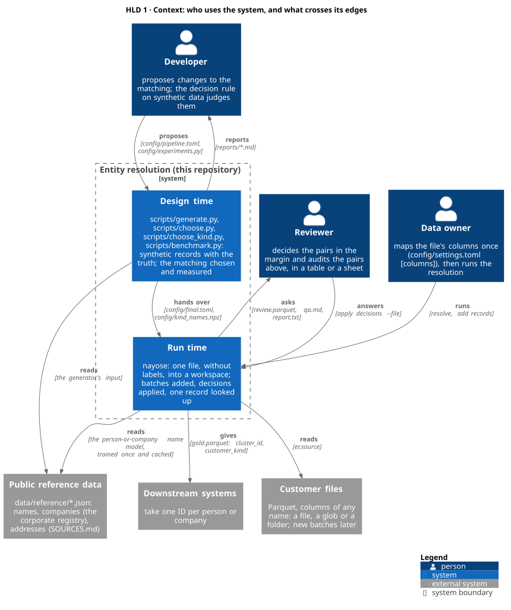
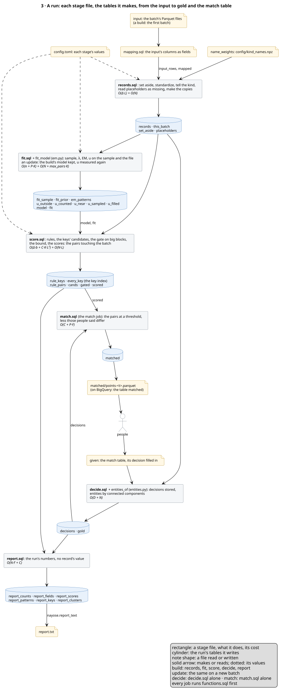

[← README](../README.md) · [Guide](guide/01-entity-resolution-and-our-task.md)

# Architecture

nayose's method is SQL in BigQuery's dialect, one file per stage, in `nayose/sql/`. The files read from top to bottom.
BigQuery runs them as written. DuckDB, on a laptop or in CI, runs them after sqlglot translates them. A run is a set of
tables: a BigQuery dataset in prod, and a DuckDB database file here. Python does four things only:

- **the jobs** (`nayose/__main__.py`, `nayose/__init__.py`), which run each stage file's statements in order;
- **the engines** (`nayose/engines.py`), which translate the SQL for DuckDB and make the deploy's statements;
- **EM** (`nayose/em.py`), which learns the model from the counts the SQL leaves;
- **connected components** (`nayose/entities.py`), which make entities from people's decisions.

EM and connected components are Python UDFs on both engines. On BigQuery they run as python-3.11 with the standard
library only. Prod therefore runs the same SQL files that the tests run, and no Python outside BigQuery touches a
record there.
Why each method is the one chosen is in [the guide](guide/01-entity-resolution-and-our-task.md). What each stage
costs is in [performance](performance.md).

## 1 · Context

| Who | Does | Uses |
|---|---|---|
| developer | changes the SQL or `config.toml`, measures the change on synthetic data, and opens a pull request | `python -m nayose`, `scripts/benchmark.py`, `scripts/estimate_cost.py` |
| data owner | starts a job in prod | Jenkins' `JOB` and `ARGS` ([operations](operations.md)) |
| reviewer | decides the pairs of a match table, in a BigQuery table or a Sheet | `matched`, `report.txt`; gives the decisions back to `decide` |
| DevOps team | applies the infrastructure and holds the credentials and the column mapping | `deploy/terraform/`, the secret `nayose-mapping` |
| downstream system | takes each record's entity | `gold` |

Design time never runs in prod: `scripts/generate.py` (synthetic records with known answers),
`scripts/benchmark.py` (quality and cost on them), `scripts/train_name_model.py` (`config/kind_names.npz`) and
`design/`. A run only loads the name model. `scripts/key_quality.py` reads a run, a real one too: each key's
candidates and matches, as counts alone.

## 2 · Components

| File | Holds |
|---|---|
| `nayose/__main__.py` | the jobs as a machine runs them here: the arguments, the run's folder, its lock, the JSON printed, the exit code |
| `nayose/__init__.py` | one function per stage and job (`records`, `fit`, `score`, `decide`, `match`, `lookup`, `build`, `update`), `values_of` (what each stage reads from `config.toml`), `stage` (a file's statements in order) and `report_text` |
| `nayose/engines.py` | `DuckDB` and `BigQuery`, which answer the same verbs (`run`, `rows`, `value`, `frame`, `put`, `read_parquet`); the translation (`duckdb_sql`, `AVOID`); the deploy's statements (`functions`, `procedures`) |
| `nayose/sql/*.sql` | the method. Each header says what the stage does, its cost, and the tables it reads and writes |
| `nayose/em.py`, `nayose/entities.py` | `fit_model`, `resampled` and `entities_of`: pure functions, JSON in and JSON out |
| `nayose/strings.js` | the character-level comparisons as BigQuery runs them |
| `nayose/config.toml`, `nayose/mapping.sql` | the values, and the input's columns ([4](#4--values-and-columns)) |
| `deploy/` | `deploy.py`, `run.py`, `smoke.py`, the Jenkinsfile and the Terraform ([10](#10--on-bigquery)) |

## 3 · A run

Every job runs `functions.sql` first. It holds the functions the other files call: the intake's `read_value`, the
comparisons (`gamma_*`, and the name's `name_score` then `name_level`; one level per pair) and the rules' fuzzy tests
(`near_*`). A stage passes its tables to the
next by name, and each file's header lists them. The costs below use these symbols: N records in the run, Δ in the
batch, L a value's length, n the fit's sample, K the comparisons (6), b the pairs a record's keys list, C the
candidates scored, P the pairs kept, F the fields, D the decisions and G the keys a record has.

**records.sql · `O(Δ·L) + O(N)`.** The batch's rows go through `mapping.sql` and come out as fields. A row is set
aside (`set_aside`, with the reason) when it has no ID, is already in the run, or shares its ID with different content.
Each field is standardized by its chain: NFKC, kana folded, the address cut to its street. Each record's kind is
decided: a written legal form makes it a company. Otherwise the name model (`name_weights`, a logistic regression on
character n-grams) decides when it is at least `name_line` sure. Otherwise the file's flag decides. A value held by
too many records and customers to be evidence is a placeholder, and the record reads it as missing. Placeholders are
counted over the run's records and the batch's together, which is the `O(N)` term. Finally the copies that the keys
and comparisons read are made, among them `one_byte_hash`, which bounds an edit distance cheaply.

**fit.sql · `O(n + P·K)` on the sample, `O(N + max_pairs·K)` on the file.** The model is Fellegi–Sunter, fitted
without labels, as Splink 5.0 fits it. The sample is whole postal areas by hash, `fit_rows` records, so the cost of
learning does not grow with the file. λ comes from the pairs the near-certain rules find. m comes from EM sessions on
the sample's pairs that share a phone, then an address (`fit_model`). u is counted exactly where equality allows, from
how many records hold each value, and is sampled elsewhere. It is measured once on the sample and once on the file,
because in a bigger file a field agrees by chance less often. The `model` table gives each level its bits,
`log2(file_m / file_u)`.

**score.sql · `O(Δ·b + C·K·L²) + O(N·L)`.** The batch's records are scored against all of the run's.

1. The rules, in order, give the certain pairs (`rule_pairs`). A rule ignores a key value held by `oversized` records
   or more.
2. The 22 key generators list the pairs worth comparing (`every_key`). Some match a value exactly, some a value with
   one character deleted, and some a name's reading.
3. The model's bits (`weights`), and an exact upper bound on each pair's weight from its equalities and lengths alone
   (`bound_of`). The costly fuzzy comparisons run only on the pairs that could reach `keep_from`.
4. The gate handles blocks of `oversized` records or more. Such a block is joined only if a sample of its pairs holds
   one at `search_floor` bits or more (`gated`), because a placeholder's block holds no true match.
5. The candidates: the pairs the keys list, and every pair of a kept block that touches the batch (`cands`).
6. The scores: each kept pair gets its level of each comparison and its weight (`weight_of`). `scored` keeps every
   pair from `keep_from` bits up, and every rule pair.

Making every record's keys again is the `O(N·L)` term. Nothing merges here.

**decide.sql · `O(D + N)`**, then **report.sql · `O(N·F + C)`**: the entities ([6](#6--decisions)), then the run's
numbers for `report.txt` (`report_*` tables), with no record's value in them.

The run's tables, those that outlive a job:

| Stage | Tables |
|---|---|
| records | `records` (a record a row: its fields, kind, copies and `batch`), `this_batch`, `set_aside`, `placeholders`, `name_weights` |
| fit | `fit_sample`, `fit_prior`, `em_patterns`, `u_outside`, `u_counted`, `u_near`, `u_sampled`, `u_filled`, `model`, `fit` (λ, sizes, notes, and `fitted`: the model whole, which an update starts from) |
| score | `rule_keys` and `every_key` (each record's keys: the index lookups read), `rule_pairs`, `cands`, `gated`, `scored` (each pair once: `id_l`, `id_r`, its levels, `match_weight`, `match_probability`, `rule`, `sources`) |
| decide | `decisions` (every decision that changed its pair, the latest flagged), `gold` (each record's `cluster_id`, its kind and its customer's) |
| report | `report_counts`, `report_fields`, `report_scores`, `report_patterns`, `report_keys`, `report_clusters` |
| match | `matched` (on BigQuery; here the job writes it to a file) |

## 4 · Values and columns

The SQL text never changes between runs. What changes is given to it:

- **`nayose/config.toml`** holds the values, one section per stage file: thresholds, seeds, lists (legal forms,
  prefectures, kana folding) and sizes. `[score]` names the key generators and rules that a run uses (`keys`,
  `rules`). Each one is written once in `score.sql`, and leaving one out of the list runs without it. `nayose.values_of`
  turns a section into the `@name` parameters a stage reads, together with the patterns built from the lists.
  `run_file` gives each statement only the values it names, because BigQuery refuses a parameter that a statement
  does not read.
- **`nayose/mapping.sql`** maps the input's columns to the fields that `records.sql` reads. Each column is read
  through `read_value`, and each field is built from the first of its sources that is filled. Each deployment has its
  own mapping. Prod's is in Secret Manager as `nayose-mapping`, outside the repository. `config.toml` `[input]` lists
  the columns it reads, and a column the file lacks is read as missing.

`report.txt` names the method's fingerprint (`nayose.fingerprint`), a hash of every stage file, `config.toml` and
the mapping, so two reports show whether two runs ran the same method.

## 5 · An increment

A run grows by batches, and a build is its first batch. Every record carries its `batch` number, and `this_batch`
names the latest. An update (`nayose.update`) runs the build's stages on a new batch:

- **records**: the batch's records join the run's. A record already in the run is set aside, so a batch given twice
  adds nothing. Placeholders are counted again over all records, and a run's record holding a new placeholder is
  made again with that value read as missing. A batch that brings none reads no record to make again.
- **fit** with `@refit` false: the build's model is kept (`fit.fitted`), so there is no sample and no EM. u is
  measured again on the run's records. A level counted exactly is counted again. A sampled comparison is sampled
  again only once its drift outweighs its sampling error (`em.stale`). That test runs on the exact counts first
  (`resampled`, a Python function like `fit_model`), so an update with none stale draws no sample at all, and
  `u_sampled` keeps the last sample drawn, which nothing reads until one is drawn again.
- **score**: only the pairs touching the batch are scored, and they are added to `scored` and `rule_pairs`.
- **decide**: the entities are made again.

An update costs `O(Δ·(L + b) + C_Δ·K·L²)`, plus `O(N)` scans of the run's records and keys.

## 6 · Decisions

Nothing merges by itself. The **match job** (`match.sql`, `O(C + P·F)`) lists the pairs at `@threshold` points or more,
less those whose latest decision is `no_match`. The list is one table for people, highest points first. Each row has
an empty `decision`, both records' fields side by side, each comparison's level and bits, the rule that joins the
pair, the keys that listed it, and whether it may be two people of one household. A threshold below `keep_from` is
refused, because the run keeps no pair below it.

The **decide job** (`decide.sql`, `O(D + N)`) reads that table back once it is filled in (`given`: `id_l`, `id_r`,
`decision`, and `why` where given). It refuses a decided row without both IDs, a decision other than `match` or
`no_match`, a pair decided both ways, and an ID that names no record. It stores each decision that changes its pair's
standing and flags each pair's latest. It then makes the entities again: connected components over the pairs whose
latest decision is `match` (`entities_of`), each entity named by its smallest ID. A–B and B–C make one entity even if
no one decided A–C. A later `no_match` parts what only that pair joined. A record that no decision joins is an
entity of its own.

## 7 · Lookups

A lookup (`nayose.lookup`, `lookup.sql`) answers which entities a record would join, as an update of that record
alone would score it. It reads what it touches, in three steps:

1. **Its keys,** made from it alone. A stored record (`--record`) gets a new batch number. Typed values or a file's
   rows go through `records.sql` with `@lookup`: the run's placeholders still apply, and the record adds none of its
   own.
2. **The run's key index,** read by those keys. `score.sql` keeps every record's keys as the run's tables `every_key`
   and `rule_keys`, clustered by key on BigQuery. Every record of its rule keys comes back, and of its blocks, but of
   an oversized block (`oversized` records or more) only the first 65 by hash: the gate's sample and one more, so the
   record asked about may rank anywhere. Such a block's whole size goes in `block_size`, which `key_blocks` takes
   for its count, so sizes and the gate's report stay exact. If the gate keeps such a block, every pair of it is a
   candidate: the lookup reads the rest of it from the run's index and scores again.
3. **The record scored against those records alone,** read by ID, with their entities (`records` and `gold` are
   clustered by ID). `score.sql` scores every candidate, whatever its points, with the run's model as it stands. Its
   prior is read at the run's size: `@outside` counts the records the step doesn't hold.

Steps 1 and 3 run in temporary tables named like the run's, since a statement reads a temporary table before the
run's table of the same name. `engine.scratch` holds them in a transaction rolled back on DuckDB, and in a session
of their own on BigQuery. `run_file`'s scratch makes every table a statement creates a temporary one, and refuses a
statement that would change a run's table, so a lookup writes nothing. `lookup.sql` gives each entity from `[lookup] at_least` points up, or joined by a rule, with its best
record, its points, each comparison's level and the keys that listed it. With no such entity, it gives the closest
record. It also reports, key by key, what was looked up and what the gate decided for big blocks. The cost is
`O(G)` for its keys, plus `O(G·b + C·K·L²)`.

## 8 · Two engines

**BigQuery** runs the SQL as written, in one session per job, so the temporary tables die with the job. The run's
dataset is the session's default, so statements name tables alone. Calls to the deploy's functions are qualified with
the dataset (`BigQuery.CALLS`), and so are the method's own SQL functions, which the deploy made in the dataset
(`BigQuery.OWN`): a statement that would make one again, Python's (a lookup's, the report's), isn't sent.

**A statement that may not need to run** says when it does, in a comment: `-- when: <condition>`, a SQL condition
on the job's values and tables. `run_file` asks the engine and skips the statement where it is false. The deploy
makes it the procedure's `IF <condition> THEN … END IF`. BigQuery bills a statement's scans whatever its result, so a
statement that isn't run is the only one that bills nothing.

**DuckDB** runs the SQL after `duckdb_sql` translates it (sqlglot, BigQuery to DuckDB, cached per statement). Some
forms would translate into another result, and `avoided` refuses each one by name, saying what to write instead:

| Refused | Because | Written instead |
|---|---|---|
| `COUNTIF` | DuckDB's gives NULL where every test is NULL, BigQuery's 0 | `COUNT(CASE WHEN … THEN 1 END)` |
| `GROUP BY ALL` | it comes back as a column named ALL | the columns named |
| `EDIT_DISTANCE` | DuckDB's Levenshtein counts bytes | `cl_levenshtein` |
| `NORMALIZE` | DuckDB has no NFKC | `nfkc(x)` |
| `CONCAT_WS` | its NULLs translate otherwise | `ARRAY_TO_STRING([…], sep)` |
| `UNPIVOT` | translated, it loses rows | one `SELECT` per column, `UNION ALL` |
| a decimal literal | BigQuery reads FLOAT64, DuckDB DECIMAL | `CAST(1.5 AS FLOAT64)` |

Where sqlglot's translation answers otherwise, `as_bigquery` rewrites the node to keep BigQuery's answer. This covers
`DIV`, an `ANY TYPE` parameter, `UNNEST … WITH OFFSET` counted from 0, `array[OFFSET(i)]` with a computed `i`, and
`REGEXP_EXTRACT`'s group and its NULL on no match.

**The function twins.** The SQL calls each function by one name, and each engine supplies its own version:

| Function | BigQuery (the deploy's, `functions`) | DuckDB (`DuckDB.__init__`) |
|---|---|---|
| `cl_levenshtein` and its `_cut` | SQL UDFs over `EDIT_DISTANCE`, in characters (`BUILT_IN`; the staging smoke test checks it) | DuckDB's own where both strings are a byte a character, else rapidfuzz |
| `cl_jaro_winkler`, `cl_damerau_levenshtein`, `cl_hamming`, and each `_cut` | JavaScript UDFs (`strings.js`) | DuckDB's own where both strings are a byte a character, else rapidfuzz; Jaro–Winkler as float32 |
| `er_hash` (every draw and order by hash) | SQL UDF: MD5's first 15 hex digits as INT64 | a macro, the same |
| `nfkc` | `NORMALIZE(x, NFKC)` | Arrow's `utf8_normalize` |
| `one_byte_hash` | SQL UDF over code points | numpy |
| `fit_model` | Python UDF, `em.py` | `em.fit` |
| `resampled` | Python UDF, `em.py` | `em.resampled` |
| `entities_of` | Python UDF, `entities.py` | `entities.of` |

`tests/test_functions.py` runs the JavaScript in V8 against the DuckDB twins, score for score.
`tests/test_sql.py` checks that every stage file parses as BigQuery SQL and translates.

## 9 · The jobs here

`python -m nayose build | update | match | decide | lookup --out FOLDER` runs a job on DuckDB. A run is a folder:

| File | Holds |
|---|---|
| `run.duckdb` | the run's tables ([3](#3--a-run)) |
| `report.txt` | after a build or an update: the run on one page with no record's value in it, to send when asking for help |
| `matched/points-<t>.parquet` | a match table at threshold `t` (or the file `--into` names) |
| `.lock` | the writers' lock |

### The run's folder

A job that writes (build, update, decide) takes the folder's lock, an OS lock that the system releases if the process
dies. It works on a copy, `run.duckdb.new` (a build starts from an empty one), and renames the copy over `run.duckdb`
once done. A run is therefore never half written, and a job that fails leaves the run as it was. A job that reads
(match, lookup) never waits and writes nothing back: match works on a copy of the run, a lookup on the run itself, read-only (on a copy on Windows, where an open file can't be replaced). `build --overwrite`
replaces the run and keeps people's decisions. An update with nothing new changes nothing and says `added: 0`.

Each job prints one JSON object on stdout, and one JSON line on stderr as each stage ends. The exit code is 0 on
success. It is 2 for a mistake people fix, where the JSON says what is wrong and how to fix it, including a refusal
raised by the SQL. It is 75 when another job is writing the run, so try again later. `--compute memory_limit=8GB
threads=4` sets DuckDB's limits for one build or update.

## 10 · On BigQuery

In prod, the run is the dataset `nayose` in each project, and nothing changes it by hand.

- **`deploy/deploy.py PROJECT.DATASET [--mapping FILE]`** makes the dataset's functions (`engines.functions`). Then
  it makes the method's own SQL functions (each file's `CREATE TEMP FUNCTION`, made persistent) and one procedure per
  job (`engines.procedures`): `build`, `update`, `decide` and `match`. A procedure holds its stages' statements in
  order, with the deployment's mapping. Each value they read is `DECLARE`d at its top from `config.toml`, so a change
  of values reaches prod only by a deploy. `build` drops the run's tables first and keeps `decisions`. `match` takes
  its threshold as an argument. Last, the deploy loads `name_weights`. Every statement is `CREATE OR REPLACE`, so a
  deploy can be run again.
- **`deploy/run.py PROJECT.DATASET JOB ARGS`** loads the job's input from Cloud Storage into `input` or `given` and
  `CALL`s the procedure. After a build or an update it prints `report.txt` from the `report_` tables. A job is all
  or nothing: it first marks the dataset (`job_running`) and clones each table, and a failed job is undone from the
  clones (`undo` undoes one whose process died, once its procedure has ended in BigQuery).
- **`deploy/smoke.py`** builds one generated file on BigQuery in staging and on DuckDB on the agent, and compares
  `scored` and `gold` row for row, and an edit distance on kanji.
- **`deploy/Jenkinsfile`** runs the stages in order. Checks runs the lint and the tests. Staging deploys and runs the
  smoke test. Approve waits for a person in `APPROVERS`. Prod deploys the same commit with the secret
  `nayose-mapping`. A build with `JOB` set does only one thing: Run, one job in prod, archiving its `report.txt`. The
  deploy runs as `nayose-deployer`, and the jobs as `nayose-runtime`.
- **`deploy/terraform/`** describes one environment per project: the input bucket, the secret, the run's dataset and
  a sandbox dataset whose tables expire in a day, the two accounts with the least each needs, Workload Identity
  Federation for Jenkins, and the budget. The DevOps team applies it ([operations](operations.md)).

A lookup has no procedure: `nayose.lookup` sends its statements, each step in a session of its own, writing only
temporary tables ([7](#7--lookups)). `deploy/run.py`'s `lookup` writes the answer to the run's table `looked_up`.

No job has run on BigQuery yet. The deploy's statements are checked offline: `tests/test_deploy.py` runs them
against a client that records what it is sent. The results are proven on DuckDB: `tests/test_parity.py` holds every
job's tables to their recorded digests.
