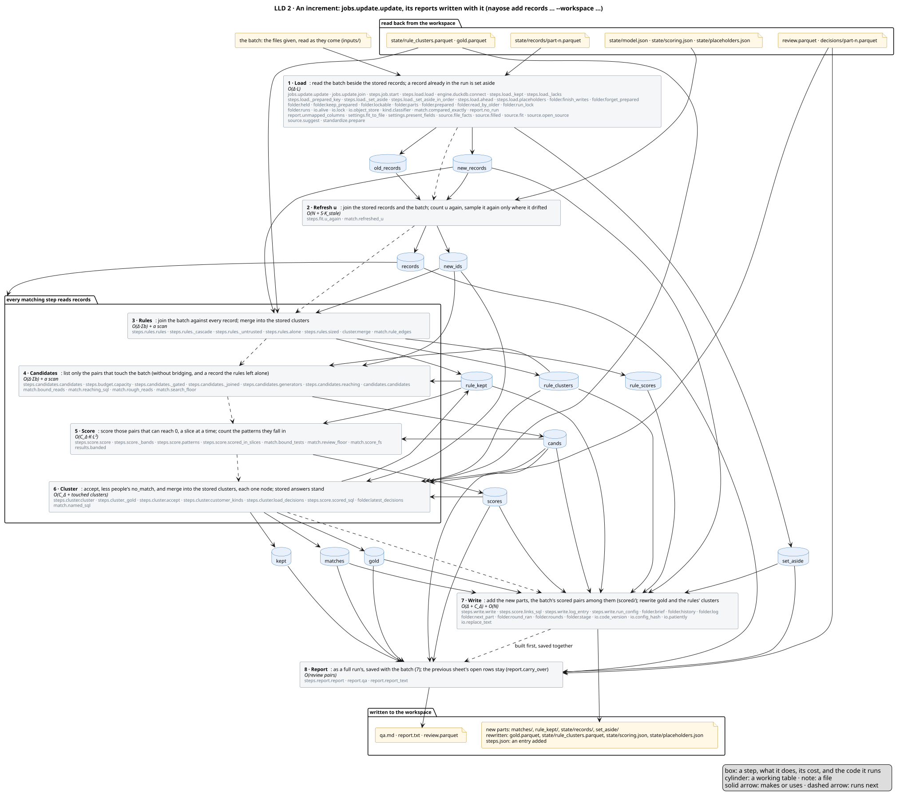
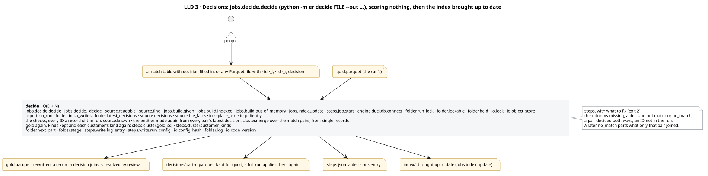
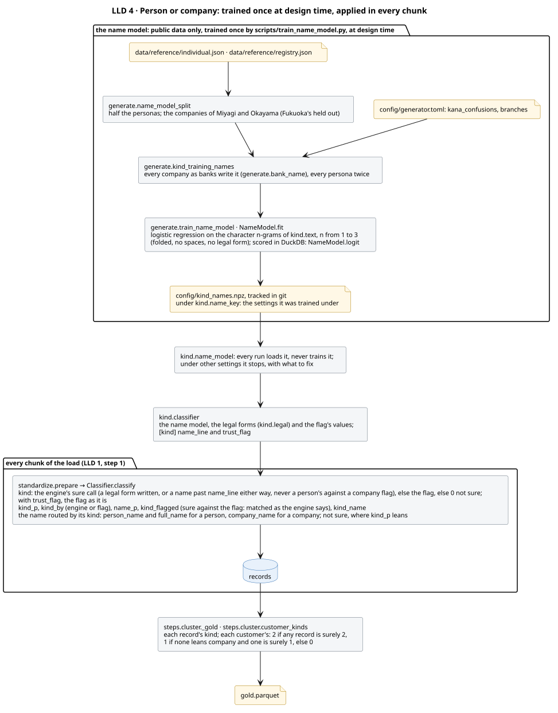

[← README](../README.md) · [Guide](guide/01-entity-resolution-and-our-task.md)

# Architecture


Above, the whole system on one page. Below, a high-level design (HLD) in three C4 views, from the outside in, then a low-level design (LLD) of every flow and every file. Each diagram has a legend: in the LLD a box is a step (what it does, its cost, and in grey the code it runs), a cylinder a working table and a note a file; a solid arrow makes or uses, a dashed one runs next, and an arrow into a group stands for one to each step in it.

| | View | Shows |
|---|---|---|
| HLD | [1 · Context](#1--context-two-loops) | who uses the system, and what crosses its edges |
| | [2 · Containers](#2--containers) | the entry points, the engine and every store |
| | [3 · Components](#3--components) | every module of `er/` and every import between them |
| LLD | [4 · The run](#4--the-run) | a full run, step by step: each step's functions, the tables it makes and uses, its cost |
| | [5 · An increment](#5--an-increment) | new records added to a written run |
| | [6 · Decisions](#6--decisions) | people's decisions applied, scoring nothing |
| | [7 · Person or company](#7--person-or-company) | the legal forms, the name model, the flag, the routing |
| | [8 · Data](#8--data) | every file of a run's folder with its columns, and every working table |

Every diagram is the contract: `tests/test_design.py` checks it against the code and fails with what to draw or remove ([the diagrams](#the-diagrams-source-and-checks)). Why each method is the one chosen is in the [guide](guide/01-entity-resolution-and-our-task.md); the measurements are in [performance](performance.md) and [the benchmark](../reports/benchmark.md).

## 1 · Context: two loops


The system turns a file of customer records into one ID per person or company. It works in two loops:

- **Design time** happens once, and again whenever the method changes. `scripts/generate.py` builds synthetic records from real names, companies and addresses, with the truth for each. `scripts/benchmark.py` runs the method on generated populations as a run does and measures it against the truth: quality across scenarios, person or company, and the cost as the file grows (`reports/benchmark.md`). The method, `config/pipeline.toml`, changes through a pull request; each of its choices is measured at design time on labelled synthetic data, and the tag `design-tools-2026-11` holds the research tooling that measured them. This is the only loop that reads the truth.
- **Run time** happens for every file, without labels. `python -m er build` runs `config/pipeline.toml` on the file, writes the run's folder and builds its lookup index. New records join that run later (`update`); people's decisions on the pairs near the threshold go back with `decide`; `lookup` says which entity a record would join, from the index, which every job that changes the run keeps up to date. Each job prints one JSON object, what it did, and exits 0; 2 on a mistake people fix (the JSON's `error` and `fix`); 75 while another job writes the run.

`config/pipeline.toml` and `config/kind_names.npz` are the hand-off between the loops. `pipeline.toml` is plain TOML, so it can be read, diffed and edited by hand. `kind_names.npz` is the person-or-company name model, trained by `scripts/train_name_model.py` from `data/reference/` and two settings of `config/generator.toml` (`kana_confusions`, `branches`); a run only loads it, so no change to the synthetic-data generator reaches a run until the model is trained again and committed.

| Who | Does | Uses |
|---|---|---|
| data owner | maps the file's columns once, then runs the jobs | [the quick start](../README.md#quick-start), `config/settings.toml` |
| reviewer | decides the pairs just below the threshold, audits those just above, checks the largest clusters, in a BigQuery table or a Sheet | `review.parquet`, `report.txt`; gives back decisions (`decide`) |
| downstream system | takes one ID per person or company | `gold.parquet` |
| developer | proposes changes to the method, and measures them on synthetic data | `config/pipeline.toml`, `scripts/benchmark.py`, `reports/benchmark.md` |

## 2 · Containers


| Part | Holds |
|---|---|
| `python -m er` | the jobs' entry, `er/__main__.py`: build, update, decide and lookup, the JSON each prints and its exit code |
| `scripts/` | the design-time entry points: generate, benchmark, train_name_model |
| `er/` | the engine: every computation a run makes, tested. It names no column, and imports nothing of `design/` |
| `design/` | design time's code, beside the engine: the synthetic generator (`design/generate.py`), the only code that names columns, and the metrics (`design/evaluate.py`). It reads `er/` |
| `config/` | every setting: `settings.toml` (paths, `[datasets]`, `[columns]`, `[locale]`, `[compute]`, `[kind]`, `[input]`), `pipeline.toml` (the method, in logical fields), `kind_names.npz` (the name model), and for design time `generator.toml` |
| `data/` | records, labels and the benchmark's runs, all Parquet. Only `data/reference/` is in git; the scripts rebuild the rest |
| `reports/` | what `benchmark.py` measured on synthetic data, kept in git; never real records |
| `deploy/` | the image and the Cloud Run jobs ([below](#on-cloud-run)) |
| `docs/diagrams/` | the diagrams on this page, as PlantUML |
| `tests/` | engine checks, whole runs, and the design's checks |

**One engine.** `python -m er` and `benchmark.py` run the same jobs (`er/jobs/`) and steps (`er/steps/`), so the benchmark measures exactly what runs, with the same gate on oversized blocks and the same untrusted values.

**Where the method comes from.** The model is Fellegi–Sunter as Splink 5.0 implements it, computed by the `er` package itself: the fit (`er.fit`: λ, EM, m from labels), the u sample, the scoring and the clustering (`cluster.merge`), each held by tests to values recorded once from Splink 5.0. Everything around it is the `er` package's own: the rules' joins and candidate generation as SQL, budgets, u from the scored file, decisions, evaluation ([where the method comes from, and what is ours](#where-the-method-comes-from-and-what-is-ours)).

**Configured for any file.** The engine reads logical fields only. `config/settings.toml` `[columns]` maps each field to the file's columns, and `[fields]` in the pipeline says which are mandatory and which optional. A missing optional field turns off only what reads it.

### Moving to another SQL engine

The SQL is written to move: joins, group-bys, window functions and `CREATE TABLE … AS`. These pieces would need a counterpart elsewhere:

| Piece | Where | DuckDB form |
|---|---|---|
| character-level similarity (`cl_jaro_winkler`, `cl_levenshtein`, …) | `er.strings`, `er.config.Comparator.test` | DuckDB's own Jaro, Jaro–Winkler and Hamming (rapidfuzz's C++, on bytes) where each character is one byte: ASCII, or katakana copied one byte each at load (`one_byte`); DuckDB's Levenshtein and Damerau–Levenshtein on ASCII, and on other text a pair failed first on copies with each character hashed to one byte (`one_byte_hash`), never farther apart than the values; else Python UDFs over Arrow (rapidfuzz) |
| one-character deletions of a value | `er.candidates`, `er.match` | a row per position (`unnest(generate_series(…))`) and `substr`, the first of each run of equal characters (`candidates.deletions_sql`) |
| a pair's generators as bits | `er.candidates` | `bit_or`, then a `CASE` per bit |
| the first rule that pairs two records | `er.match`, `er/steps/rules.py` | `DISTINCT ON`, `arg_min` |
| sampling whole postal areas for the fit, and every draw by hash | `er.match`, `config.hashed` | `ORDER BY er_hash(…)`: MD5's first 60 bits as an integer, a macro each engine defines alike |
| reading and writing files, a table's columns, slices, an index attached | `er.source`, `er/steps/write.py`, `er/jobs/index.py` | asked of the engine (`er/engine/engine.py`: `read`, `write`, `columns`, `exists`, `slices`, `attach`), never written into a step's SQL; `UNION ALL BY NAME` |
| standardization (NFKC, hiragana as katakana, separators dropped, kana folding, the address chain) | `er.standardize` | pandas, per chunk: DuckDB has no NFKC |

The fit's EM runs in Python on the agreement patterns' counts, a few hundred rows, so it needs nothing of the engine but one query per session.

**The BigQuery engine** (`er/engine/bigquery.py`) gives DuckDB's engine's verbs on a BigQuery client, every statement in one session of the job's own:

- **`translate`** turns a step's SQL into BigQuery's (sqlglot). A table a statement makes is the session's temporary table; `cl_*` and `er_hash` are the job dataset's functions.
- **`functions`** makes those functions in the dataset, once per deploy. The comparison functions are rapidfuzz's algorithms in JavaScript (`er/engine/udfs/strings.js`), Jaro and Jaro–Winkler as float32s, as DuckDB's engine scores them (rapidfuzz's cpdist). `tests/test_bigquery.py` runs them in V8 against DuckDB's engine's own `cl_*` functions, score for score to the last bit. The float32 also hides how a build of rapidfuzz rounds the double: arm64's fuses Jaro–Winkler's boost into one multiply-add, x86's rounds twice.
- **A statement with a part only DuckDB has is refused by name** (`NotPortable`), never sent half translated: DESCRIBE, `duckdb_tables()`, `current_setting`, `read_parquet`, `COPY … TO`, `rowid`, ATTACH, the list functions and their lambda, `UNPIVOT … COLUMNS(*)` and `INTO NAME`, `arg_min` of n, `AS MATERIALIZED`, and whatever BigQuery's grammar refuses. The steps write none of them: what depends on where the tables are is the engine's to answer (`columns`, `exists`, `read`, `write`, `slices`, `attach`, `threads`). A full run with its reports, an increment, people's decisions, the index kept up to date and lookups send about 1,500 statements, and every one translates (`tests/test_bigquery.py`). What a BigQuery job still needs is the engine's store: those answers on a dataset's tables.

### On Cloud Run

`deploy/` holds what runs the jobs on Google Cloud. Jenkins builds and deploys it, and nobody changes Cloud Run or BigQuery by hand.

- **The image** (`deploy/Dockerfile`, python 3.12) holds the engine. Its dependencies are pip only, at the pins the tests run with (`deploy/requirements.txt`, held equal by `tests/test_deploy.py`), plus the BigQuery client; the method is `config/`. `deploy/job.sh` is its entry point. It copies a run's folder from the bucket, which Cloud Run mounts at `/gcs`, onto the job's own disk, keeping the files' times. It runs `python -m er "$@" --out /tmp/run` there, and copies the folder back after a job that changes it (build, update, decide). A run takes its lock on a disk, never on object storage, and each job runs one task at a time.
- **The jobs** (`deploy/jobs/`): `nayose-build` (`build /gcs/in/records.parquet --overwrite`: a full run into `runs/main`), `nayose-update` (`update /gcs/in/batch.parquet`: an increment) and `nayose-lookup` (`lookup --record RECORD_ID`: one record, whose ID an execution gives in `--args`). Each names the image, the service account and the bucket as `${…}`, which Jenkins fills.
- **Jenkins** (`deploy/Jenkinsfile`): every push runs the lint and the tests. A push to main builds the image, pushes it to Artifact Registry and deploys the three jobs (`gcloud run jobs replace`). A build with `RUN` set starts one, with `ARGS`. Every gcloud call runs as the service account whose key Jenkins holds.
- **Run on this machine in Docker:** the build job on the 200k generated file, then a batch added and a record looked up, the run's folder kept on a mounted folder as the bucket would hold it. The clusters, pairs, scores and model are the local run's. `kind_p` differs in its last bit on 241 of 200,000 records: the name model's floats on Linux's math library against macOS's. A job runs on the DuckDB engine; on BigQuery's once the parts it refuses are done (above).

### Where the method comes from, and what is ours

The model is Fellegi–Sunter as Splink 5.0 implements it. The `er` package computes every part of it, in SQL on DuckDB and in Python, and tests hold each part to values recorded once from Splink 5.0.0 with DuckDB 2.0.0: `tests/fixtures/splink-5.0.0.json`, with each fit's records (synthetic) in `tests/fixtures/splink-5.0.0/`.

| Part | Code | As Splink 5.0 computes it |
|---|---|---|
| training (λ, EM, m from labels) | `er.fit` | the same λ, fixed comparisons, starts and rounds, m within 10⁻¹² (`tests/test_fit.py`). Its sums run in a fixed order, so a fit repeats to the last bit; Splink's move by a last bit from run to run, in the order DuckDB's threads leave the rows |
| the u sample | `match.sample_u` | Splink's draw (the records whose hash of ID and seed falls in a share, and every pair of them) by the portable hash (`config.hashed`), so every engine draws the same records; on every pair, the same u as Splink's to the last bit; every comparison's levels counted in one pass over the pairs, where Splink joins them again for each comparison |
| scoring | `match.predict_sql` | Splink's predict SQL in one query: the same scores to the last bit (`tests/test_scoring.py`), without the two copies of the records Splink makes first |
| connected components | `cluster.merge`: scipy on the nodes numbered in their ids' order | the same clusters (`tests/test_cluster.py`), in one pass over the edges where Splink's SQL takes a round per step of the longest path |

A level weighs the same whichever value agrees: a pipeline that sets `tf` on a comparison, and a saved model adjusted by term frequency, are refused.

The rest has no counterpart in Splink, or does what Splink's doesn't:

| Job | Why it is ours |
|---|---|
| the rules' joins | plain SQL. Splink's `deterministic_link` gives the same pairs but first joins every column of both records back: 1.35× slower at a million records, 17× at 10,000. Splink has no cascade (a later stage adding a pair only for a record still unresolved) |
| merging the generators' pairs | 1.56× faster at a million records, and every generator that found a pair is kept (`sources`); Splink keeps the first |
| counting a key's pairs before any join | one group-by, 5–6× faster than Splink's exact count |
| cluster metrics, intervals, the paired test | Splink has no cluster-level accuracy |
| λ at the file's size, exact u from value counts | Splink has neither; a 10⁷-pair sample can't see an agreement rarer than one in 10⁹ pairs |
| increments: merging into stored clusters, stable names | Splink 5 has no incremental clustering; `predict_between` scores only |
| string similarity (`cl_*`) | DuckDB's built-ins, which Splink's comparison libraries call, compare bytes: タナカ / タカナ get Jaro–Winkler 0.956 from them, 0.556 by character |

Not used, and why: chunked prediction (refuses given pairs, and only bounds memory); salting (ignored in Splink 5); Parquet materialisation (1.05–1.67× slower here); `cluster_using_single_best_links` (for sources without duplicates); `DateOfBirthComparison` (birth dates that aren't dates, and no extra true pair); m from people's review decisions (rows chosen by their score bias m by up to 3.8 bits; the decisions are applied as merges instead).

## 3 · Components


Every module sits in one layer: the tools (`er/__main__.py`, the jobs' entry: their words, the JSON printed, the exit codes; and `scripts/`), design time (`design/`: the generator and the metrics, which no module of `er/` imports), the run (`er/jobs/`, the jobs, each one line per step; `er/jobs/index.py`, the index a record is looked up in; `er/steps/`, a run's steps, one module each; `er/folder.py`, the run's folder on disk; `er/report.py`, the reports for people), the steps, and the foundation. Each layer imports only the layers below it; `tests/test_design.py` fails on an import that goes up or across.

## 4 · The run


A job runs a chosen pipeline on one file, without labels, and reads top to bottom, one line per step. Each step is one module of `er/steps/` with one public function, `step(job, …)`, which returns its result (`Loaded`, `Budget`, `Fitted`, `Ruled`, `Listed`, `Scored`, `Clustered`); its docstring names the tables it reads and writes. `steps.job.start` gives every step of a job what it shares (`Job`: the engine, the settings, the method, the log), and `Ran` holds what the job did, which the write, the reports and the callers read. `jobs.build.build` reads the records through the intake into a folder of the job's own (`source.readable`), calls steps 1–8 in order (`jobs.build.resolve`: steps 1–7, writing nothing), then builds the lookup index (`jobs.build.indexed`). It holds the run's lock throughout, so no other job writes in between; given the pipeline file (`python -m er` gives it), step 8 builds step 9's reports first and writes them with the run's files. The lock (`flock`) and the renames that finish a write (`os.replace`) hold on a disk, not on object storage. `jobs.update.update` adds a batch of new records to a written run and `jobs.update.would_join` says what adding it would do ([5](#5--an-increment)). Each step logs its Big-O, with the numbers filled in, its time and its peak memory to `steps.json` (`Log.done`).

| Mode | Cost |
|---|---|
| full run | `O(N·L + ΣP + C·K·L² + E·log E)`, plus a fixed-size fit and u sample. Linear in N while every key keeps its pairs per record flat, which the budget checks |
| increment | `O(Δ·(L + Σb) + C_Δ·K·L²)`, plus narrow `O(N)` scans: the stored records read into one table, the exact and one-edit u counts, gold rewritten. A comparison's u is sampled again, `O(S)`, only once its drift exceeds its sampling error. The joins start from the batch, so the expensive work follows Δ, not N |
| decisions | `O(D + touched clusters)`, plus `O(N)` to rewrite gold. Nothing is scored |

*N records · Δ records in a batch · L characters in a value · P pairs a key makes, b records in one key block · C candidate pairs · K comparisons · E accepted pairs · d the largest cluster's diameter. All symbols, and the measured times: [performance](performance.md#end-to-end-the-cost-of-every-step).*

### 1 · Load and standardize · `O(N·L)`

Opens the input through `er.source`, the one door every input file goes through, people's decisions included. A job first reads the file it is given as it comes (`er.intake`, by `source.readable`), into a folder of the job's own in the system's temporary folder, which goes when the job ends and needs room for the reader's Parquet of the file: a Parquet file, every column read as text, what loses nothing fixed and counted, as the run's notes say. A file that isn't Parquet is refused, with how to write it as Parquet (`intake.check`, `intake.CONVERT`). The door finds the Parquet files (a path, a glob, a folder, or the files the intake read), checks that each is Parquet, reads several together by column name, and uses a column whose name differs from the mapping only in case, width or separators. Then it checks the columns against `[fields]`: a missing mandatory field stops the run, with suggestions from the file's values; a missing optional one turns off what reads it, and a file that turns off every rule or every candidate generator stops the run. Records it can't resolve are set aside, with the reason: no ID, or one ID holding different records. Finally, in chunks of 200,000 records, it builds each logical field from its columns, each record's kind ([7](#7--person-or-company)), and the normalized copies that keys and comparisons use: kana folded, legal forms removed, one key per address. Last, a value of an identifying field (`[fields] identifying`: a customer ID, one customer's each) held by 64 records or more is a placeholder, such as 00000000, not one customer's. So is a value of a field a comparison's first level tests for equality (the name, the phone, the birth date) that 64 customers or more hold, held by at least ten times the field's records per value (its filled records over its distinct values: on a large file every value of a 4-digit phone is on a hundred records, and none is a placeholder), and whose pairs outnumber those of all the values held by fewer: a placeholder name on thousands of records would otherwise be what the exact level's u describes, and every exact name would weigh what agreeing on it weighs. Copies of one customer's record (one identifying value) are no such crowd; a record without an identifying value is a customer of its own. Each is made missing in the field, every copy of it and every field built from the same columns on those records (a name read into `person_name`, `full_name` and `any_name`), so no rule, key, comparison or lookup reads it as two records agreeing, and the summary names it. A run that told placeholders otherwise takes no increment until it runs again.

- **Why:** every later step compares values, so the same fact must be written the same way first. Chunks keep memory flat at any size. A mistake in the input either gets fixed and reported, or stops the run with what to fix (exit code 2): never a traceback.
- **Why a reader before the door:** a file from another system holds what its writer left in it: control and zero-width characters, BOMs, placeholders such as NULL, numbers a spreadsheet wrote (1.23E+11, 12345.0), values written as lists (`["8700848"]`), blank column names or two that differ only in case. `er.intake` reads the file a chunk of 200,000 rows at a time, by column, every column as text, and fixes only what loses nothing: control and zero-width characters and BOMs removed; `[input] nulls` and values of spaces alone made missing; a number in E notation made missing (its digits are gone) and 12345.0 read as 12345; a list read as its first item (counted apart when it lists several); a blank column name numbered, and one that repeats another but for case suffixed. Each fix is counted in the run's notes, never a value. A column stored as a number is read as text, with a note that its leading zeros may be lost upstream. Records are Parquet, whose text is UTF-8, so no value's encoding is guessed: a value stored as bytes that aren't UTF-8, or holding U+FFFD (bytes decoded wrong upstream), is made missing and counted as damaged. A CSV is written as Parquet first, every column as text, by whoever holds it (`intake.CONVERT`: one line of pandas or DuckDB). `O(bytes)` in one pass: a chunk's values that reading keeps as they are (plain ASCII, Japanese UTF-8 with nothing to fix) settled in Arrow, each tested only as what it can be, and only the rest one by one. Which columns hold numbers is read from the first chunk's first 50,000 values. About 3.3 s a million records of 25 columns ([performance](performance.md#reading-a-file-as-it-comes)).
- **Code:** `steps.load.load` → `source.open_source` (reads only each file's schema), `source.suggest` (a fixed-size sample), `settings.fit_to_file` → `config.check_fields`, `restrict`; `steps.load._set_aside`; `steps.load.placeholders`; `kind.classifier`; `standardize.prepare`
- **Increment:** the batch only, `O(Δ·L)`. It first finishes any interrupted write. A record already stored is set aside, so a batch given twice adds nothing. The batch is read with the run's fields: one it lacks (a file without birth dates) is read as missing (`steps.load._lacks`), so it is compared as the run's records were. The stored records and the batch then form one table, `records`, which every later step reads. The placeholders the run read as missing (`state/placeholders.json`) are missing in the batch too; a value the batch takes past the count above is from then on, and the summary says that pairs joined on it before stay until the run is run again.

### 2 · Budget · `O(N)` per key

Counts the pairs each rule and each candidate generator would make, Σ C(b, 2) over its blocks, its largest block, and its **oversized** blocks, with one group-by each. A block is oversized when it has more pairs than a check sample (`[budget] sample_pairs`, 2,000): 64 records or more sharing one value. Such a block is never joined blind: a generator checks it on a sample first (step 5), and a rule doesn't trust its value (step 4). The run stops only if the pairs of the normal blocks alone would not fit in memory and the room DuckDB may spill to (about 350 bytes a pair), naming the largest contributors. That room is DuckDB's own cap: 90% of the temp disk's free space, unless `max_temp_directory_size` sets a size.

- **Why:** the work after this step is per pair, and a block's pairs grow with the square of its size. A block's share of true matches falls as it grows, and a placeholder's block (a dummy phone) holds none. Counting costs `O(N)`; the joins it steers cost far more.
- **Code:** `steps.budget.budget` → `candidates.estimate`; `steps.budget.capacity` (memory limit + spill room)
- **Increment:** no budget step. Inside step 5, the oversized blocks the batch's keys reach are checked on a sample, and only they are held to the room; the normal blocks' pairs all touch the batch.

### 3 · Fit the model, without labels · `O(n + S·K + P_em·K) + O(N + S·K)`

Takes a fixed sample of 100,000 records, made of whole postal areas (by the ID's hash when the file has no postal code), and learns the Fellegi–Sunter model: λ, how likely two random records are to match, from near-certain rules; m, how often true matches agree, by EM on pairs that share a phone or an address. With `em_from_keys` and `em_median` in the model, EM instead learns in one session per equality key of the method, each leaving out the comparisons its key reads (it chose the pairs by them), and each level's m is the median of the sessions that learned it: a block of families sharing a phone then sets no level alone. Those pairs are `[model] em_rules`, one session per rule, and they can name other fields: where families outnumber one person's duplicates, pairs that share a phone or an address teach EM households, while pairs born on the same day or sharing a name don't. Each session is judged by the matches it learned (`match.judged`, kept in the model as `em_given`): where fewer than half of them agree on the given name (a name level of exact or near-exact agreement, or the given name itself; where that is filled in under 30% of the named records, the full name alone), the session learned households, and report.txt's DIAGNOSIS names it. EM also needs u, how often strangers agree at each level: on the sample, counted as below where it can be and from 10⁶ random pairs for the rest (`fit_u_max_pairs`). These feed only EM. Then it measures u on the whole file, because how often strangers agree depends on the file's size, so u from the sample would weigh agreements wrongly:

- the leading exact levels are counted from value counts;
- a one-edit level right after them on the same column (the customer ID, phone or birth date one digit off) is counted exactly too, by keys, never pair by pair: two distinct values one substitution apart share exactly one key "the value without its i-th character, at i", a swap of neighbours apart exactly one "those two in order, at i", and a length one apart is a join of the longer's deletions on the shorter values. So cif, phone and birth need no sample;
- the other levels, of name, company and address, come from 10⁷ random pairs, every one of them.

The gate on oversized blocks (step 5) and the scores (step 6) both use these u.

- **Why:** a real file has no labels, so the model learns from the data. A fixed sample keeps the cost flat at any size; whole postal areas keep a household's records together. A sample of 10⁷ pairs can't see an agreement rarer than one in 10⁹ pairs, such as two customer IDs one digit apart in a big file; a count can.
- **Code:** `steps.fit.fit` → `match.train_fs` (`fit.prior`, `fit.session`, `fit.m_from_labels`), `exact_u` (value counts, and position, swap and deletion keys), `counted` (the comparisons that need no sample), `scored_sample` (u by random sampling, cached per comparison and the values it reads, so within one process a model's variants share one sample), `assemble_u`, `u_basis`. A near-certain or learning rule that finds no pair in the sample (its field nearly empty) is skipped and named in the summary; with none left of either, the run stops with what to fix.
- **Increment:** no fit. It reads `state/model.json`, so every increment scores with the full run's model, and settles its u before the rules, as a full run does: `match.refreshed_u`. The exact and one-edit levels are counted again on all records. A comparison's sampled u are measured again only once the drift of its exact level, since it was sampled, exceeds the sampling error of its most precise sampled level, 1/(ln 2·√hits) bits: before that, a new sample would only redraw the noise. `O(N + S·K_stale)`.

### 4 · Rules: the certain cases · `O(N + ΣP_r·L²) + O(E·log E + N)`

Each rule is one join on its exact keys; its fuzzy conditions (names within two edits, addresses by Jaro–Winkler, a phone one digit off, …) are checked on the joined pairs only. A pair belongs to the first rule that finds it. Stage by stage, exact then fuzzy, a pair is kept only if it touches a record still unresolved, and the kept pairs are merged into the rule clusters, each cluster one node.

- **Why:** certain cases are cheap and auditable, and settle most duplicates without a false merge. The model then works only on what is left.
- **Code:** `steps.rules.rules` → `steps.rules._cascade` → `match.rule_edges` (one plain SQL join per rule, the same for full runs and increments), `config.Stage.sql` (a fuzzy condition lets equal values through without the string function), `er/engine/duckdb.py`'s `connect` (the character-level `cl_*` functions), `cluster.merge`. A rule leaves out any value of its keys held by an oversized block (`steps.rules._untrusted`): one address and phone on 3,000 records is not one customer's, so the summary names it, and the model can still match those records. A customer ID such as that is already missing (step 1).
- **Increment:** each rule joins the batch against all records. Each stored cluster is merged as a single node (`cluster.merge`): `O(Δ·Σb)` plus a scan.

### 5 · Candidates: which pairs to score · `O(N·L + ΣP_g)`

Lists the pairs worth scoring. Each generator is one SQL query:

| Generator | SQL | Cost |
|---|---|---|
| equal keys | a self-join | `O(N + P)` |
| one-character deletions of a value (a company name, a customer ID; a person's name within its postal area, a birth date within its prefecture) | each value and its deletions, unnested once per call into a table that the count, the join and the sample read, then a self-join | `O(N·L + P)` |

Only pairs that touch a record the rules left alone are listed (with `[model] bridge`, every pair across two rule clusters too). Each generator sets one bit, so OR-ing the bits merges the lists and every pair keeps the names of the generators that found it.

Oversized blocks are left out of each generator's join, then checked: about 2,000 pairs among 64 of the block's records, chosen by hash, minus those another block already listed and, without `bridge`, those of two records the rules joined (which the run never lists), are scored as the candidates will be: with the model and the file's u (step 3). A block with a sampled pair at the search floor (`[threshold] search_floor`, 0 bits, or the review floor if that is lower) or above is joined in full, so a pair a better model would lift to review is already listed; one without is skipped, and the run's notes count it. No hit in 2,000 pairs bounds a block's yield under 0.15%. If the kept blocks would not fit, the highest-yield ones go first.

- **Why:** comparing every pair is impossible: 5 × 10¹¹ at a million records. Each key of the method makes at most 5 pairs per record at a million records (`[budget] max_pairs_per_record`), and every true pair of labelled train able to reach the threshold shares one, as measured at design time. Checking a big block on a sample costs at most what joining it would, and tells a placeholder from a real shared value without guessing.
- **Code:** `steps.candidates.candidates` → `candidates.candidates` (run, gate, merge) → `Records.variants` (the deletion keys), `candidates.oversized`, `pairs_sql`, `sample_sql`, `_gate`; `steps.candidates._Gate` scores the sample, `steps.candidates._gated` keeps what it decided
- **Increment:** the batch is the query, so only pairs touching it are listed (without `bridge`, only those that also touch a record the rules left alone, as in a full run), and the deletion keys are kept only for the blocks the batch reaches: `O(Δ·Σb)` plus a scan.

### 6 · Score: evidence in bits · `O(C·K·L²)`

Scores every candidate, with the u step 3 measured on this file: for each field, it finds the level the pair reaches (exact, close, different or missing) and adds that level's bits, log2(m/u), to the starting point.

- **Why:** bits add up, so every score can be explained field by field.
- **Code:** `steps.score.score` → `match.score_fs`, `scaled_prior` (λ at this file's size)
- **The floor:** a pair is scored and stored only if it can reach the floor, `[threshold] keep_from` (0 points). A lower floor keeps pairs people can review that 0 drops, such as a moved customer with a new ID, for more pairs scored and stored. The oversized blocks' gate keeps its own floor (step 5).
- **Increment:** only the pairs touching the batch that can reach the floor are scored, as above, a slice at a time: `O(C_Δ·K·L²)`.

### 7 · Cluster: from pairs to entities · `O(C + E·log E + N)`

Accepts a pair at 6 bits or more (`[model] min_match_weight`), if it touches a record the rules left alone (with `[model] bridge`, also if it joins two rule clusters), if a name was compared (`[model] needs`: the person names or the company names, filled on both sides), and if people haven't decided it is no match. Then it clusters the accepted pairs with the rules' pairs and the pairs people decided are a match (connected components: a run refuses a pipeline that asks for another resolver), and records, for each record, its cluster, the stage that resolved it, and the rule (`fs` for the model, `review` for people), with its kind and its customer's ([7](#7--person-or-company)). A cluster is named after its smallest record ID.

- **Why:** pairs must become entities: if A matches B and B matches C, all three are one. Recording what resolved each record makes every merge auditable, and naming a cluster by its smallest ID makes an increment name it as a full run would. A household shares address and phone, and those two alone reach the threshold; so do a person and a company at one address. Without a name compared, people decide.
- **Code:** `steps.cluster.load_decisions` (people's decisions, from `decisions/`), `steps.cluster.cluster` → `steps.cluster.accept` (the threshold, `match.named_sql`), `cluster.merge` (connected components from single records over the pairs that join, as in an increment), `steps.cluster._gold` (`steps.cluster.customer_kinds`), and the false links the model expects among those it accepted
- **Increment:** the stored gold is the base, each stored cluster one node, stored answers stand, and people's no_match holds for the batch's pairs too: `O(C_Δ + touched clusters)`.

### 8 · Write the run's folder · `O(N + C)`

Writes each table as Parquet under a temporary name, with the reports (9), and `scored/`: every pair at 0 points or more and every rule's pair, with the level each comparison reached (`steps.score.links_sql`), so a run's pairs can be read without a run. Once all are complete, it saves the moves still owed in `pending.json`, then does them; `steps.json` too is written whole, then renamed, and a full run starts it again. A full run writes into `.full.tmp/`, and its moves replace the old run's files only then: an overwrite cut short leaves the old run, people's decisions included.

- **Why:** an interruption must never leave half a run. A write cut before `pending.json` leaves the run as it was; one cut after it is finished by the next run, increment or set of decisions. A run lands with its reports or not at all: a retry finds nothing new, so it could not make them again. A new part takes the number after the highest (`folder.next_part`), so a part deleted by hand frees no number to write over.
- **Code:** `steps.write.write` → `folder.next_part`, `folder.stage`, `folder.finish_writes`, `steps.write.log_entry` → `folder.log`
- **Increment:** new parts of records, rule pairs and matches; gold and the rules' clusters rewritten: `O(Δ + C_Δ) + O(N)`.

### 9 · Report, for people · `O(review pairs)` + `O(N)` in SQL

`steps.report.report` builds, and step 8 writes with the run's files: `report.txt`, the run on one page with no record's value in it and the label-free checks among it, which can leave the machine that holds the records, headed by what limits what the run finds (`report.diagnosis`); and `review.parquet`, with the evidence for each pair. The review sheet's *decide* rows are every pair of clusters whose best link scored in the threshold rule's safety margin: from the `[threshold]` grid point `margin_steps` below the threshold (4 bits) up to it, and every pair above it with no name compared. Its *audit* rows are about 50 of the pairs the run accepted (`matches`), up to 4 bits above it.

- **Why:** the margin holds pairs that were clean on cross-validated train, held back in case of noise: on the synthetic val split, 55 pairs from 4 to 6 bits, none of them false; one grid step lower, at 2 bits, val's first false pairs appear. So people decide them. Without labels, the audit rows and the largest clusters are how a person catches over-merging.
- **Code:** `steps.report.report` → `report.qa` (`report.fill_rates`, `match.review_floor`, `report.review_sheet`, `report.carry_over`, `match.pattern_coverage`), `report.diagnosis` (kept in the step's facts in `steps.json`), `report.report_text` (`report.diagnosis_lines`)
- **Increment:** the same for the pairs the batch made, plus the previous sheet's rows still open: a run keeps no scores, so a row dropped from the sheet could never come back.

## 5 · An increment



`jobs.update.update` reads the batch through the intake, as a full run reads its records, and reads back from the run's folder `state/model.json`, `state/scoring.json`, `state/placeholders.json`, `state/records/`, `state/rule_clusters.parquet`, `gold.parquet` and `decisions/`. It runs steps 1 and 3–8 on the batch, as each step's *Increment* line above says; `steps.report.report` then keeps the previous sheet's open rows. Last, it brings the lookup index up to date (`jobs.build.indexed`, `jobs.index.update`). It takes no model: the stored records' kinds and the model come from the full run. It stops, with what to fix, when the folder holds no run, and when the pipeline or the column mapping is not the one the full run used (`state/config.txt`): its batch would be resolved otherwise than the records it joins.

`jobs.update.would_join` runs the same steps on a batch and writes nothing: for each record, the entity it would join, or a new one, the rule or the model's best weight that links it, or why it is set aside (`jobs.update.join` holds the steps both share).

`jobs.index.look_up` answers one record without a run, from the index `jobs.index.build` writes: the run's own records, every key of each hashed into a table sorted by the hash, so a lookup reads a few row groups of a table, whatever N; a block's records counted in its sorted rows. The record is prepared by `standardize.prepare`, its keys looked up, a key value on `budget.min_oversized()` records or more gated as `candidates._gate` gates it, the rules' keys and conditions checked as `match.rule_edges` does, and the records found scored with the run's model by each level's own SQL: the pairs an increment of that record alone lists, scored alike (`tests/test_lookup.py`). The records sit in a database of their own, in row groups of 2,048, since scoring reads every column of the few it names; the keys in DuckDB's own, which keep them half the size. Build `O(N·(G + R + D·L) + N log N)`; a lookup `O(G·(log N + b) + C·K·L²)`.

`jobs.index.update` keeps the index up to date after a job that changes the run (`jobs.build.indexed`, as the last step of `update` and `decide`): it writes again, beside the index, a second database of what changed since the build: the records of the parts added since, with every key and value of theirs, and the records whose entity or rule cluster moved (gold and the rules' clusters against the index's). Every read is of both, a window the nearest of each merged, a record's entity the second's where it moved. Anything else changed (a full run's parts, the mapping, the method's keys) builds it again (`jobs.index._since`), and so do a column of the added records read as another type (its keys would hash otherwise) and the records added or moved reaching a tenth of it (every read joins what moved). The manifest names its files, each named by the build and the write, and a write removes the others: a reader open on them reads on, and one that read the manifest just before reads the new one (`jobs.index._open`). `O(Δ·(G + R + D·L) + N)`, the N a pass over two columns; the index kept up to date answers every lookup as one built again (`tests/test_lookup.py`).

## 6 · Decisions



`python -m er decide` gives people's decisions back to a written run, scoring nothing: a Parquet file of `<id>_l`, `<id>_r` and `decision`, or, with none named, the run's own `review.parquet` as people filled it in. Each `match` pair merges its two clusters, each cluster one node; each record keeps its kind, and a merged customer's kind follows its records again. A `no_match` pair splits nothing at once, but a full run on the folder never accepts it. Rows without a decision are skipped, and so is a decision the folder already holds as its pair's latest: a sheet given twice changes nothing. Last, the lookup index is brought up to date.

- **Why:** people's work must change the answer at once, and must survive a full re-run. `decisions/` is not a run file, so `--overwrite` keeps it and the full run applies it again. `report.txt` describes the run before the decisions until the next run or increment writes it again; `review.parquet` shows each pair's latest decision.
- **Code:** `jobs.decide.decide` → `source.readable` (a file given, read by the intake), `source.decisions` (the columns, a decided row without both IDs, a sheet with no decision, the values, a pair decided both ways), `source.known` (every ID a record of the run), `cluster.merge`, `steps.cluster.customer_kinds`, `folder.stage`

## 7 · Person or company



Each chunk, before its normalized copies, gets each record's kind (`er.kind`): `kind` 2 company, 1 person, 0 not sure (the codes a person/company flag uses), `kind_p` the probability of a company, and `name_p`, what the name alone says.

- **The parts:** a legal form written where banks write one (`config.legal_pattern`: each reading, and the bank abbreviation at the front, カ)〇〇, or the end, 〇〇(カ), a company, near certain. A name model, logistic regression on the name's character 1–3-grams with legal forms and spaces removed, trained once on public data (half the personas and two prefectures' registry companies: `generate.name_model_split`, `generate.kind_training_names`, `generate.train_name_model`) by `scripts/train_name_model.py` into `config/kind_names.npz`. A run loads it and stops with what to fix when it was trained under other settings (`kind.name_key`: the legal forms, the kana folding, the n-grams); a test fails when it is not what training builds today.
- **The engine's call, else the flag:** the engine calls a side only when it is sure: a written legal form, or a name past `[kind] name_line` (0.99) either way, but never a person's name against a company flag. Where the engine is not sure, the file's flag decides; with no flag, 0. A sure call the flag contradicts is flagged (`kind_flagged`). On the benchmark's populations it makes fewer false merges than the flag alone on every flag, and calls fewer companies persons but more persons companies ([chapter 7](guide/07-person-or-company.md#on-a-whole-run)).
- **Routing, and the gate:** with one name column for every kind (`[columns]` `kind = …`), each record's name goes to `person_name` or `company_name` by its kind, a flagged record's by the engine's call; a record not sure, by where `kind_p` leans. A person–company pair then has no name compared, and the model's name check (`[model] needs`) leaves it to people: no other gate is needed. Without that routing, a name a record holds both as a person's and as its company name (a column of every record's name mapped to both), compared folded, stays on its kind's side only: one piece of evidence, compared once.
- **People:** `gold.parquet` marks the flagged records (`kind_flagged`) and `report.txt` counts them, for the flag's owners; every record's kind is the engine's rule's, never people's. The parts are measured at design time on labelled synthetic populations ([chapter 7](guide/07-person-or-company.md#how-we-know-every-combination-across-the-unknowns)).
- **Code:** `kind.name_model`, `kind.name_key`, `NameModel.load`, `NameModel.logit`, `kind.classifier`, `Classifier.classify`; `standardize.prepare`; a customer's kind in `steps.cluster.customer_kinds`.

## 8 · Data


### On disk

Every table is Parquet. The layout follows the medallion layers of the pipeline: bronze is the records as they arrive, silver the standardized records a run keeps, gold the resolved run. The reference data feeds the synthetic generator and the person-or-company name model, so it sits outside them.

```
data/reference/*.json                       public names, companies, addresses (in git; SOURCES.md)   generator input; the name model's training
data/medallion/bronze/<dataset>.parquet     records as they arrive                                    scripts/generate.py
data/labels/<dataset>.parquet               the truth, read only to measure                           scripts/generate.py
data/artifacts/benchmark/                   the benchmark's runs: a run's folder each                  scripts/benchmark.py
```

`<dataset>` is `train`, `val` or `test`: one generated population, split by entity ([data](data.md)). `python -m er build` writes a run's folder wherever `--out` says, in the same form; silver is its `state/records/`.

### The run's folder

Kept on disk. Steps are numbered as in [the run](#4--the-run); the diagram above gives every file's columns.

| File | Written by step | Read by | Holds |
|---|---|---|---|
| `gold.parquet` | 8, rewritten each run and by decisions | you; the next increment | record → `cluster_id`, `resolved_stage`, `resolved_by`; its `kind`, `kind_p`, `kind_by`, `kind_flagged`, and its entity's `customer_kind` |
| `matches/part-n.parquet` | 8, one part per run | you | accepted pairs: weight, probability, generators |
| `rule_kept/part-n.parquet` | 8, one part per run | you | the rules' pairs, with the model's bits for each and whether it joined (`merged`) |
| `scored/part-n.parquet` | 8, one part per run | you | every pair at 0 points or more and every rule's pair: weight, how it was found, the level each comparison reached |
| `state/records/part-n.parquet` | 8, one part per run | increments | the standardized records: the silver layer |
| `state/rule_clusters.parquet` | 8, rewritten each run | increments | record → rule cluster |
| `state/model.json` | 8, full runs only | increments | the fitted model: λ, and m and u per level |
| `state/scoring.json` | 8, every run | increments | the u the run scored with; per comparison, the exact u it was sampled alongside and its last drift check |
| `state/placeholders.json` | 8, every run | increments, lookups | each field's values read as missing: placeholders, not one entity's nor evidence |
| `state/config.txt` | 8, full runs only | increments, lookups | the hash of the pipeline, but the fit's sample and EM (an increment scores with the stored model), and the settings that shape the records (column mapping, `[locale]`, the flag's values) the full run used |
| `steps.json` | 8, and decisions | you; an audit | one entry per job since the full run (the full run, each increment and set of decisions): when, the code's commit and the files changed in this copy, the config hash, each file read with what it is (records, decisions, the name model), its size and SHA-256, and each step's Big-O with its numbers, time and peak memory; the candidates step also lists the pairs each generator found, the score step the pairs at each level of each comparison, and the report step the weight bands |
| `pending.json` | 8, deleted when done | the next run, increment or decisions | moves owed by an unfinished write |
| `.lock` | every writer | every writer | the run's lock: one writer at a time |
| `review.parquet` | 9; decisions fill in its `decision` | people; decisions given no file | the pairs to decide and to audit |
| `report.txt` | 9 | whoever helps with the run | the run on one page, with no record's value in it |
| `decisions/part-n.parquet` | decisions, one part per file | full runs, increments | the pairs people decided: both IDs and `match` or `no_match`, and the sheet's `why` |
| `index/` | `build`, after its write (`jobs.index.build`); kept up to date by `update` and `decide` (`jobs.index.update`) | `lookup` (`jobs.index.look_up`) | `manifest.json`: the files below, by name, and the run files it rests on by size and time (`jobs.index.stale`); `<id>.duckdb`: one table per pair key and rule, each row a key's hash and a record, sorted by the hash; `<id>.records.duckdb`: the run's records as compared; `<id>-<n>.duckdb`: what changed since, the same tables of the records added and the records whose entity moved |
| `set_aside/part-n.parquet` | 8, one part per run | you | records not resolved, and why: no ID; the same ID with different content; already in the run |

### While a run runs

Working tables live in DuckDB, in memory; past `[compute]` `memory_limit` they spill to `temp_directory`, by default a folder of the person's own, readable only by them, in the system's temporary folder (`er/engine/duckdb.py`, its `connect`). All are dropped when the run ends. The tables one step makes and later steps use are those the LLD diagrams draw:

| Table | Made by step | Used by | Holds |
|---|---|---|---|
| `records` | 1 (an increment: after it) | 2–9 | the standardized records: logical fields and keys; in an increment, the stored records and the batch together |
| `set_aside` | 1 | 8, 9 | records set aside, with the reason |
| `rule_clusters`, `rule_kept` | 4 | 5, 7, 8 | record → rule cluster; the pairs the cascade kept |
| `cands` | 5 | 6, 7, 9 | candidate pairs, and the generators that found each |
| `scores` | 6 | 7, 9 | weight, probability, the level of each field |
| `matches`, `gold` | 7 | 8, 9 | accepted pairs; the answer |
| `old_records`, `new_records`, `new_ids` | 1, increments only | 3–8 | a view over the stored records' parts; the batch; the batch's IDs |

Each step's own working tables, used inside it only: `er_in` (1, when something was off), `er_untrusted_<i>`, `rule_edges`, `er_stage` (4), `er_query` and the deletion keys (5), `kept`, `clusters`, `er_decisions`, `gold_old` (7), and `er_e`, `er_comp` wherever clusters merge. The Python process holds a chunk (200,000 records) per worker that cleans one, plus one queued (load cleans chunks in parallel processes, as many as DuckDB's threads, at most one per chunk and 61 on Windows), the fit sample (100,000), the model, the oversized blocks' sampled pairs (about 2,000 each) while the gate scores them, and the rows of the review sheets.

## The diagrams: source and checks

The diagrams are PlantUML: the HLD in the C4 model (C4-PlantUML, bundled with PlantUML), the LLD in plain PlantUML. Each `docs/diagrams/<name>.puml` is the source and `<name>.svg` its rendering, which GitHub shows. After an edit:

```bash
brew install plantuml                      # once: PlantUML with Java and Graphviz
plantuml -tsvg docs/diagrams/*.puml        # every diagram
.venv/bin/python -m pytest tests/test_design.py
```

`tests/test_design.py` holds the diagrams to the code. Each check fails with exactly what to draw or remove:

| Check | Against |
|---|---|
| the components diagram holds every file of `er/` and `scripts/` in exactly one box, and draws an arrow between two boxes exactly where an import connects them | the code, read with `ast` |
| every path and every function a diagram or a doc names exists | the repository, and `er` imported |
| each step box of the run, the increment and the decisions names the functions its step reaches in the run layer, and those of other modules they call | `er/jobs/`, `er/steps/`, `er/folder.py` and `er/report.py`, read with `ast` |
| each step's tables: those it makes, and those it uses that an earlier step made | a whole run, increment and decisions on a generated population, with DuckDB's query log on, parsed by sqlglot |
| the data diagram's files and columns | the run's folder that run leaves |
| each SVG holds its `.puml`'s source | the source PlantUML stores in the SVG |
