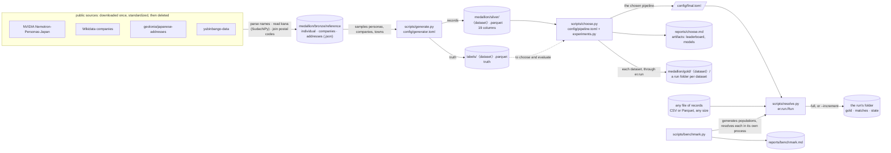
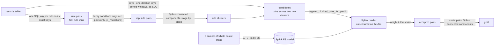

[← README](../README.md) · [Guide](guide/01-entity-resolution-and-our-task.md)

*Reference for the guide. The concepts are explained in [chapters 2–5](guide/02-the-same-fact-written-differently.md).*

# Architecture

## Roles

| Part | Role | Data size |
|---|---|---|
| `er/` | the engine: every computation, tested; names no column | any |
| `config/` | every setting: `settings.toml` (paths, `[columns]`, `[locale]`, `[compute]`), `pipeline.toml` (the matching, in logical fields), `final.toml` (what was chosen), `generator.toml` and `experiments.py` (development only) | — |
| `scripts/` | the runs: generate, choose, resolve, benchmark, export | any |
| `notebooks/demo.ipynb` | a walkthrough that calls the engine one step at a time and charts each; no logic of its own | about 3,700 records, 25 s |
| `reports/` | what `choose.py` and `benchmark.py` measured on synthetic data, kept in git; never real records | — |
| `docs/` | the guide and these reference pages, citing `reports/` | — |

## How data moves

Each step reads only what the one before wrote. Truth is read only to choose and to evaluate, never by a run.



`〈dataset〉` ∈ `train`, `val`, `test`: one generated population, split by entity ([data.md](data.md)). Every script reads
`config/settings.toml` through `er.settings.load_settings()`.

**Configured for any file.** `[columns]` maps each logical field to the file's columns: a list is a set of fallbacks
(the first filled one wins), an inner list is concatenated. `pipeline.toml` `[fields]` says which fields a run needs:
`id` is mandatory, at least one of `person_name` and `company_name` must be present, and an optional field that is
missing disables only the rules, generators and comparison levels that read it, which the run lists. A file with other
column names needs only `[columns]`; another language needs `[locale]`.

## A run, on DuckDB tables

`er.run.Run` runs a chosen pipeline on one file, without labels. Its steps (`load`, `budget`, `fit`, `rules`,
`candidates`, `score`, `cluster`, `write`) are called in order by `full()`, or one at a time by the demo; each records
its Big-O, with the numbers filled in, its time and the peak memory ([performance.md](performance.md)). Everything of
size N or C stays in DuckDB tables; past `[compute]` `memory_limit`, DuckDB spills to `temp_directory`. pandas holds
one chunk of `load` at a time, the fitting sample and small summaries.

What a run writes (`scripts/resolve.py --output <folder>`):

```
<folder>/
  gold.parquet                    each record's cluster_id, and the stage and rule that resolved it
  matches/part-*.parquet          the accepted pairs: weights, match probability, the generators that found them
  rule_kept/part-*.parquet        the rules' pairs
  steps.json                      every run's steps: Big-O, numbers, seconds, peak memory
  qa.md                           the label-free report: fill rates, what was disabled, weight bands, cluster sizes
  review.parquet                  pairs around the threshold, for people to check (it holds records: keep it with the data)
  state/records/part-*.parquet    the standardized records
  state/rule_clusters.parquet     the rules' clusters
  state/model.json                the fitted model
  pending.json                    only while a write is unfinished: the renames it still owes
```

`scripts/choose.py` writes the same folder for each dataset, in `data/medallion/gold/<dataset>/`, so the labelled
splits and any production file are stored alike. An increment (`--increment`) adds a part to each folder, rewrites `gold.parquet` and `state/rule_clusters.parquet`,
and keeps the model. Every file is written under a temporary name; once all are complete, the renames they need are
saved to `pending.json` and done. An increment interrupted before that leaves the run as it was; one interrupted after
it is finished by the next increment. A full run refuses a folder that already holds a run, unless `--overwrite`. Cluster ids are the smallest record id in the cluster, so a merge done by an increment names the
cluster as a full run would.

**Where Splink sits.** Splink does the rules' joins, the training, the scoring and the clustering, on the run's DuckDB
connection. Everything around it is the `er` package: candidate generation as SQL, budgets, u from the scored file and
from value counts, thresholds, decisions, evaluation.



`scripts/choose.py` runs the same engine on pandas frames for the labelled decisions, through `er.select`. The rules
stage hands its results to the Fellegi–Sunter stage in memory, and a test requires both engines to give the same gold:
`RulesChooser` and `FSChooser` hold every design analysis, A/B, decision, cost check and test scoring. Both Optuna
studies are off by default (`enabled=False` in `config/experiments.py`): their adopted suggestions are written as
changes, and later searches found nothing that passed the decision rule. `--optuna` turns them on; they are stored in
SQLite (`artifacts/optuna/*.db`), and optuna-dashboard reads them live.

## The `er` package

| Step | Question | Module | Output |
|---|---|---|---|
| Configure | which columns hold which field, what does the pipeline need? | `er.settings`, `er.config` | typed settings and pipeline |
| Standardize | logical fields from their sources, normalized copies | `er.standardize` | prepared records |
| Candidates (blocking) | which pairs are worth comparing? | `er.candidates` | candidate pairs, with the generators that found them |
| **Entity matching** | are these two records the same entity? | `er.match` | accepted / scored pairs |
| **Entity resolution** | which records form one entity? | `er.resolve`, `er.pipeline.cascade` | clusters |
| Run | all of it on one file, without labels, full or incremental | `er.run` | the run's folder |
| Choose | which configuration, by the decision rule? | `er.select`, `er.pipeline` | `config/final.toml`, `reports/choose.md` |
| Evaluation | how good, how sure, at what cost? | `er.evaluate` | metrics with intervals, Big-O, seconds |

`er.generate` (the synthetic population), `er.strings` (character-level functions and the DuckDB connection),
`er.io` (datasets, final configurations, leaderboard, test counter, report tables), `er.tune` (Optuna helpers).

**Matching vs resolution:**
- **Matching** decides pair by pair:
  - rule stages accept a pair automatically when every condition of one rule holds
  - the probabilistic stage accepts a pair when its Fellegi–Sunter match weight reaches the threshold
- **Resolution** turns accepted pairs into entities:
  - `connected_components`: transitive; A–B and B–C make one entity
  - `constrained`: refuses a merge whose clusters hold different values in a cannot-link column
- **Metrics:** `pairs_*` measure the accepted pairs; the others measure the clusters (pairwise, B-cubed, over-merged, split).

**Cascade:** a rule stage adds pairs only where at least one record is still unresolved, so leftovers can join
existing clusters. The probabilistic stage may also join two clusters the rules formed (`FSSpec.bridge`): it scores
every pair across two clusters, so an entity the rules split in two can still be joined. Metrics are cumulative.

**Blocking:**
- **Rules:** each rule is a join on its exact keys. Fuzzy conditions run only on the joined pairs, so a rule costs
  `O(N + P)`, with P = Σ C(k, 2) over its key blocks. `budget` counts P per rule on the file before any join and stops
  the run if a rule is over `max_pairs_per_record` × N.
- **Probabilistic stage:** `er.candidates` turns each generator into SQL on the records table and merges their pairs,
  each generator one bit. Pairs inside one rule cluster are dropped; Splink scores exactly that list.

  | Generator | SQL | Cost |
  |---|---|---|
  | keys (`KeyBlocker`) | a self-join on equal keys | `O(N + P)` |
  | one-deletion keys (`DeletionKeys`) | each value and its one-character deletions, unnested, then a self-join | `O(N·L + P)` |
  | sorted neighbourhood | `lead()` over the sorted key, w − 1 times | `O(N log N + N·w)` |
  | TF-IDF (defined, not chosen) | pandas, brute-force cosine | `O(U·N·q)` |

  A key whose values come from a fixed pool pairs a share of the records that grows with the file: the last four
  phone digits (10,000 values), an address shared by a household. So in `FINAL` no such field is a key alone; each is
  combined with another (phone and prefecture, address and phone, address and the name's first letter). Most of them
  then grow like N; the slowest-diluted, phone with the name's first letter, makes 2.0 pairs per record at a million
  records, inside the budget of 5 (`er.pipeline.scale_check`). A sorted window reaches fewer pairs as the file grows, so `choose.py` stops if a true
  pair that could reach the threshold shares no key, at train's size or at `target_rows`
  (`er.pipeline.window_only`; [chapter 3](guide/03-far-too-many-pairs.md#keeping-every-potential-match)). On val,
  `FINAL`'s 17 generators list 49,987 candidates; the two person-name sorted passes make 45,020 of them.

**Character vs byte:** DuckDB's `jaro_winkler_similarity`, `jaccard` and `damerau_levenshtein` compare UTF-8 bytes,
and katakana is 3 bytes per character. That scores サトウヒロシ / サトウタカシ at 0.897 instead of 0.844.
`er.strings.connect()` registers character-level rapidfuzz versions (`cl_*`); every rule and every Fellegi–Sunter
level uses them. `connect()` checks them on every start, and so does `tests/`.

## Porting to another SQL engine

The SQL is written to move: joins, group-bys, window functions and `CREATE TABLE … AS`. What would need a
counterpart elsewhere:

| Piece | Where | DuckDB form |
|---|---|---|
| character-level similarity (`cl_jaro_winkler`, `cl_levenshtein`, …) | `er.strings` | Python UDFs over Arrow (rapidfuzz) |
| one-character deletions of a value | `er.candidates` | `list_transform` + `unnest` |
| a pair's generators as bits | `er.candidates` | `bit_or`, `any_value` |
| the first rule that pairs two records | `er.match`, `er.run` | `DISTINCT ON`, `arg_min` |
| sampling whole postal areas for the fit | `er.run` | `ORDER BY hash(…)` |
| reading and writing files | `er.run` | `read_csv`, `read_parquet`, `COPY … (FORMAT parquet)`, `UNION ALL BY NAME` |
| standardization (NFKC, kana folding, the address chain) | `er.standardize` | pandas, per chunk: DuckDB has no NFKC. Both pandas' Arrow strings and DuckDB use RE2, whose `\s` doesn't match the full-width space, so the patterns name it |

Splink generates the training, scoring and clustering SQL for each of the engines it supports.
