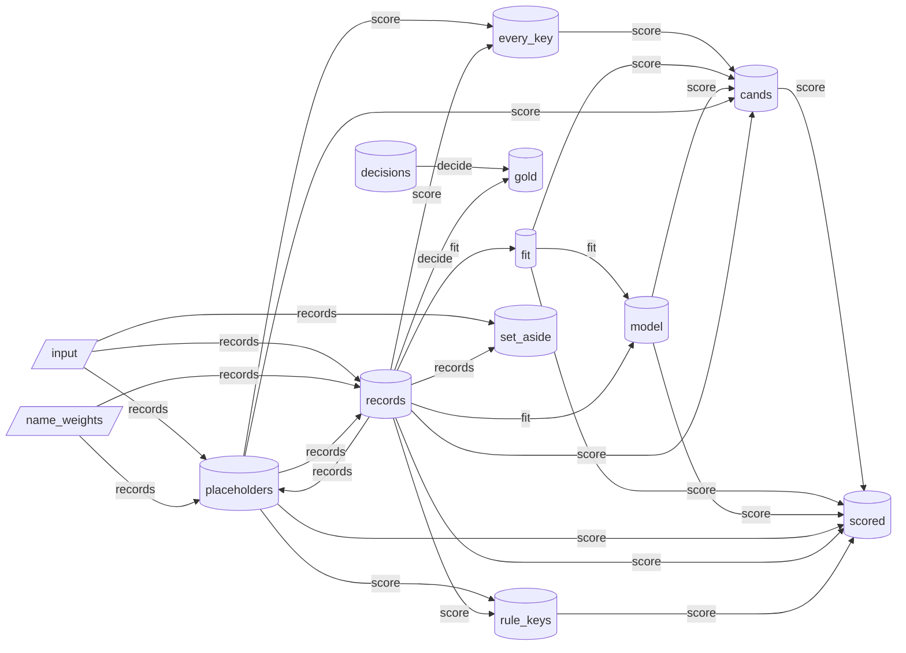
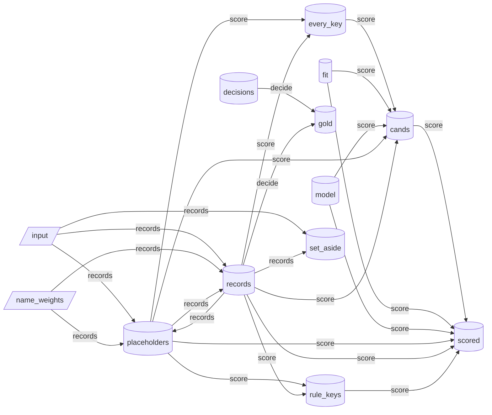
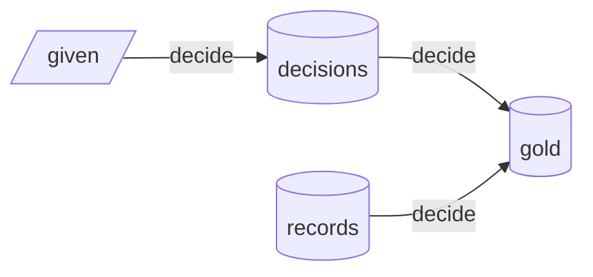
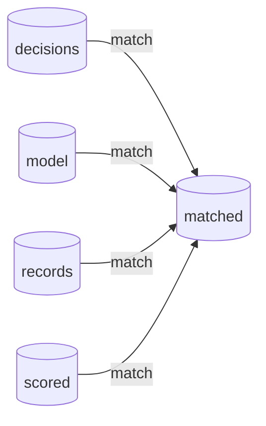

[← README](../README.md) · [Architecture](architecture.md)

# Data flow

Each job's data flow, drawn from its SQL by `scripts/dataflow.py`, which a test holds this page to. A cylinder is one of the run's tables; a slanted box, a table loaded into the dataset (a file, or the deploy's name model). An arrow says that the stage it names writes its end from its start; the temporary tables, views and WITHs between them are folded into the arrow.

## build

Stages: functions, mapping, records, fit, score, decide, report.

## update

Stages: functions, mapping, records, score, decide, report.

## decide

Stages: functions, decide.

## match

Stages: functions, match.

