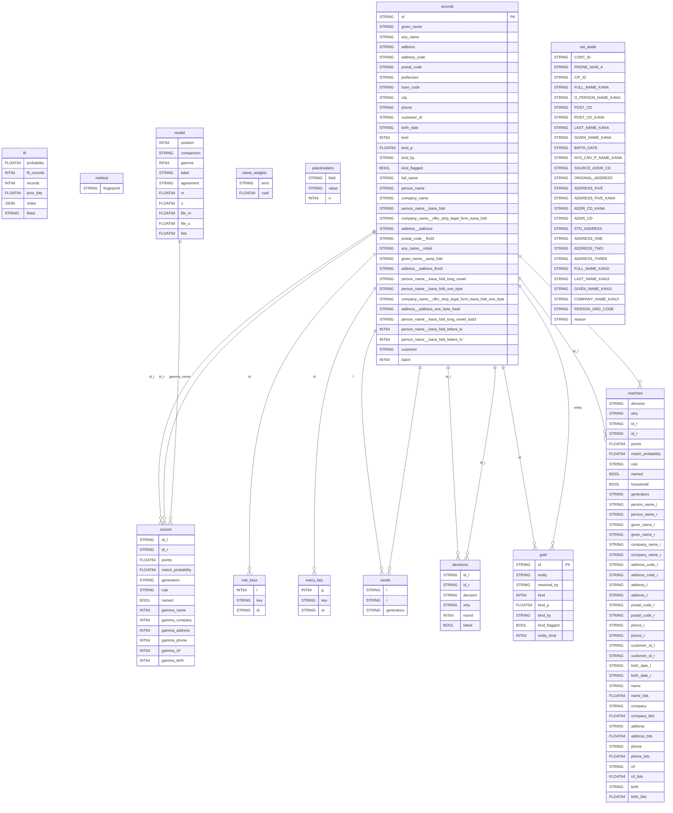
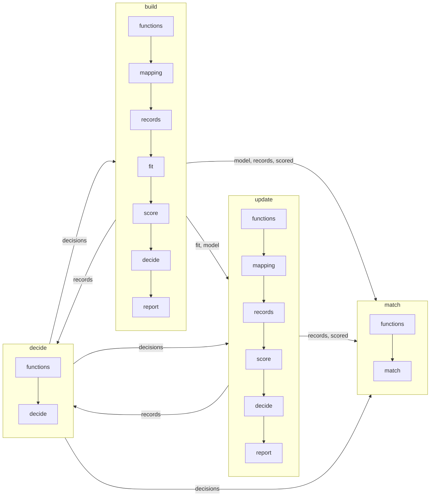
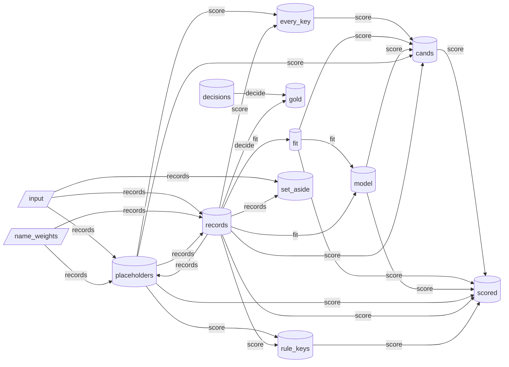
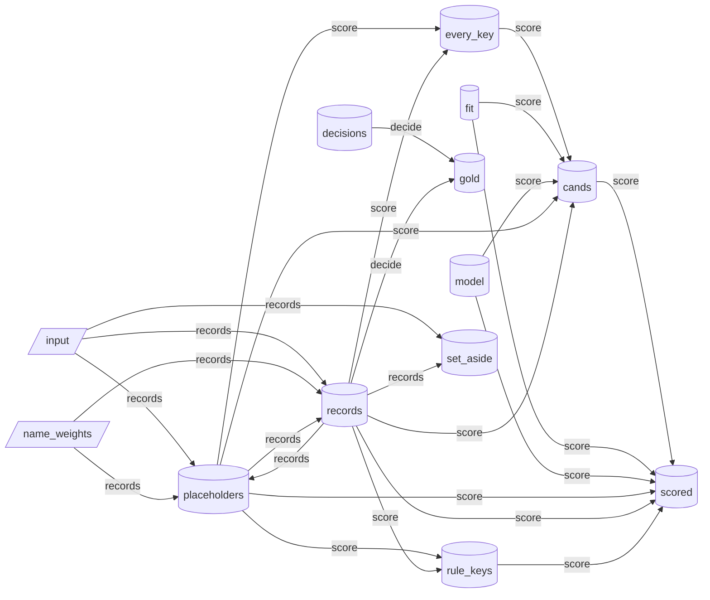
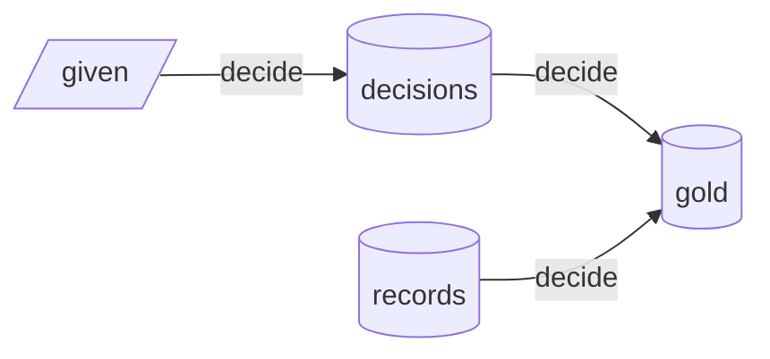
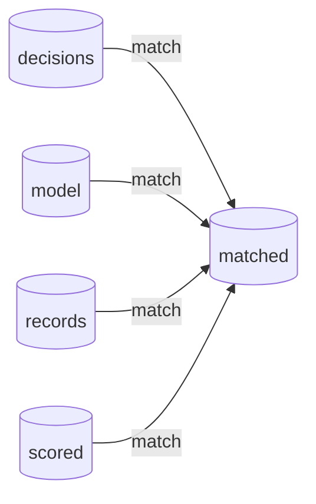

[← README](../README.md) · [Architecture](architecture.md)

# Data flow

The run's SQL files, its tables, its jobs and each job's data flow, all drawn from the code by `scripts/dataflow.py`, which a test holds this page to.

## The SQL files

| File | In short | In the code |
|---|---|---|
| `mapping.sql` | Turns the input's columns into the fields nayose works with. | Each column goes through `read_value`; a field takes its first fully filled source. Writes `input_rows` (each distinct row, with `nayose_id`) and `mapped`. The repository's maps the generated data; a deployment deploys its own (`deploy.py --mapping`; in prod, the secret `nayose-mapping`). |
| `functions.sql` | The functions every job creates first. | The intake (`read_value`, `blank`, `trimmed`); the comparison levels (`name_level` with `name_score`, `gamma_company`, `gamma_address`, `gamma_phone`, `gamma_cif`, `gamma_birth`); the rules' fuzzy tests (`near_*`); shared steps (`pairs_of`, `padded`, `numbers_dashed`). |
| `records.sql` | Stage 1: adds a batch to the run's records, cleaned, each marked person or company. | (1) `set_aside`: no ID, an ID already in the run, or one ID with two contents. (2) Standardizes: `nfkc`, katakana, `strip_spaces`, `strip_separators`, `padded`, `strip_legal_form`, `kana_fold`. (3) `kind`: a written legal form; else the name model (logistic regression on character n-grams, `name_weights`) at `name_line`; else the file's flag. (4) Each name to its side's fields. (5) `placeholders` (`placeholder_min`, `spread`, `crowd`). (6) Writes `records` with each field's copies (`field__steps`); a run record holding a new placeholder is made again (`redone`). |
| `fit.sql` | Stage 2, a build only: estimates how many points each comparison level is worth, without labelled pairs. | Fellegi–Sunter. The sample: `fit_records` records, whole postal areas by `er_hash`. λ from the near-certain rules' pairs; m by EM (`fit_model`, `nayose/em.py`) on pairs blocked on phone, then address; u counted exactly where equality allows and sampled elsewhere, on the sample and on the file. Writes `model` and `fit`. |
| `score.sql` | Stage 3: finds the pairs worth comparing and gives each its points. Nothing merges here. | The rules' pairs (`rule_keys`); the 22 generators' keys (`every_key`: exact, deletion and reading keys); the gate on blocks of `oversized` records (kept only if a sample holds a pair at `search_floor`); `bound_of`, an upper bound from cheap tests, so the costly comparisons run only where needed; then each comparison's level and `points_of` (the prior plus each level's bits). Writes `cands` and `scored` (the pairs from `keep_from` points up, and every rule pair). |
| `decide.sql` | Stores people's decisions and groups records into entities from them. | Reads `given` (`given_text`, `said`) and refuses a wrong file with its fix (`ERROR`); adds to `decisions` each decision that changes its pair's latest; `gold` is the connected components of the latest-`match` pairs (`entities_of`, `nayose/entities.py`), each named by its smallest ID. A build and an update run it without `given`. |
| `match.sql` | Makes the review list. | `matched`: the `scored` pairs at `@threshold` points or more, less those whose latest decision is `no_match`, with both records' fields, each level's label and bits (`model`), `household()`, and empty `decision` and `why`. |
| `report.sql` | The run's counts for `report.txt`, never a record's value. | The `report_*` temporary tables `nayose.report_text` prints: counts, each field's fill and look (`[report.looks]`), score bands, each generator's candidates. |
| `lookup.sql` | Finds which entities one record would match, changing nothing. | After `records.sql` and `score.sql` ran on the asked record in temporary tables (`nayose.lookup`): its entities at `@at_least` points or more, or joined by a rule, best first, and each generator's look-up. On BigQuery, `run.py` stores the answer in `looked_up`. |

## The tables

| Table | In short | Key columns |
|---|---|---|
| `input` | The batch a job reads: a file `run.py` loads, or the table the mapping's `FROM` names. |  |
| `name_weights` | The person-or-company name model, loaded by the deploy. | `term`, `coef` |
| `given` | People's decisions, loaded for `decide`. |  |
| `records` | Every record of the run, cleaned. | `id`, `kind`, `customer`, `batch` |
| `set_aside` | The latest batch's rows that weren't added. | `reason` |
| `placeholders` | Values too common to be evidence, read as missing. | `field`, `value`, `n` |
| `fit` | The fit's result as a whole; an update scores with it. | `probability`, `fitted` |
| `model` | How many points each comparison level gives. | `comparison`, `gamma`, `label`, `bits` |
| `rule_keys` | Each record's keys for the rules. | `i`, `key`, `id` |
| `every_key` | Each record's keys for finding pairs: the key index. | `g`, `key`, `id` |
| `cands` | The latest batch's candidate pairs. | `l`, `r`, `generators` |
| `scored` | Every pair kept, with its points. | `id_l`, `id_r`, `points`, `rule` |
| `decisions` | Every decision people gave, by round. | `id_l`, `id_r`, `decision`, `latest` |
| `gold` | **The answer:** each record's entity. | `id`, `entity` |
| `matched` | The review list. | `decision`, `why`, `id_l`, `id_r`, `points` |
| `method` | The installed method's fingerprint; every job after a build checks it. | `fingerprint` |

Not drawn below: `compared`: a view of `records`, the columns `fit.sql` and `score.sql` read. `looked_up`: on BigQuery, each lookup's answer (`asked`, `asked_at`, `answer`). `job_running` and `before__<table>`: `run.py`'s mark of a job under way, and the clones of the tables it writes; both dropped when it ends.

### Every table's columns

Each of the run's tables with its columns, as BigQuery types them; a line joins a column to the table whose row it names.

## The jobs

Each job's stages, in order; an arrow from one job to another names the tables the first writes that the second reads and doesn't write itself.

## Each job's data flow

A cylinder is one of the run's tables; a slanted box, a table loaded into the dataset (a file, or the deploy's name model). An arrow says that the stage it names writes its end from its start: a statement names the one to write the other, even one a build has just emptied. The temporary tables, views and WITHs between them are folded into the arrow. Not drawn: a table's reads of its own rows, report.sql (it writes only temporary report_ tables, which report.txt reads), and `method`, which the procedure writes after a build and checks first in every other job.

### build

Stages: functions, mapping, records, fit, score, decide, report.

### update

Stages: functions, mapping, records, score, decide, report.

### decide

Stages: functions, decide.

### match

Stages: functions, match.

