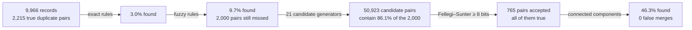

[README](../../README.md) · **Guide:** **1 Task** · [2 Variants](02-the-same-fact-written-differently.md) · [3 Pairs](03-far-too-many-pairs.md) · [4 Rules](04-certain-cases-first-rules.md) · [5 Evidence](05-uncertain-evidence-fellegi-sunter.md) · [6 Measuring](06-measuring-and-choosing.md) · [7 Kinds](07-person-or-company.md)

# 1. Entity matching, entity resolution, and our task

## Start with an example

Here are two customer records:

| | Name | Address | Phone (last 4) | CIF ID |
|---|---|---|---|---|
| Record A | マツモトヒサオ | 福島県福島市吉倉4-11 | 0599 | 5227073594045 |
| Record B | マツモトヒサウ | 福島県福島市吉倉4-11 | 0499 | 5912064752971 |

Is this one person or two? Most people would say *probably one*. The names differ by a single character, the address is identical, and the phone numbers differ by one digit. A computer, though, sees four fields that do not match.

This repository teaches a computer to make that call, reliably, for every record in a file.

## What are entity matching and entity resolution?

The work splits into two questions.

**Entity matching** asks: *are these two records the same person?* It looks at one pair at a time and answers yes or no, or gives a probability.

**Entity resolution** asks: *across the whole file, which records belong to the same person?* Its answer is a set of groups, one per person or company.

Matching is one step inside resolution. Resolution adds two jobs of its own:

1. **Choosing which pairs to compare.** A file of 10,000 records contains 50 million pairs. Comparing all of them is too slow, so resolution first picks a short list of likely pairs.
2. **Turning answers about pairs into consistent groups.** Suppose matching says A and B are the same person, and so are B and C. Then A, B and C must be one group, even if A and C look nothing alike.

| | Entity matching | Entity resolution |
|---|---|---|
| Question | are these two records the same entity? | which records belong together? |
| Looks at | one pair | the whole file |
| Answer | yes / no, or a probability | groups of records, one per entity |
| In this repo | `er.match` | `er.candidates`, then `er.match`, then connected components (`Run._merge` in a run, `er.cluster` at design time) |

The same problem goes by other names. *Deduplication* finds duplicates inside one file, which is our case. *Record linkage* connects records across two files. Linking records to a master list is a third variant.

**In short:** matching judges pairs; resolution builds people.

## How has this been solved before?

Research on the problem goes back more than sixty years. Four ideas shape this repository.

**Weighing the evidence.** In 1959, Howard Newcombe and colleagues linked vital records (births, marriages and deaths) by computer. Their insight was that some agreements say more than others: sharing a rare surname is stronger evidence than sharing a common one. In 1969, Ivan Fellegi and Alan Sunter turned this into a mathematical model. Each field adds evidence for or against a match, and a pair is accepted when the total is high enough. They proved that this is the best possible rule, as long as the fields are independent of one another. *This is the model we use ([chapter 5](05-uncertain-evidence-fellegi-sunter.md)).*

**Comparing only likely pairs.** The number of pairs grows with the square of the file size. Database researchers answered with *blocking*: only compare records that already share something, such as a phone number or a postcode. Surveys by Peter Christen (2012) and by George Papadakis and colleagues (2020) describe dozens of variants. *We use three of them ([chapter 3](03-far-too-many-pairs.md)).*

**Learning from labelled examples.** From the 2000s on, researchers trained classifiers on pairs that people had labelled "match" or "not a match". Magellan (2016) packaged this into a toolkit. The `dedupe` library asks a person to label only the most useful pairs. DeepMatcher (2018) brought in deep learning and found it helps most with messy text, but not with tidy records like ours. Ditto (2020) used pre-trained language models and needed about half as many labels as earlier methods.

**Measuring uncertainty about whole groups.** Bayesian methods treat the true people as unknowns, so they can say how sure we are about each grouping. Olivier Binette and Rebecca Steorts (2022) review this work, and the field as a whole.

## How is it done in practice?

Governments and statistics offices link records about people with the Fellegi–Sunter model. The UK Ministry of Justice built Splink, the library we use, to link people across court, prison and probation records that share no common ID. Other parts of the UK government, including the Office for National Statistics, use it too.

Teams cleaning customer data often work in three tiers:

1. Exact rules accept the certain cases.
2. A score decides the rest.
3. People review the uncertain middle.

We implement all three. For the third, a run writes a review sheet of the uncertain pairs, and takes people's decisions back.

## What problem are we solving?

We find duplicates within one file of Japanese customer records. Six things make it hard:

- **One name, several katakana spellings.** Voicing marks get lost (ガ becomes カ), small kana are typed full-size (ッ becomes ツ), and long vowels are spelled in different ways (ー, ウ or オ). Some systems write names in half-width katakana (ｻﾄｳ) or with a space between surname and given name. On top of that come ordinary typos: a wrong or dropped character.
- **Addresses come in many formats.** One address can be typed as 1丁目3番17号, as 1-3-17, or with full-width digits and a building name.
- **Identifiers are weak.** We see only the last four digits of a phone number, and a duplicate record keeps its customer's CIF ID (the customer ID) only 3% of the time.
- **People and companies change.** People move and marry; companies open branches. So one entity can have several phones, addresses and names.
- **Many fields are empty.** Some columns are filled in for only 65% of records, and the birth date for 15%.
- **Few duplicates are clear-cut.** About 1% of true pairs share the customer ID and the name, or the name, the address code and the phone. 11.5% share nothing usable at all, so no method can find them.

On real data there are no labelled examples. So the method must learn without labels, and we test it on synthetic records whose true answers we know.

**Our goal:** find as many duplicates as possible, while almost never merging two different people. Every merge must be explainable, and the method must scale to a million records.

**Why Fellegi–Sunter, and not deep learning?** Deep models need labelled pairs, which we don't have. They can't explain a merge field by field. And on structured records like ours, the DeepMatcher study found that they don't beat classic methods. Fellegi–Sunter learns without labels, explains every decision in plain numbers, and has run at national scale for decades.

## What exactly is the task?

- **Input:** customer records, each with 21 columns. The ones that matter most are the name in katakana, the address, the last four phone digits, the CIF ID and the birth date. Many are empty.
- **Output:** for every record (CONT_ID), the entity it belongs to.
- **What "good" means.** Two numbers, always reported together:
  - **Recall:** of all pairs of records that truly belong together, the share we put together.
  - **False merges:** pairs of *different* entities we put together by mistake.

  A missed duplicate costs a little: one customer is seen as two. A false merge costs a lot: one customer's mail or statements go to another. So we maximize recall while keeping false merges at (almost) zero.
- **Constraints:** no labels on real data; every merge explainable; the cost must grow about linearly with the file, so any size is feasible.

## What makes it hard, and how do we answer each challenge?

| # | Challenge | What it looks like in our data | Our answer | Chapter |
|---|---|---|---|---|
| C1 | The same fact is written differently | マツモトヒサオ and マツモトヒサウ; one address typed three ways | normalize, then compare with a similarity score | [2](02-the-same-fact-written-differently.md) |
| C2 | Japanese text breaks standard tools | a standard similarity function scores katakana by bytes, not characters | character-level versions of every function | [2](02-the-same-fact-written-differently.md) |
| C3 | Far too many pairs | 9,966 records make 49,655,595 pairs; a million make 5 × 10¹¹ | compare only pairs that share a key or look alike | [3](03-far-too-many-pairs.md) |
| C4 | Different people look alike | on train, 45,079 pairs of *different* entities share the last four phone digits | never trust one field; weigh them all | [4](04-certain-cases-first-rules.md), [5](05-uncertain-evidence-fellegi-sunter.md) |
| C5 | Evidence is partial and uncertain | one true pair has a name typo, a phone typo and a new CIF ID at once | add up evidence from every field, in bits | [5](05-uncertain-evidence-fellegi-sunter.md) |
| C6 | Fields are often empty | some columns are filled for only 65% of records | an empty field counts as no evidence either way | [5](05-uncertain-evidence-fellegi-sunter.md) |
| C7 | Answers about pairs don't make groups | A matches B, and B matches C | group with connected components, behind a strict threshold | [5](05-uncertain-evidence-fellegi-sunter.md) |
| C8 | No answer key, and every choice can overfit | real data has no truth to learn from or measure against | synthetic data with known truth; a rule for every choice; test used once | [1](#where-does-the-truth-come-from), [6](06-measuring-and-choosing.md) |

**Why two stages?** Rules are cheap, easy to audit and, on our data, never wrong. So they go first and settle the clear cases: 9.7% of the true pairs on val. What remains is messy, with typos in two fields at once, or a move plus a new CIF ID. Messy pairs need evidence weighed, not all-or-nothing conditions, so a probabilistic model handles them.

Here is what happens to the validation file:

**In short:** each challenge has one answer, and each answer has a chapter.

## Where does the truth come from?

Real customer data has no answer key. Nobody knows for sure which records are the same person, so nobody can count our mistakes. We therefore build a **synthetic world** that looks like the real one, and we know its truth exactly.

**Real ingredients.** The names, companies and towns are real, taken from public sources:

- 60,000 Japanese personas from NVIDIA's Nemotron-Personas-Japan, with kana readings
- 31,596 companies from Wikidata
- about 46,000 towns in all 47 prefectures, with postal codes, from geolonia's address data and yubinbango
- 60,000 corporations' kana readings from the National Tax Agency's corporate-number registry, for telling persons from companies ([chapter 7](07-person-or-company.md))

**Synthetic behaviour.** The generator then decides who has duplicates and how the records go wrong:

- **40,000 entities.** 20% are companies. Each persona is used at most once, so no two entities are copies of the same person.
- **Records per entity:** 1 plus a Poisson(0.25) draw, so about one entity in five has more than one record.
- **Several of everything.** People move and change phones: each person owns 1 + Poisson(2.0) phones and addresses, and a company 1 + Poisson(3.0). Each person owns 1 + Poisson(0.3) surnames (married names), each company 1 + Poisson(1.0) names. Each record shows one of them.
- **Typing errors:** 30% of name parts get one kana wrong or dropped; 10% of phones, birth dates and typed addresses one digit wrong (in an address, sometimes a dropped character).
- **Notations:** 30% of person records put a space between surname and given name, 15% of records write every name in half-width katakana, a company's legal form is written four ways, or left out, and one company record in ten adds a branch.
- **A CIF ID** is kept on 3% of the duplicate records, and in a tenth of those typed with one digit wrong. The other duplicates carry a new one.
- **Empty fields:** the fill rate falls from 99.99% to 65% across the columns, and fields of one kind (name, postal code, address) tend to be empty together. A person's birth date is filled for 15%, independently of the rest.
- **Households:** unrelated entities sometimes share an address. They are look-alikes that must not be merged.
- **Hard on purpose.** These rates make about 1% of true pairs direct, the kind exact rules settle. `er.generate.profile` measures it ([data.md](../data.md#how-hard-it-is)).

**Split by entity, not by record.** The 40,000 entities are split 60 / 20 / 20 into train, validation (val) and test. A person's records always stay in one split, so test asks only about people that nothing was ever tuned on.

| Split | Records | Used for |
|---|---|---|
| train | 30,103 | learning, and every choice (by rule) |
| val | 9,966 | confirming each choice |
| test | 10,047 | the final report, scored once |

**In short:** real names, invented behaviour, exact truth.

## Words used in this guide

| Term | Meaning | Chapter |
|---|---|---|
| record, entity | one row of a file; the person or company behind one or more records | 1 |
| true pair | two records of the same entity | 1 |
| matching, resolution | deciding pair by pair; turning the accepted pairs into groups | 1 |
| train, val, test | the three splits: fit and choose; confirm; report, once | 1, 6 |
| field | a logical part of a record (name, address, phone), mapped from the file's columns by `[columns]` | [usage](../usage.md#2--map-your-columns) |
| standardize | rewrite each value in one form, so equal facts compare equal | 2 |
| rule | a condition that accepts a pair outright, such as the same customer ID and the same name | 4 |
| key, block | a value records share, such as the same address and phone; records with one key form a block, and only pairs inside a block are listed | 3 |
| candidate generator | one way of listing pairs: a key, one-letter deletions of a name, or a sorted window | 3 |
| candidates | every generator's pairs together: the only pairs scored | 3 |
| potential match | a true pair whose fields would reach the threshold, if it were scored | 3 |
| m | how often two records of the **same** entity land in a comparison level, such as "same address" | 5 |
| u | how often two **different** entities land there by chance | 5 |
| λ | the chance that two random records are the same entity: the starting point | 5 |
| bits, match weight | log₂(λ / (1 − λ)) plus log₂(m / u) for each field; each bit doubles the odds | 5 |
| threshold | the weight a pair needs to be accepted: 8 bits | 5, 6 |
| cluster | records joined by accepted pairs, directly or through others: one entity | 5 |
| recall | the share of true pairs found | 6 |
| false merge | two different entities put in one cluster; "at most 0.28%" is the 95% upper bound when none was seen | 6 |
| cross-validation | fitting on two thirds of train and scoring the other third, three times, so a choice is never judged on the data it was fitted on | 6 |
| the chosen pipeline, `FINAL` | every change `scripts/choose.py` adopted, written to `config/final.toml`; the reports call it `FINAL` | 6 |
| increment | a batch of new records added to a written run | [usage](../usage.md#5--add-new-records) |

## In the code

- `config/settings.toml`: paths, datasets, `[columns]` (which of a file's columns hold each field)
- `er/generate.py`: the generator (`Spec`, `Split`, `generate`, `check`, and `profile`, how hard the population is), configured by `config/generator.toml` and run by `scripts/generate.py`
- `notebooks/demo.ipynb`, section 2: a small population generated and charted
- `data/reference/SOURCES.md`: where each reference file came from
- reference details: [data.md](../data.md)

## Further reading

- O. Binette and R. C. Steorts, "[(Almost) all of entity resolution](https://arxiv.org/abs/2008.04443)," *Science Advances* 8(12), 2022. A broad, readable review.
- P. Christen, [*Data Matching*](https://users.cecs.anu.edu.au/~Peter.Christen/data-matching-book-2012.html), Springer, 2012. The standard textbook. Chapters 1–2 cover the process.
- H. B. Newcombe et al., "Automatic linkage of vital records," *Science* 130(3381), 1959.
- I. P. Fellegi and A. B. Sunter, "A theory for record linkage," *Journal of the American Statistical Association* 64(328), 1969.
- G. Papadakis et al., "[Blocking and filtering techniques for entity resolution: a survey](https://arxiv.org/abs/1905.06167)," *ACM Computing Surveys* 53(2), 2020.
- P. Konda et al., "[Magellan: toward building entity matching management systems](https://sigmodrecord.org/2018/08/09/magellan-toward-building-entity-matching-management-systems/)," *VLDB*, 2016.
- S. Mudgal et al., "Deep learning for entity matching: a design space exploration," *SIGMOD*, 2018.
- Y. Li et al., "[Deep entity matching with pre-trained language models](https://arxiv.org/abs/2004.00584)," *PVLDB* 14(1), 2020.
- UK Ministry of Justice, "[Splink: MoJ's open source library for probabilistic record linkage at scale](https://www.gov.uk/government/publications/joined-up-data-in-government-the-future-of-data-linking-methods/splink-mojs-open-source-library-for-probabilistic-record-linkage-at-scale)."

**Next:** [2. The same fact, written differently →](02-the-same-fact-written-differently.md)
